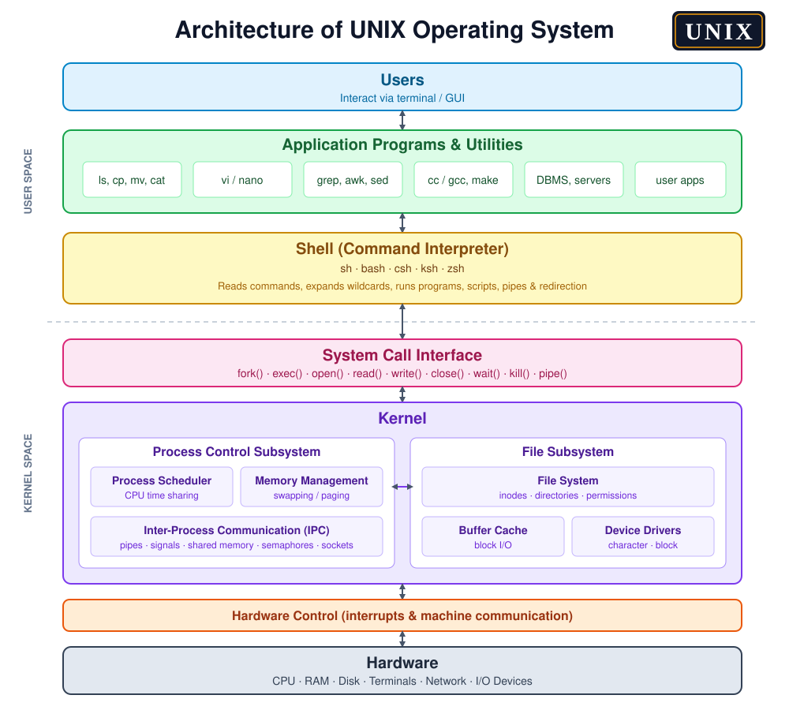
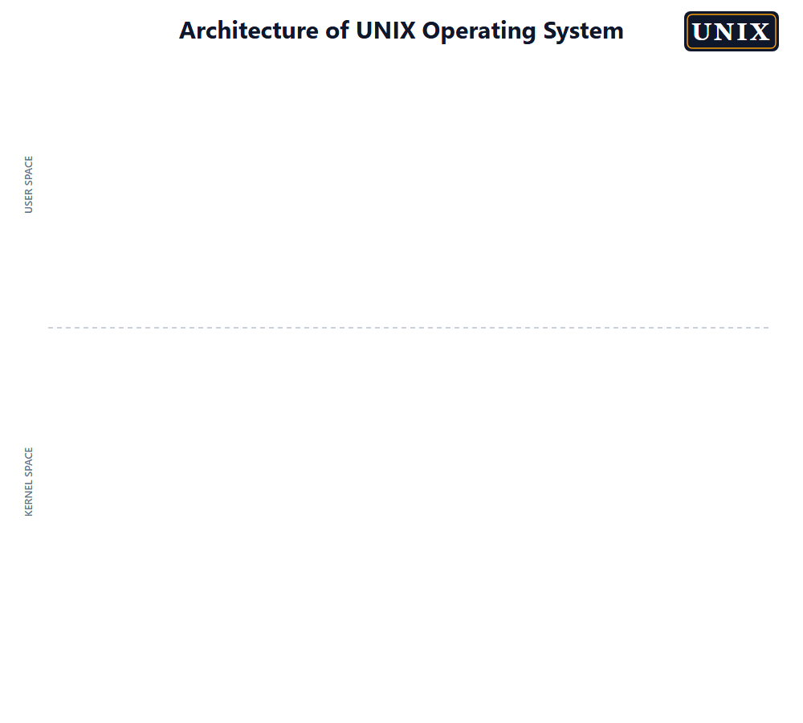

# Unix का Architecture

Unix परतों में बना है: hardware, kernel, shell, utilities और users। Kernel space बनाम user space और system calls उन्हें कैसे जोड़ते हैं, समझें।



## परतें (Layers)

हर परत सिर्फ़ अपनी पास वाली परत से बात करती है। Users कभी सीधे hardware को नहीं छूते।

| परत | भूमिका | उदाहरण |
| :--- | :--- | :--- |
| Users | लोग या scripts जो commands देते हैं | आप, CI job, cron job |
| Utilities और applications | काम करने वाले प्रोग्राम | `ls`, `grep`, `vi`, `gcc`, Nginx, MySQL |
| Shell | User और kernel के बीच command interpreter | `bash`, `sh`, `zsh`, `ksh` |
| System call interface | Kernel में जाने के तय entry points | `fork()`, `exec()`, `open()`, `read()` |
| Kernel | OS का केंद्र, सभी resources संभालता है | process scheduler, memory, file system, drivers |
| Hardware | भौतिक मशीन | CPU, RAM, disk, network card |

नीचे का animated संस्करण hardware से ऊपर की ओर stack बनाता है:



## Kernel

Kernel boot के समय load होता है और shutdown तक मेमोरी में रहता है। Kernel hardware और software के बीच पुल का काम करता है। इसके मुख्य subsystems:

- **Process control subsystem**: scheduling, processes बनाना और ख़त्म करना, inter-process communication (pipes, signals, shared memory, sockets)।
- **Memory management**: virtual memory, paging और swapping।
- **File subsystem**: files, directories, inodes, buffer cache, permissions। देखें [paths and inodes](../02_Filesystem/paths-and-inodes.md)।
- **Device drivers**: character devices (terminals) और block devices (disks)।

Linux एक **monolithic kernel** है जिसमें loadable modules होते हैं: drivers kernel के अंदर चलते हैं लेकिन runtime पर जोड़े जा सकते हैं।

```bash
uname -a          # kernel name, version, architecture
lsmod | head -5   # loaded kernel modules
```

## Kernel space बनाम user space

CPU दो privilege modes में चलता है।

| | Kernel space | User space |
| :--- | :--- | :--- |
| CPU mode | Privileged (ring 0) | Unprivileged (ring 3) |
| यहाँ कौन चलता है | Kernel और drivers | Shell, utilities, आपके apps |
| Hardware access | सीधा | सिर्फ़ system calls के ज़रिए |
| Crash का मतलब | Kernel panic, पूरी मशीन बंद | सिर्फ़ वह process ख़त्म |

इसी अलगाव के कारण एक buggy प्रोग्राम दूसरे प्रोग्राम की मेमोरी नहीं बदल सकता या ख़ुद disk format नहीं कर सकता।

## System calls

**System call** वह तरीका है जिससे user-space प्रोग्राम kernel से कोई privileged काम करवाता है। C library (`glibc`) इन्हें सामान्य functions में लपेटती है।

| System call | उद्देश्य |
| :--- | :--- |
| `fork()` | मौजूदा process की copy बनाना |
| `exec()` | Process को नए प्रोग्राम से बदलना |
| `wait()` | Child process के ख़त्म होने का इंतज़ार |
| `open()` / `read()` / `write()` / `close()` | Files के साथ काम |
| `kill()` | Process को signal भेजना |
| `pipe()` | Processes के बीच एकतरफ़ा channel बनाना |

`strace` से देखिए `cat` कौन से system calls करता है:

```bash
strace -e trace=openat,read,write,close cat /etc/hostname
```

नमूना आउटपुट (छोटा किया हुआ):

```text
openat(AT_FDCWD, "/etc/hostname", O_RDONLY) = 3
read(3, "web-01\n", 131072)             = 7
write(1, "web-01\n", 7)                 = 7
web-01
close(3)                                = 0
```

## एक command का परतों से सफ़र

जब आप terminal में `ls -l` टाइप करते हैं:

1. **User** command टाइप करता है; terminal टेक्स्ट shell को भेजता है।
2. **Shell** उसे parse करता है, `$PATH` में `/usr/bin/ls` ढूँढता है, फिर `fork()` और `exec()` call करता है।
3. **Utility** `ls` directory पढ़ने के लिए `openat()`, `getdents64()` और `stat()` call करता है।
4. **Kernel** file system से directory और inodes पढ़ता है, ज़रूरत हो तो disk drivers इस्तेमाल करता है।
5. **Hardware** (disk) डेटा लौटाता है; डेटा ऊपर आता है और `ls` `write()` से स्क्रीन पर लिखता है।

इसके बारे में और [shells](shells.md) और [processes](../03_Processes/README.md) में।

## इंटरव्यू प्रश्न

**Q1. Kernel की भूमिका क्या है?**
यह CPU, memory, files और devices संभालता है, और सिस्टम का अकेला हिस्सा है जो hardware को सीधे छू सकता है।

**Q2. System call क्या है?**
User space से kernel में जाने का नियंत्रित entry point, जैसे `open()` या `fork()`। यह CPU को kernel mode में बदलता है, काम करता है, और वापस लौटता है।

**Q3. क्या shell kernel का हिस्सा है?**
नहीं। Shell एक सामान्य user-space प्रोग्राम है। आप kernel को छुए बिना उसे बदल सकते हैं (`bash`, `zsh`)।

**Q4. Driver crash हो तो क्या होता है और app crash हो तो क्या?**
Driver kernel space में चलता है, इसलिए उसके crash से kernel panic हो सकता है। App user space में चलता है, इसलिए सिर्फ़ वह process ख़त्म होता है।
