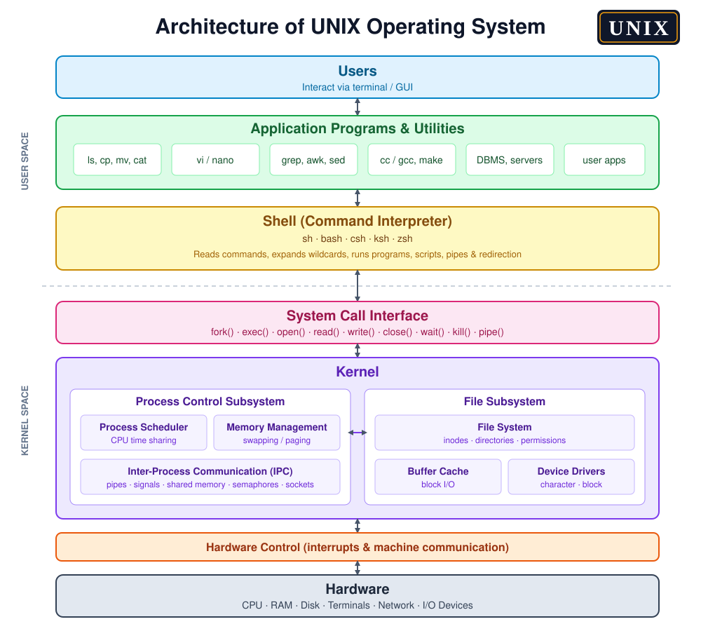
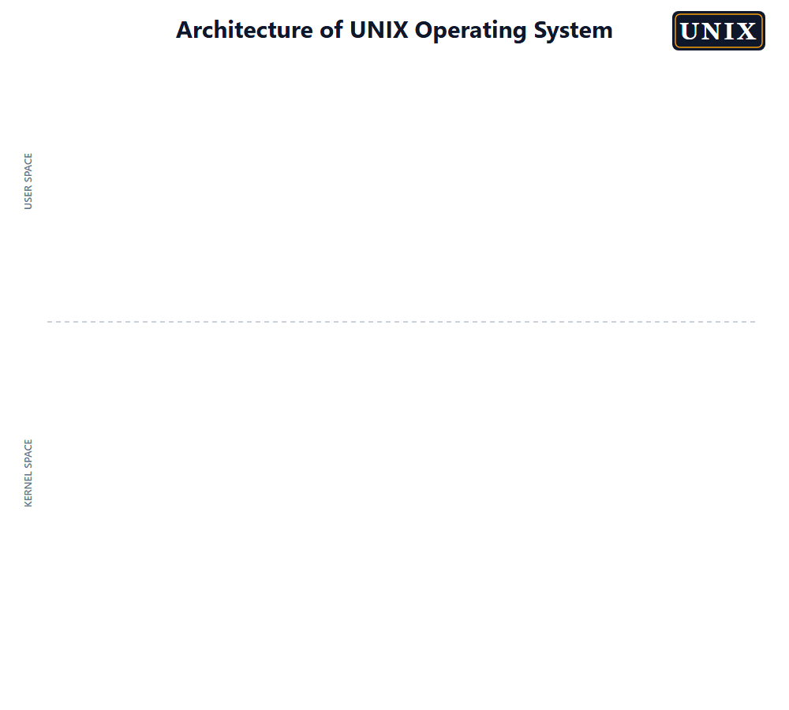

# Unix ka Architecture

Unix layers mein bana hai: hardware, kernel, shell, utilities aur users. Kernel space vs user space aur system calls unhe kaise jodte hain, samjhein.



## Layers

Har layer sirf apne bagal wali layer se baat karti hai. Users kabhi seedhe hardware ko touch nahi karte.

| Layer | Role | Examples |
| :--- | :--- | :--- |
| Users | Log ya scripts jo commands dete hain | aap, CI job, cron job |
| Utilities aur applications | Kaam karne wale programs | `ls`, `grep`, `vi`, `gcc`, Nginx, MySQL |
| Shell | User aur kernel ke beech command interpreter | `bash`, `sh`, `zsh`, `ksh` |
| System call interface | Kernel mein jaane ke fixed entry points | `fork()`, `exec()`, `open()`, `read()` |
| Kernel | OS ka core, saare resources manage karta hai | process scheduler, memory, file system, drivers |
| Hardware | Physical machine | CPU, RAM, disk, network card |

Neeche wala animated version hardware se upar ki taraf stack banata hai:



## Kernel

Kernel boot ke time load hota hai aur shutdown tak memory mein rehta hai. Kernel hardware aur software ke beech bridge ka kaam karta hai. Iske main subsystems:

- **Process control subsystem**: scheduling, processes create aur kill karna, inter-process communication (pipes, signals, shared memory, sockets).
- **Memory management**: virtual memory, paging aur swapping.
- **File subsystem**: files, directories, inodes, buffer cache, permissions. Dekhein [paths and inodes](../02_Filesystem/paths-and-inodes.md).
- **Device drivers**: character devices (terminals) aur block devices (disks).

Linux ek **monolithic kernel** hai jisme loadable modules hote hain: drivers kernel ke andar chalte hain lekin runtime par add kiye ja sakte hain.

```bash
uname -a          # kernel name, version, architecture
lsmod | head -5   # loaded kernel modules
```

## Kernel space vs user space

CPU do privilege modes mein chalta hai.

| | Kernel space | User space |
| :--- | :--- | :--- |
| CPU mode | Privileged (ring 0) | Unprivileged (ring 3) |
| Yahan kaun chalta hai | Kernel aur drivers | Shell, utilities, aapke apps |
| Hardware access | Direct | Sirf system calls ke through |
| Crash ka matlab | Kernel panic, poori machine down | Sirf woh process marta hai |

Isi separation ki wajah se ek buggy program dusre program ki memory overwrite nahi kar sakta ya khud disk format nahi kar sakta.

## System calls

**System call** woh tareeka hai jisse user-space program kernel se koi privileged kaam karwata hai. C library (`glibc`) inhe normal functions mein wrap karti hai.

| System call | Purpose |
| :--- | :--- |
| `fork()` | Current process ki copy banana |
| `exec()` | Process ko naye program se replace karna |
| `wait()` | Child process ke khatam hone ka wait karna |
| `open()` / `read()` / `write()` / `close()` | Files ke saath kaam |
| `kill()` | Process ko signal bhejna |
| `pipe()` | Processes ke beech one-way channel banana |

`strace` se dekhiye `cat` kaun se system calls karta hai:

```bash
strace -e trace=openat,read,write,close cat /etc/hostname
```

Sample output (trimmed):

```text
openat(AT_FDCWD, "/etc/hostname", O_RDONLY) = 3
read(3, "web-01\n", 131072)             = 7
write(1, "web-01\n", 7)                 = 7
web-01
close(3)                                = 0
```

## Ek command ka layers se safar

Jab aap terminal mein `ls -l` type karte hain:

1. **User** command type karta hai; terminal text shell ko bhejta hai.
2. **Shell** use parse karta hai, `$PATH` mein `/usr/bin/ls` dhoondhta hai, phir `fork()` aur `exec()` call karta hai.
3. **Utility** `ls` directory padhne ke liye `openat()`, `getdents64()` aur `stat()` call karta hai.
4. **Kernel** file system se directory aur inodes padhta hai, zarurat ho to disk drivers use karta hai.
5. **Hardware** (disk) data lautata hai; data upar aata hai aur `ls` `write()` se screen par likhta hai.

Iske baare mein aur [shells](shells.md) aur [processes](../03_Processes/README.md) mein.

## Interview questions

**Q1. Kernel ka role kya hai?**
Yeh CPU, memory, files aur devices manage karta hai, aur system ka akela hissa hai jo hardware ko seedhe touch kar sakta hai.

**Q2. System call kya hai?**
User space se kernel mein jaane ka controlled entry point, jaise `open()` ya `fork()`. Yeh CPU ko kernel mode mein switch karta hai, kaam karta hai, aur wapas aata hai.

**Q3. Kya shell kernel ka hissa hai?**
Nahi. Shell ek normal user-space program hai. Aap kernel ko chhue bina use badal sakte hain (`bash`, `zsh`).

**Q4. Driver crash ho to kya hota hai aur app crash ho to kya?**
Driver kernel space mein chalta hai, isliye uske crash se kernel panic ho sakta hai. App user space mein chalta hai, isliye sirf woh process kill hota hai.
