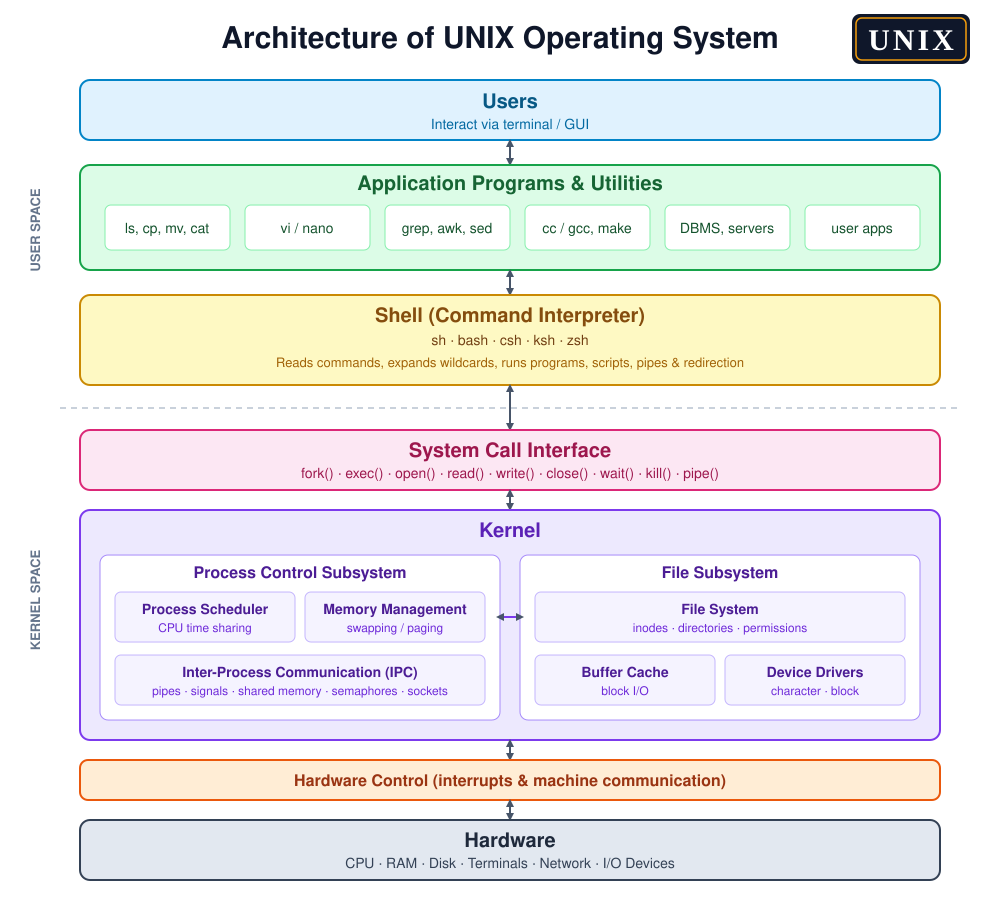
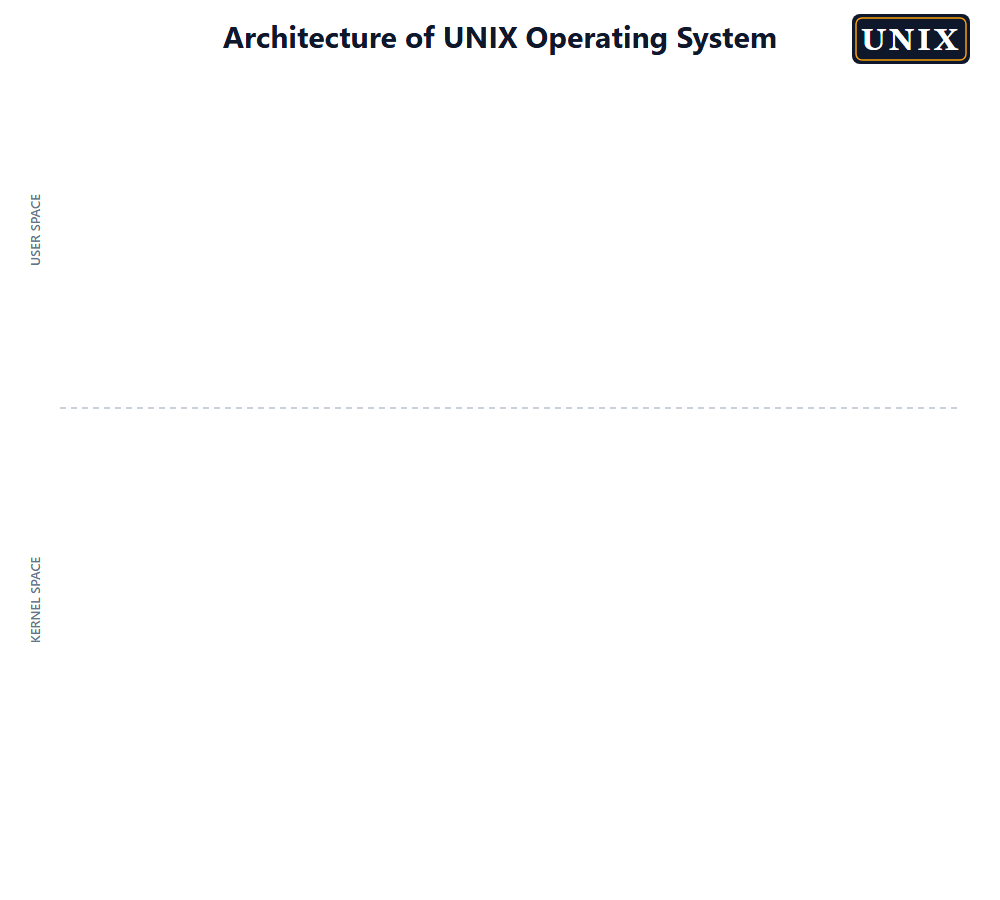

# Architecture of Unix

Unix is built in layers: hardware, kernel, shell, utilities and users. Learn kernel space vs user space and how system calls connect them.



## The layers

Each layer only talks to the layer next to it. Users never touch the hardware directly.

| Layer | Role | Examples |
| :--- | :--- | :--- |
| Users | People or scripts giving commands | you, a CI job, a cron job |
| Utilities and applications | Programs that do useful work | `ls`, `grep`, `vi`, `gcc`, Nginx, MySQL |
| Shell | Command interpreter between user and kernel | `bash`, `sh`, `zsh`, `ksh` |
| System call interface | The fixed entry points into the kernel | `fork()`, `exec()`, `open()`, `read()` |
| Kernel | Core of the OS, manages all resources | process scheduler, memory, file system, drivers |
| Hardware | Physical machine | CPU, RAM, disk, network card |

The animated version below builds the stack from the hardware up:



## The kernel

The kernel is loaded at boot and stays in memory until shutdown. It acts as the bridge between hardware and software. Its main subsystems:

- **Process control subsystem**: scheduling, creating and killing processes, inter-process communication (pipes, signals, shared memory, sockets).
- **Memory management**: virtual memory, paging and swapping.
- **File subsystem**: files, directories, inodes, buffer cache, permissions. See [paths and inodes](../02_Filesystem/paths-and-inodes.md).
- **Device drivers**: character devices (terminals) and block devices (disks).

Linux is a **monolithic kernel** with loadable modules: drivers run inside the kernel but can be added at runtime.

```bash
uname -a          # kernel name, version, architecture
lsmod | head -5   # loaded kernel modules
```

## Kernel space vs user space

The CPU runs in two privilege modes.

| | Kernel space | User space |
| :--- | :--- | :--- |
| CPU mode | Privileged (ring 0) | Unprivileged (ring 3) |
| Who runs here | Kernel and drivers | Shell, utilities, your apps |
| Hardware access | Direct | Only through system calls |
| A crash means | Kernel panic, whole machine down | Only that process dies |

This separation is why a buggy program cannot overwrite another program's memory or format the disk on its own.

## System calls

A **system call** is how a user-space program asks the kernel to do something privileged. The C library (`glibc`) wraps them in normal functions.

| System call | Purpose |
| :--- | :--- |
| `fork()` | Create a copy of the current process |
| `exec()` | Replace the process with a new program |
| `wait()` | Wait for a child process to finish |
| `open()` / `read()` / `write()` / `close()` | Work with files |
| `kill()` | Send a signal to a process |
| `pipe()` | Create a one-way channel between processes |

Watch the system calls that `cat` makes with `strace`:

```bash
strace -e trace=openat,read,write,close cat /etc/hostname
```

Sample output (trimmed):

```text
openat(AT_FDCWD, "/etc/hostname", O_RDONLY) = 3
read(3, "web-01\n", 131072)             = 7
write(1, "web-01\n", 7)                 = 7
web-01
close(3)                                = 0
```

## Walking one command through the layers

When you type `ls -l` in a terminal:

1. **User** types the command; the terminal sends the text to the shell.
2. **Shell** parses it, finds `/usr/bin/ls` in `$PATH`, then calls `fork()` and `exec()`.
3. **Utility** `ls` calls `openat()`, `getdents64()` and `stat()` to read the directory.
4. **Kernel** reads the directory and inodes from the file system, using disk drivers if needed.
5. **Hardware** (the disk) returns the data; it flows back up and `ls` writes it to your screen with `write()`.

More on this in [shells](shells.md) and [processes](../03_Processes/README.md).

## Interview questions

**Q1. What is the role of the kernel?**
It manages CPU, memory, files and devices, and is the only part of the system allowed to touch hardware directly.

**Q2. What is a system call?**
A controlled entry point from user space into the kernel, for example `open()` or `fork()`. It switches the CPU into kernel mode, does the work, and returns.

**Q3. Is the shell part of the kernel?**
No. The shell is an ordinary user-space program. You can replace it (`bash`, `zsh`) without touching the kernel.

**Q4. What happens if a driver crashes vs if an app crashes?**
A driver runs in kernel space, so its crash can cause a kernel panic. An app runs in user space, so only that process is killed.
