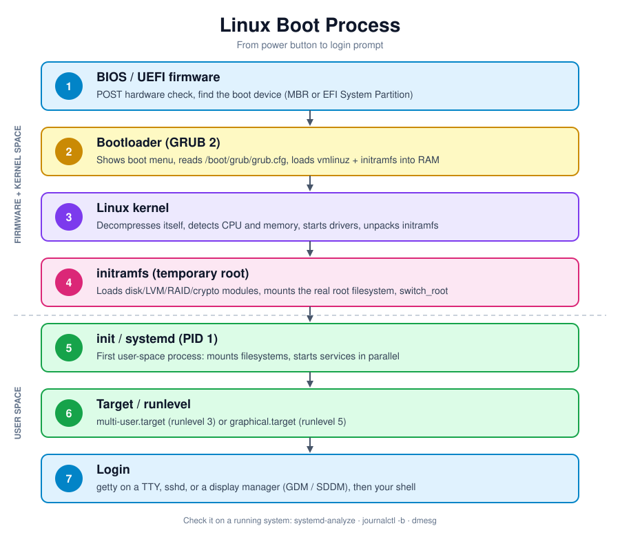

# Linux Boot Process

Power on से login तक: BIOS या UEFI, GRUB, kernel, initramfs, systemd, targets और runlevels, commands के साथ क़दम दर क़दम।



## सारांश

| चरण | प्रोग्राम | मुख्य काम |
| :---: | :--- | :--- |
| 1 | BIOS / UEFI | Hardware जाँचना, boot device ढूँढना |
| 2 | GRUB 2 | Kernel और initramfs चुनकर load करना |
| 3 | Kernel | CPU, memory और drivers शुरू करना |
| 4 | initramfs | असली root filesystem mount करना |
| 5 | systemd (PID 1) | सभी services शुरू करना |
| 6 | Target / runlevel | कौन सा services का समूह चाहिए, तय करना |
| 7 | Login | getty, sshd या display manager |

## 1. BIOS / UEFI

Firmware सबसे पहले चलता है और **POST** (Power-On Self Test) करता है।

| | Legacy BIOS | UEFI |
| :--- | :--- | :--- |
| Boot code कहाँ | Disk के पहले 512 bytes (MBR) | EFI System Partition पर `.efi` file |
| Partition table | MBR (अधिकतम 2 TB, 4 primary) | GPT (बड़े disks, 128 partitions) |
| Secure Boot | नहीं | हाँ |

```bash
[ -d /sys/firmware/efi ] && echo UEFI || echo BIOS
```

## 2. Bootloader: GRUB 2

GRUB boot menu दिखाता है, `/boot/grub/grub.cfg` (RHEL पर `/boot/grub2/grub.cfg`) पढ़ता है, और दो files मेमोरी में load करता है: kernel `vmlinuz-*` और `initrd.img-*` / `initramfs-*` image। यह `root=` और `quiet` जैसे kernel parameters भी देता है।

```bash
ls /boot
cat /proc/cmdline                  # parameters GRUB passed to the kernel
sudo nano /etc/default/grub        # edit settings, never grub.cfg directly
sudo update-grub                   # Debian/Ubuntu: regenerate grub.cfg
sudo grub2-mkconfig -o /boot/grub2/grub.cfg   # RHEL family
```

## 3. Kernel

Kernel ख़ुद को decompress करता है, CPUs और memory पहचानता है, built-in drivers शुरू करता है और initramfs को RAM में खोलता है। इसके संदेश kernel ring buffer में होते हैं:

```bash
dmesg | head
uname -r
```

## 4. initramfs

**Initial RAM filesystem** एक छोटा अस्थायी root है। इसमें बस उतने tools और modules होते हैं (SATA/NVMe, LVM, RAID, LUKS encryption) जितने असली root filesystem को ढूँढकर mount करने के लिए चाहिए। फिर यह `switch_root` चलाता है और नियंत्रण `/sbin/init` को सौंप देता है।

अगर यह चरण fail हो तो आप **emergency/dracut shell** में पहुँचते हैं, अक्सर इसलिए कि root disk का UUID गलत है या कोई driver नहीं है।

## 5. init / systemd

`/sbin/init` पहला user-space process है और इसका **PID हमेशा 1** होता है। आधुनिक distros पर यह **systemd** का link है (पुराने सिस्टम SysV `init` या Upstart इस्तेमाल करते थे)। यह `/etc/fstab` से filesystems mount करता है, services को समानांतर शुरू करता है, और अनाथ (orphan) processes को अपनाता है।

```bash
ps -p 1 -o pid,comm
systemctl list-units --type=service --state=running | head
```

```text
  PID COMMAND
    1 systemd
```

## 6. Targets और runlevels

systemd units को **targets** में समूहित करता है। ये पुराने SysV **runlevels** की जगह लेते हैं।

| Runlevel | systemd target | मतलब |
| :---: | :--- | :--- |
| 0 | `poweroff.target` | बंद करना |
| 1 | `rescue.target` | Single user, रखरखाव |
| 3 | `multi-user.target` | Multi-user, network, बिना GUI (servers) |
| 5 | `graphical.target` | Multi-user GUI के साथ |
| 6 | `reboot.target` | Reboot |

```bash
systemctl get-default                      # target used at boot
sudo systemctl set-default multi-user.target
sudo systemctl isolate rescue.target       # switch now
runlevel                                   # old-style: previous and current
```

## 7. Login

- Text console: `getty` हर TTY पर `login:` prompt दिखाता है।
- Remote: `sshd` SSH logins स्वीकार करता है।
- Desktop: display manager (GNOME के लिए GDM, KDE के लिए SDDM) graphical login दिखाता है।

Authentication के बाद आपका [shell](shells.md) शुरू होता है और अपनी startup files पढ़ता है।

## Boot को मापना और debug करना

```bash
systemd-analyze                 # total boot time
systemd-analyze blame | head    # slowest units
journalctl -b -p err            # errors from the current boot
journalctl --list-boots         # previous boots
```

```text
Startup finished in 3.1s (kernel) + 8.4s (userspace) = 11.5s
```

यह भी देखें: [monitoring and security](../07_System_Administration/monitoring-and-security.md)।

## इंटरव्यू प्रश्न

**Q1. initramfs और root filesystem में क्या अंतर है?**
initramfs एक अस्थायी RAM-आधारित root है जिसमें असली root mount करने के drivers होते हैं। Mount होने के बाद `switch_root` उसे असली `/` से बदल देता है।

**Q2. PID 1 क्या है और यह ख़ास क्यों है?**
यह init process है (आजकल systemd)। यह बाकी सभी services शुरू करता है, orphan processes अपनाता है, और अगर यह ख़त्म हो जाए तो kernel panic होता है।

**Q3. Server को डिफ़ॉल्ट रूप से बिना GUI के कैसे boot करें?**
`sudo systemctl set-default multi-user.target`।

**Q4. `/etc/fstab` बदलने के बाद server boot पर अटक गया। क्या करेंगे?**
Rescue या emergency mode में boot करें (GRUB में `systemd.unit=emergency.target` जोड़ें), `mount -o remount,rw /` से `/` को read-write remount करें, `/etc/fstab` ठीक करें, reboot करें।

**Q5. GRUB options बदलने के लिए कौन सी file edit करनी चाहिए?**
`/etc/default/grub`, फिर `update-grub` या `grub2-mkconfig` से दोबारा बनाएँ। `grub.cfg` overwrite हो जाती है।
