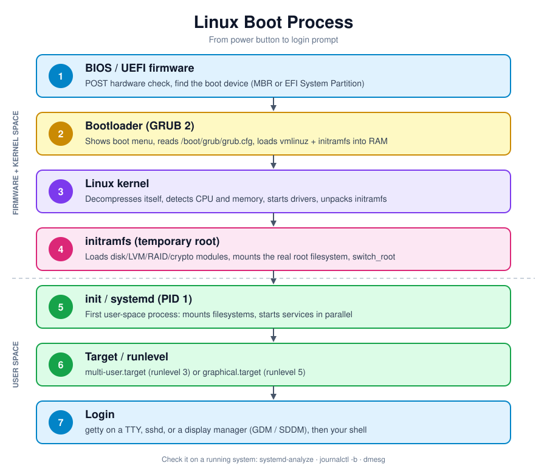

# Linux Boot Process

Power on se login tak: BIOS ya UEFI, GRUB, kernel, initramfs, systemd, targets aur runlevels, commands ke saath step by step.



## Overview

| Stage | Program | Main kaam |
| :---: | :--- | :--- |
| 1 | BIOS / UEFI | Hardware test karna, boot device dhoondhna |
| 2 | GRUB 2 | Kernel aur initramfs choose karke load karna |
| 3 | Kernel | CPU, memory aur drivers initialise karna |
| 4 | initramfs | Asli root filesystem mount karna |
| 5 | systemd (PID 1) | Saari services start karna |
| 6 | Target / runlevel | Kaun sa services ka set chahiye, decide karna |
| 7 | Login | getty, sshd ya display manager |

## 1. BIOS / UEFI

Firmware sabse pehle chalta hai aur **POST** (Power-On Self Test) karta hai.

| | Legacy BIOS | UEFI |
| :--- | :--- | :--- |
| Boot code kahan | Disk ke pehle 512 bytes (MBR) | EFI System Partition par `.efi` file |
| Partition table | MBR (max 2 TB, 4 primary) | GPT (bade disks, 128 partitions) |
| Secure Boot | Nahi | Haan |

```bash
[ -d /sys/firmware/efi ] && echo UEFI || echo BIOS
```

## 2. Bootloader: GRUB 2

GRUB boot menu dikhata hai, `/boot/grub/grub.cfg` (RHEL par `/boot/grub2/grub.cfg`) padhta hai, aur do files memory mein load karta hai: kernel `vmlinuz-*` aur `initrd.img-*` / `initramfs-*` image. Yeh `root=` aur `quiet` jaise kernel parameters bhi pass karta hai.

```bash
ls /boot
cat /proc/cmdline                  # parameters GRUB passed to the kernel
sudo nano /etc/default/grub        # edit settings, never grub.cfg directly
sudo update-grub                   # Debian/Ubuntu: regenerate grub.cfg
sudo grub2-mkconfig -o /boot/grub2/grub.cfg   # RHEL family
```

## 3. Kernel

Kernel khud ko decompress karta hai, CPUs aur memory detect karta hai, built-in drivers start karta hai aur initramfs ko RAM mein unpack karta hai. Iske messages kernel ring buffer mein hote hain:

```bash
dmesg | head
uname -r
```

## 4. initramfs

**Initial RAM filesystem** ek chhota temporary root hai. Isme bas utne tools aur modules hote hain (SATA/NVMe, LVM, RAID, LUKS encryption) jitne asli root filesystem ko dhoondh ke mount karne ke liye chahiye. Phir yeh `switch_root` chalata hai aur control `/sbin/init` ko de deta hai.

Agar yeh step fail ho to aap **emergency/dracut shell** mein pahunchte ho, aksar isliye ki root disk ka UUID galat hai ya koi driver missing hai.

## 5. init / systemd

`/sbin/init` pehla user-space process hai aur iska **PID hamesha 1** hota hai. Modern distros par yeh **systemd** ka link hai (purane systems SysV `init` ya Upstart use karte the). Yeh `/etc/fstab` se filesystems mount karta hai, services parallel mein start karta hai, aur orphan processes ko adopt karta hai.

```bash
ps -p 1 -o pid,comm
systemctl list-units --type=service --state=running | head
```

```text
  PID COMMAND
    1 systemd
```

## 6. Targets aur runlevels

systemd units ko **targets** mein group karta hai. Yeh purane SysV **runlevels** ki jagah lete hain.

| Runlevel | systemd target | Matlab |
| :---: | :--- | :--- |
| 0 | `poweroff.target` | Shut down |
| 1 | `rescue.target` | Single user, maintenance |
| 3 | `multi-user.target` | Multi-user, network, bina GUI (servers) |
| 5 | `graphical.target` | Multi-user GUI ke saath |
| 6 | `reboot.target` | Reboot |

```bash
systemctl get-default                      # target used at boot
sudo systemctl set-default multi-user.target
sudo systemctl isolate rescue.target       # switch now
runlevel                                   # old-style: previous and current
```

## 7. Login

- Text console: `getty` har TTY par `login:` prompt dikhata hai.
- Remote: `sshd` SSH logins accept karta hai.
- Desktop: display manager (GNOME ke liye GDM, KDE ke liye SDDM) graphical login dikhata hai.

Authentication ke baad aapka [shell](shells.md) start hota hai aur apni startup files padhta hai.

## Boot ko measure aur debug karna

```bash
systemd-analyze                 # total boot time
systemd-analyze blame | head    # slowest units
journalctl -b -p err            # errors from the current boot
journalctl --list-boots         # previous boots
```

```text
Startup finished in 3.1s (kernel) + 8.4s (userspace) = 11.5s
```

Yeh bhi dekhein: [monitoring and security](../07_System_Administration/monitoring-and-security.md).

## Interview questions

**Q1. initramfs aur root filesystem mein kya fark hai?**
initramfs ek temporary RAM-based root hai jisme asli root mount karne ke drivers hote hain. Mount hone ke baad `switch_root` use asli `/` se replace kar deta hai.

**Q2. PID 1 kya hai aur yeh special kyun hai?**
Yeh init process hai (aajkal systemd). Yeh baaki saari services start karta hai, orphan processes adopt karta hai, aur agar yeh mar jaye to kernel panic hota hai.

**Q3. Server ko default mein bina GUI ke kaise boot karein?**
`sudo systemctl set-default multi-user.target`.

**Q4. `/etc/fstab` edit karne ke baad server boot par hang ho gaya. Kya karenge?**
Rescue ya emergency mode mein boot karein (GRUB mein `systemd.unit=emergency.target` add karein), `mount -o remount,rw /` se `/` ko read-write remount karein, `/etc/fstab` fix karein, reboot karein.

**Q5. GRUB options badalne ke liye kaun si file edit karni chahiye?**
`/etc/default/grub`, phir `update-grub` ya `grub2-mkconfig` se regenerate karein. `grub.cfg` overwrite ho jaati hai.
