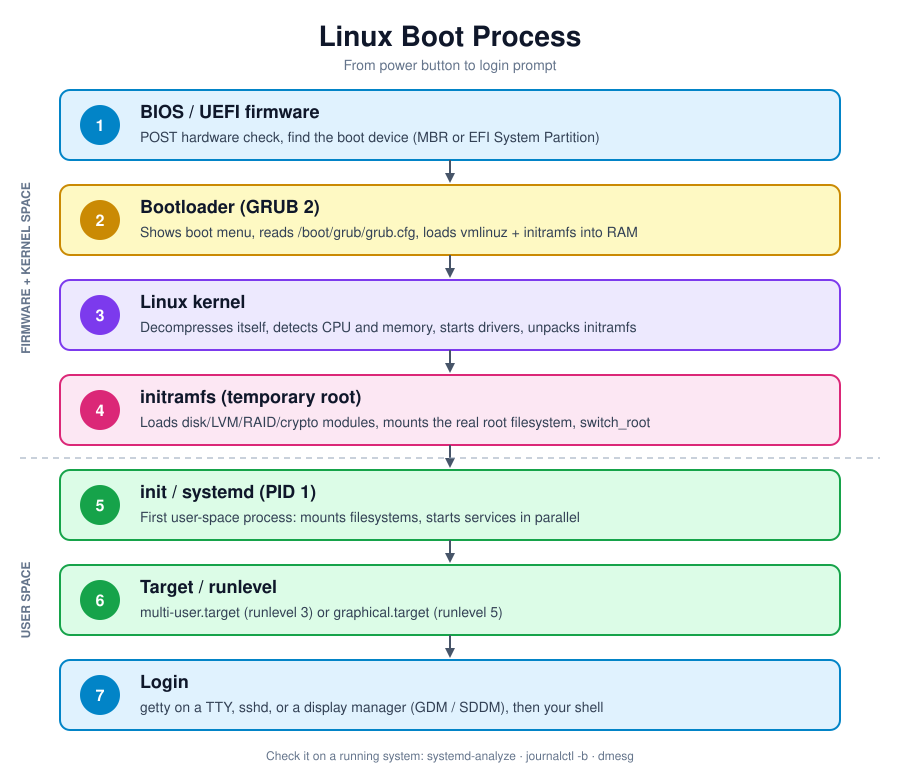

# Linux Boot Process

From power on to login: BIOS or UEFI, GRUB, the kernel, initramfs, systemd, targets and runlevels, step by step with commands.



## Overview

| Stage | Program | Main job |
| :---: | :--- | :--- |
| 1 | BIOS / UEFI | Test hardware, find a boot device |
| 2 | GRUB 2 | Choose and load the kernel and initramfs |
| 3 | Kernel | Initialise CPU, memory and drivers |
| 4 | initramfs | Mount the real root filesystem |
| 5 | systemd (PID 1) | Start all services |
| 6 | Target / runlevel | Decide which set of services to reach |
| 7 | Login | getty, sshd or a display manager |

## 1. BIOS / UEFI

The firmware runs first and performs the **POST** (Power-On Self Test).

| | Legacy BIOS | UEFI |
| :--- | :--- | :--- |
| Boot code location | First 512 bytes of disk (MBR) | `.efi` file on the EFI System Partition |
| Partition table | MBR (max 2 TB, 4 primary) | GPT (huge disks, 128 partitions) |
| Secure Boot | No | Yes |

```bash
[ -d /sys/firmware/efi ] && echo UEFI || echo BIOS
```

## 2. Bootloader: GRUB 2

GRUB shows the boot menu, reads `/boot/grub/grub.cfg` (`/boot/grub2/grub.cfg` on RHEL), and loads two files into memory: the kernel `vmlinuz-*` and the `initrd.img-*` / `initramfs-*` image. It also passes kernel parameters such as `root=` and `quiet`.

```bash
ls /boot
cat /proc/cmdline                  # parameters GRUB passed to the kernel
sudo nano /etc/default/grub        # edit settings, never grub.cfg directly
sudo update-grub                   # Debian/Ubuntu: regenerate grub.cfg
sudo grub2-mkconfig -o /boot/grub2/grub.cfg   # RHEL family
```

## 3. Kernel

The kernel decompresses itself, detects CPUs and memory, starts built-in drivers and unpacks the initramfs into RAM. Its messages are in the kernel ring buffer:

```bash
dmesg | head
uname -r
```

## 4. initramfs

The **initial RAM filesystem** is a small temporary root. It contains just enough tools and modules (SATA/NVMe, LVM, RAID, LUKS encryption) to find and mount the real root filesystem. Then it runs `switch_root` and hands control to `/sbin/init`.

If this step fails you land in an **emergency/dracut shell**, usually because the root disk UUID is wrong or a driver is missing.

## 5. init / systemd

`/sbin/init` is the first user-space process and always has **PID 1**. On modern distros it is a link to **systemd** (older systems used SysV `init` or Upstart). It mounts filesystems from `/etc/fstab`, starts services in parallel, and adopts orphan processes.

```bash
ps -p 1 -o pid,comm
systemctl list-units --type=service --state=running | head
```

```text
  PID COMMAND
    1 systemd
```

## 6. Targets and runlevels

systemd groups units into **targets**. They replace the old SysV **runlevels**.

| Runlevel | systemd target | Meaning |
| :---: | :--- | :--- |
| 0 | `poweroff.target` | Shut down |
| 1 | `rescue.target` | Single user, maintenance |
| 3 | `multi-user.target` | Multi-user, network, no GUI (servers) |
| 5 | `graphical.target` | Multi-user with GUI |
| 6 | `reboot.target` | Reboot |

```bash
systemctl get-default                      # target used at boot
sudo systemctl set-default multi-user.target
sudo systemctl isolate rescue.target       # switch now
runlevel                                   # old-style: previous and current
```

## 7. Login

- Text console: `getty` shows a `login:` prompt on each TTY.
- Remote: `sshd` accepts SSH logins.
- Desktop: a display manager (GDM for GNOME, SDDM for KDE) shows the graphical login.

After authentication your [shell](shells.md) starts and reads its startup files.

## Measuring and debugging boot

```bash
systemd-analyze                 # total boot time
systemd-analyze blame | head    # slowest units
journalctl -b -p err            # errors from the current boot
journalctl --list-boots         # previous boots
```

```text
Startup finished in 3.1s (kernel) + 8.4s (userspace) = 11.5s
```

See also [monitoring and security](../07_System_Administration/monitoring-and-security.md).

## Interview questions

**Q1. What is the difference between initramfs and the root filesystem?**
initramfs is a temporary RAM-based root with drivers needed to mount the real root. After mounting it, `switch_root` replaces it with the real `/`.

**Q2. What is PID 1 and why is it special?**
The init process (systemd today). It starts all other services, adopts orphaned processes, and if it dies the kernel panics.

**Q3. How do you boot a server without a GUI by default?**
`sudo systemctl set-default multi-user.target`.

**Q4. A server hangs at boot after editing `/etc/fstab`. What do you do?**
Boot into rescue or emergency mode (add `systemd.unit=emergency.target` in GRUB), remount `/` read-write with `mount -o remount,rw /`, fix `/etc/fstab`, reboot.

**Q5. Which file should you edit to change GRUB options?**
`/etc/default/grub`, then regenerate with `update-grub` or `grub2-mkconfig`. `grub.cfg` is overwritten.
