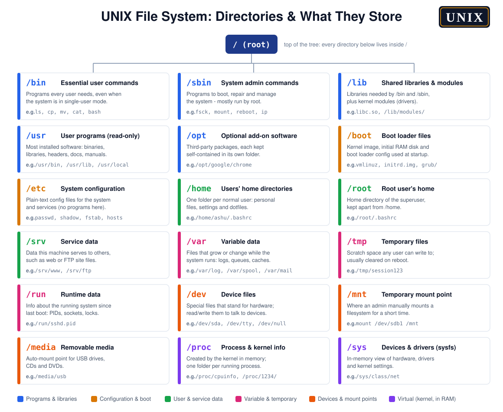

# Linux फ़ाइलसिस्टम हायरार्की (FHS)

Linux डायरेक्टरी ट्री का परिचय: /, /bin, /etc, /home, /var, /tmp, /usr, /proc, /dev और /opt में क्या रहता है, और असली सर्वर पर कहाँ देखें।

## सब कुछ फ़ाइल है, एक ही Root के नीचे

Linux में एक ही डायरेक्टरी ट्री होता है जो `/` (root) से शुरू होता है। यहाँ `C:` या `D:` जैसे ड्राइव लेटर नहीं होते। अतिरिक्त डिस्क, USB ड्राइव और नेटवर्क शेयर इसी ट्री के अंदर कहीं **mount** किए जाते हैं (देखें [disks and mounting](../07_System_Administration/disks-and-mounting.md))।

यह लेआउट **Filesystem Hierarchy Standard (FHS)** से तय होता है, इसलिए Ubuntu, RHEL, Amazon Linux और Alpine सब लगभग एक जैसे दिखते हैं। एक बार नक्शा समझ लिया, तो किसी भी सर्वर पर configs, logs और binaries कहाँ हैं, पता चल जाता है।


## डायरेक्टरी का नक्शा

नीचे का डायग्राम top-level डायरेक्टरीज़ को काम के हिसाब से समूहों में बाँटता है: programs और libraries, configuration और boot, user और service data, variable और temporary data, devices और mount points, और kernel द्वारा बनाए गए virtual (RAM वाले) filesystems।



| डायरेक्टरी | उद्देश्य | उदाहरण |
| :--- | :--- | :--- |
| `/` | पूरे ट्री का root | सब कुछ इसके नीचे है |
| `/bin` | ज़रूरी user commands | `ls`, `cp`, `mv`, `cat`, `bash` |
| `/sbin` | सिस्टम admin commands | `fdisk`, `mkfs`, `reboot`, `ip` |
| `/lib` | Shared libraries और kernel modules | `libc.so.6`, `/lib/modules/` |
| `/usr` | इंस्टॉल किया गया software (read-only) | `/usr/bin/python3`, `/usr/share/man` |
| `/opt` | वैकल्पिक third-party software | `/opt/google/chrome`, `/opt/jdk` |
| `/boot` | Kernel और boot loader फ़ाइलें | `vmlinuz`, `initrd.img`, `grub/` |
| `/etc` | सिस्टम configuration (text फ़ाइलें) | `/etc/passwd`, `/etc/nginx/`, `/etc/fstab` |
| `/home` | सामान्य users की home डायरेक्टरी | `/home/ashu` |
| `/root` | Root user का home | `/root/.bashrc` |
| `/srv` | इस मशीन द्वारा serve किया गया data | `/srv/www`, `/srv/ftp` |
| `/var` | चलते समय बदलने वाला data | `/var/log`, `/var/lib/docker`, `/var/cache` |
| `/tmp` | अस्थायी फ़ाइलें, अक्सर reboot पर साफ़ | sockets, scratch फ़ाइलें |
| `/run` | पिछले boot से runtime data | PID फ़ाइलें, `/run/docker.sock` |
| `/dev` | Device फ़ाइलें | `/dev/sda`, `/dev/null`, `/dev/tty` |
| `/mnt` | अस्थायी manual mount point | `/mnt/backup` |
| `/media` | अपने-आप mount होने वाला removable media | `/media/usb` |
| `/proc` | Virtual: process और kernel की जानकारी | `/proc/cpuinfo`, `/proc/1234/` |
| `/sys` | Virtual: devices और drivers (sysfs) | `/sys/class/net/` |

> आधुनिक distros (usr-merge) पर `/bin`, `/sbin` और `/lib` असल में `/usr` के अंदर symbolic links हैं। जाँचने के लिए `ls -l /bin` चलाएँ।

## ट्री को एक्सप्लोर करना

```bash
ls /                      # list top-level directories
ls -l /bin                # on Ubuntu: lrwxrwxrwx ... /bin -> usr/bin
tree -L 1 /               # tree view (install with: sudo apt install tree)
man hier                  # the manual page describing the hierarchy
```

### Virtual filesystems: /proc और /sys

ये डायरेक्टरीज़ डिस्क की जगह नहीं लेतीं। Kernel इन्हें memory में बनाता है, और फ़ाइल पढ़ना मतलब kernel से एक सवाल पूछना।

```bash
cat /proc/cpuinfo | grep "model name" | head -1
cat /proc/meminfo | head -3
ls /proc/$$               # info about the current shell process
cat /proc/loadavg
```

हर चल रहे process का एक फ़ोल्डर `/proc/<PID>/` होता है; इसके बारे में और [processes](../03_Processes/README.md) में।

### /dev में Device फ़ाइलें

```bash
ls -l /dev/sda /dev/null
# brw-rw---- 1 root disk 8, 0 Nov 27 10:00 /dev/sda    (b = block device)
# crw-rw-rw- 1 root root 1, 3 Nov 27 10:00 /dev/null   (c = character device)

command > /dev/null 2>&1  # throw away all output
```

## असली सर्वर पर कहाँ देखें

| काम | लोकेशन |
| :--- | :--- |
| Web server logs पढ़ना | `/var/log/nginx/`, `/var/log/apache2/` |
| System logs | `/var/log/syslog`, `/var/log/messages`, या `journalctl` |
| Service config बदलना | `/etc/nginx/nginx.conf`, `/etc/ssh/sshd_config` |
| systemd unit फ़ाइलें | `/etc/systemd/system/`, `/lib/systemd/system/` |
| Scheduled jobs | `/etc/crontab`, `/var/spool/cron/` |
| User और group accounts | `/etc/passwd`, `/etc/group`, `/etc/shadow` |
| Docker images और volumes | `/var/lib/docker/` |
| Locally built tools | `/usr/local/bin/` |

```bash
df -h /var                # is the log partition full?
du -sh /var/log/* | sort -h | tail -5   # biggest log folders
```

## संबंधित नोट्स

- [Paths and inodes](paths-and-inodes.md)
- [Permissions](permissions.md)
- [Hard and symbolic links](links.md)
- [Commands overview](../04_Commands/README.md)

## इंटरव्यू प्रश्न

**Q1. `/bin` और `/usr/bin` में क्या अंतर है?**
पहले `/bin` में वे commands होती थीं जो `/usr` mount होने से पहले boot और repair के लिए ज़रूरी थीं; बाकी सब `/usr/bin` में। usr-merged distros पर `/bin` बस `/usr/bin` का link है।

**Q2. `/proc` डिस्क पर खाली क्यों है?**
यह virtual filesystem (`procfs`) है। Kernel इसका content तुरंत बनाता है, इसलिए `du -sh /proc` लगभग कुछ नहीं दिखाता, जबकि `/proc/meminfo` जैसी फ़ाइलें live data दिखाती हैं।

**Q3. Third-party application कहाँ रखेंगे?**
Self-contained package के लिए `/opt/<app>` में, या ख़ुद compile किए software के लिए `/usr/local` में। इसे `/usr/bin` में न मिलाएँ, वह package manager का है।

**Q4. सर्वर की डिस्क भर गई है। पहले कौन सी डायरेक्टरी देखेंगे?**
आमतौर पर `/var`, क्योंकि logs (`/var/log`), caches और Docker data (`/var/lib/docker`) समय के साथ बढ़ते हैं। `du -sh /var/* | sort -h` का उपयोग करें।

**Q5. `/tmp` और `/var/tmp` में क्या अंतर है?**
`/tmp` अक्सर reboot पर साफ़ हो जाता है (और RAM वाला `tmpfs` हो सकता है); `/var/tmp` reboot के बाद भी रहता है और लंबे समय तक चाहिए अस्थायी फ़ाइलों के लिए है।
