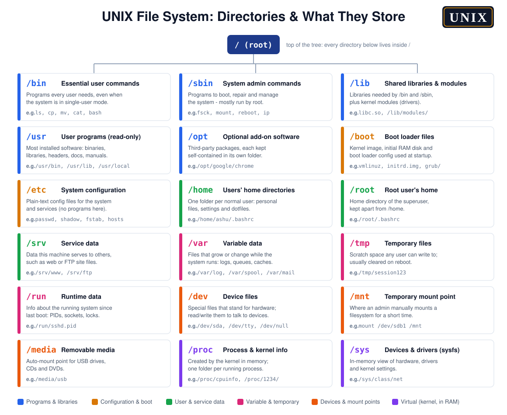

# Linux Filesystem Hierarchy (FHS)

Linux directory tree ka tour: /, /bin, /etc, /home, /var, /tmp, /usr, /proc, /dev aur /opt mein kya hota hai, aur real server par kahan dekhna hai.

## Sab Kuch File Hai, Ek Hi Root Ke Neeche

Linux mein ek hi directory tree hota hai jo `/` (root) se start hota hai. Yahan `C:` ya `D:` jaise drive letters nahi hote. Extra disks, USB drives aur network shares is tree ke andar kahin **mount** kiye jaate hain (dekho [disks and mounting](../07_System_Administration/disks-and-mounting.md)).

Yeh layout **Filesystem Hierarchy Standard (FHS)** se standard hai, isliye Ubuntu, RHEL, Amazon Linux aur Alpine sab lagbhag same dikhte hain. Ek baar map samajh gaye, toh kisi bhi server par configs, logs aur binaries kahan hain, pata chal jaata hai.


## Directory Ka Map

Neeche wala diagram top-level directories ko kaam ke hisaab se group karta hai: programs aur libraries, configuration aur boot, user aur service data, variable aur temporary data, devices aur mount points, aur kernel ke banaye virtual (RAM wale) filesystems.



| Directory | Purpose | Examples |
| :--- | :--- | :--- |
| `/` | Poore tree ka root | sab kuch iske neeche hai |
| `/bin` | Zaroori user commands | `ls`, `cp`, `mv`, `cat`, `bash` |
| `/sbin` | System admin commands | `fdisk`, `mkfs`, `reboot`, `ip` |
| `/lib` | Shared libraries aur kernel modules | `libc.so.6`, `/lib/modules/` |
| `/usr` | Installed software (read-only) | `/usr/bin/python3`, `/usr/share/man` |
| `/opt` | Optional third-party software | `/opt/google/chrome`, `/opt/jdk` |
| `/boot` | Kernel aur boot loader files | `vmlinuz`, `initrd.img`, `grub/` |
| `/etc` | System configuration (text files) | `/etc/passwd`, `/etc/nginx/`, `/etc/fstab` |
| `/home` | Normal users ki home directories | `/home/ashu` |
| `/root` | Root user ka home | `/root/.bashrc` |
| `/srv` | Is machine dwara serve kiya gaya data | `/srv/www`, `/srv/ftp` |
| `/var` | Chalte waqt badalne wala data | `/var/log`, `/var/lib/docker`, `/var/cache` |
| `/tmp` | Temporary files, aksar reboot par saaf | sockets, scratch files |
| `/run` | Last boot se runtime data | PID files, `/run/docker.sock` |
| `/dev` | Device files | `/dev/sda`, `/dev/null`, `/dev/tty` |
| `/mnt` | Temporary manual mount point | `/mnt/backup` |
| `/media` | Auto-mounted removable media | `/media/usb` |
| `/proc` | Virtual: process aur kernel info | `/proc/cpuinfo`, `/proc/1234/` |
| `/sys` | Virtual: devices aur drivers (sysfs) | `/sys/class/net/` |

> Modern distros (usr-merge) par `/bin`, `/sbin` aur `/lib` asal mein `/usr` ke andar symbolic links hain. Check karne ke liye `ls -l /bin` chalao.

## Tree Ko Explore Karna

```bash
ls /                      # list top-level directories
ls -l /bin                # on Ubuntu: lrwxrwxrwx ... /bin -> usr/bin
tree -L 1 /               # tree view (install with: sudo apt install tree)
man hier                  # the manual page describing the hierarchy
```

### Virtual filesystems: /proc and /sys

Yeh directories disk space use nahi karti. Kernel inhe memory mein banata hai, aur file padhna matlab kernel se ek sawaal poochna.

```bash
cat /proc/cpuinfo | grep "model name" | head -1
cat /proc/meminfo | head -3
ls /proc/$$               # info about the current shell process
cat /proc/loadavg
```

Har running process ka ek folder `/proc/<PID>/` hota hai; iske baare mein aur [processes](../03_Processes/README.md) mein.

### Device files in /dev

```bash
ls -l /dev/sda /dev/null
# brw-rw---- 1 root disk 8, 0 Nov 27 10:00 /dev/sda    (b = block device)
# crw-rw-rw- 1 root root 1, 3 Nov 27 10:00 /dev/null   (c = character device)

command > /dev/null 2>&1  # throw away all output
```

## Real Server Par Kahan Dekhein

| Task | Location |
| :--- | :--- |
| Web server logs padhna | `/var/log/nginx/`, `/var/log/apache2/` |
| System logs | `/var/log/syslog`, `/var/log/messages`, ya `journalctl` |
| Service config edit karna | `/etc/nginx/nginx.conf`, `/etc/ssh/sshd_config` |
| systemd unit files | `/etc/systemd/system/`, `/lib/systemd/system/` |
| Scheduled jobs | `/etc/crontab`, `/var/spool/cron/` |
| User aur group accounts | `/etc/passwd`, `/etc/group`, `/etc/shadow` |
| Docker images aur volumes | `/var/lib/docker/` |
| Locally built tools | `/usr/local/bin/` |

```bash
df -h /var                # is the log partition full?
du -sh /var/log/* | sort -h | tail -5   # biggest log folders
```

## Related Notes

- [Paths and inodes](paths-and-inodes.md)
- [Permissions](permissions.md)
- [Hard and symbolic links](links.md)
- [Commands overview](../04_Commands/README.md)

## Interview Questions

**Q1. `/bin` aur `/usr/bin` mein kya fark hai?**
Pehle `/bin` mein woh commands hoti thi jo `/usr` mount hone se pehle boot aur repair ke liye chahiye; baaki sab `/usr/bin` mein. usr-merged distros par `/bin` bas `/usr/bin` ka link hai.

**Q2. `/proc` disk par khaali kyun hai?**
Yeh virtual filesystem (`procfs`) hai. Kernel iska content on the fly banata hai, isliye `du -sh /proc` almost kuch nahi dikhata jabki `/proc/meminfo` jaisi files live data dikhati hain.

**Q3. Third-party application kahan rakhoge?**
Self-contained package ke liye `/opt/<app>` mein, ya khud compile kiye software ke liye `/usr/local` mein. Ise `/usr/bin` mein mat milao, woh package manager ka hai.

**Q4. Server ka disk full hai. Pehle kaunsi directory check karoge?**
Aksar `/var`, kyunki logs (`/var/log`), caches aur Docker data (`/var/lib/docker`) time ke saath badhte hain. `du -sh /var/* | sort -h` use karo.

**Q5. `/tmp` aur `/var/tmp` mein kya fark hai?**
`/tmp` aksar reboot par saaf ho jaata hai (aur RAM wala `tmpfs` ho sakta hai); `/var/tmp` reboot ke baad bhi rehta hai, lambe time tak chahiye temporary files ke liye.
