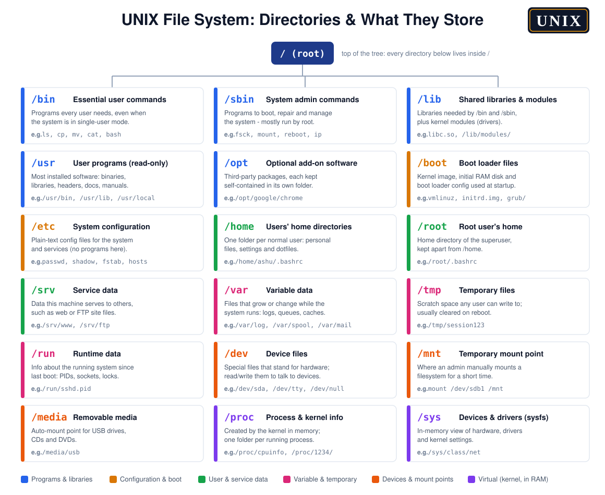

# Linux Filesystem Hierarchy (FHS)

Tour of the Linux directory tree: what lives in /, /bin, /etc, /home, /var, /tmp, /usr, /proc, /dev and /opt, and where to look on a real server.

## Everything Is a File, Under One Root

Linux has a single directory tree that starts at `/` (root). There are no drive letters like `C:` or `D:`. Extra disks, USB drives and network shares are **mounted** somewhere inside this tree (see [disks and mounting](../07_System_Administration/disks-and-mounting.md)).

The layout is standardised by the **Filesystem Hierarchy Standard (FHS)**, so Ubuntu, RHEL, Amazon Linux and Alpine all look broadly the same. Once you know the map, you know where configs, logs and binaries live on any server.


## The Directory Map

The diagram below groups the top-level directories by purpose: programs and libraries, configuration and boot, user and service data, variable and temporary data, devices and mount points, and virtual (in-RAM) filesystems created by the kernel.



| Directory | Purpose | Examples |
| :--- | :--- | :--- |
| `/` | Root of the whole tree | everything lives under it |
| `/bin` | Essential user commands | `ls`, `cp`, `mv`, `cat`, `bash` |
| `/sbin` | System admin commands | `fdisk`, `mkfs`, `reboot`, `ip` |
| `/lib` | Shared libraries and kernel modules | `libc.so.6`, `/lib/modules/` |
| `/usr` | Installed software (read-only) | `/usr/bin/python3`, `/usr/share/man` |
| `/opt` | Optional third-party software | `/opt/google/chrome`, `/opt/jdk` |
| `/boot` | Kernel and boot loader files | `vmlinuz`, `initrd.img`, `grub/` |
| `/etc` | System configuration (text files) | `/etc/passwd`, `/etc/nginx/`, `/etc/fstab` |
| `/home` | Home directories of normal users | `/home/ashu` |
| `/root` | Home of the root user | `/root/.bashrc` |
| `/srv` | Data served by this machine | `/srv/www`, `/srv/ftp` |
| `/var` | Data that changes while running | `/var/log`, `/var/lib/docker`, `/var/cache` |
| `/tmp` | Temporary files, often cleared on reboot | sockets, scratch files |
| `/run` | Runtime data since last boot | PID files, `/run/docker.sock` |
| `/dev` | Device files | `/dev/sda`, `/dev/null`, `/dev/tty` |
| `/mnt` | Temporary manual mount point | `/mnt/backup` |
| `/media` | Auto-mounted removable media | `/media/usb` |
| `/proc` | Virtual: process and kernel info | `/proc/cpuinfo`, `/proc/1234/` |
| `/sys` | Virtual: devices and drivers (sysfs) | `/sys/class/net/` |

> On modern distros (usr-merge), `/bin`, `/sbin` and `/lib` are symbolic links into `/usr`. Run `ls -l /bin` to check.

## Exploring the Tree

```bash
ls /                      # list top-level directories
ls -l /bin                # on Ubuntu: lrwxrwxrwx ... /bin -> usr/bin
tree -L 1 /               # tree view (install with: sudo apt install tree)
man hier                  # the manual page describing the hierarchy
```

### Virtual filesystems: /proc and /sys

These directories use no disk space. The kernel builds them in memory, and reading a file asks the kernel a question.

```bash
cat /proc/cpuinfo | grep "model name" | head -1
cat /proc/meminfo | head -3
ls /proc/$$               # info about the current shell process
cat /proc/loadavg
```

Every running process has a folder `/proc/<PID>/`; more on that in [processes](../03_Processes/README.md).

### Device files in /dev

```bash
ls -l /dev/sda /dev/null
# brw-rw---- 1 root disk 8, 0 Nov 27 10:00 /dev/sda    (b = block device)
# crw-rw-rw- 1 root root 1, 3 Nov 27 10:00 /dev/null   (c = character device)

command > /dev/null 2>&1  # throw away all output
```

## Where to Look on a Real Server

| Task | Location |
| :--- | :--- |
| Read web server logs | `/var/log/nginx/`, `/var/log/apache2/` |
| System logs | `/var/log/syslog`, `/var/log/messages`, or `journalctl` |
| Edit a service config | `/etc/nginx/nginx.conf`, `/etc/ssh/sshd_config` |
| systemd unit files | `/etc/systemd/system/`, `/lib/systemd/system/` |
| Scheduled jobs | `/etc/crontab`, `/var/spool/cron/` |
| User and group accounts | `/etc/passwd`, `/etc/group`, `/etc/shadow` |
| Docker images and volumes | `/var/lib/docker/` |
| Locally built tools | `/usr/local/bin/` |

```bash
df -h /var                # is the log partition full?
du -sh /var/log/* | sort -h | tail -5   # biggest log folders
```

## Related Notes

- [Paths and inodes](paths-and-inodes.md)
- [Permissions](permissions.md)
- [Hard and symbolic links](links.md)
- [Commands overview](../04_Commands/README.md)

## Interview Questions

**Q1. What is the difference between `/bin` and `/usr/bin`?**
Historically `/bin` held commands needed to boot and repair the system before `/usr` was mounted; `/usr/bin` held everything else. On usr-merged distros `/bin` is just a link to `/usr/bin`.

**Q2. Why is `/proc` empty on disk?**
It is a virtual filesystem (`procfs`). The kernel generates its contents on the fly, so `du -sh /proc` shows almost nothing while files like `/proc/meminfo` show live data.

**Q3. Where would you put a third-party application?**
In `/opt/<app>` for a self-contained package, or `/usr/local` for software you compile yourself. Never mix it into `/usr/bin`, which the package manager owns.

**Q4. A server's disk is full. Which directory do you check first?**
Usually `/var`, because logs (`/var/log`), caches and Docker data (`/var/lib/docker`) grow over time. Use `du -sh /var/* | sort -h`.

**Q5. What is the difference between `/tmp` and `/var/tmp`?**
`/tmp` is often cleared on reboot (and may be RAM-backed `tmpfs`); `/var/tmp` survives reboots and suits temporary files that must persist longer.
