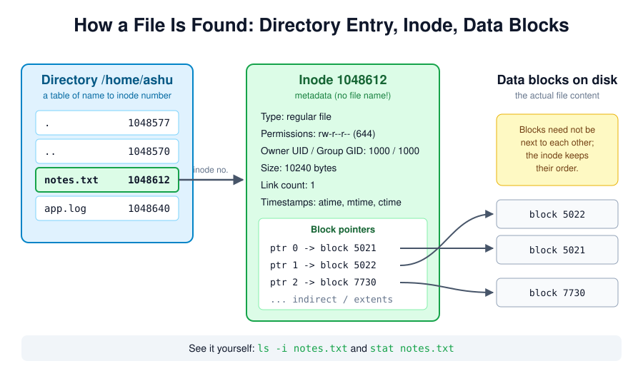

# Paths और Inodes

Absolute बनाम relative paths, विशेष नाम ., .. और ~, pwd और cd से घूमना, और inodes हर नाम के पीछे फ़ाइल का metadata कैसे रखते हैं।

## Absolute बनाम Relative Paths

**Path** बताता है कि फ़ाइल [डायरेक्टरी ट्री](README.md) में कहाँ रहती है।

| प्रकार | किससे शुरू | अर्थ | उदाहरण |
| :--- | :--- | :--- | :--- |
| Absolute | `/` | Root से पूरा path; कहीं से भी काम करता है | `/var/log/nginx/error.log` |
| Relative | कुछ और | Current directory से path | `log/nginx/error.log` (जब `/var` में हों) |

```bash
cd /var
cat /var/log/syslog      # absolute: same result from any directory
cat log/syslog           # relative: works only because we are in /var
```

Scripts, cron jobs और systemd units में absolute paths का उपयोग करें, क्योंकि उनकी working directory अक्सर वह नहीं होती जो आप सोचते हैं।

## विशेष Path नाम

| चिह्न | अर्थ | उदाहरण |
| :--- | :--- | :--- |
| `.` | Current directory | `./deploy.sh` यहीं की script चलाता है |
| `..` | Parent directory | `cd ../..` दो level ऊपर जाता है |
| `~` | Current user की home directory | `cd ~/projects` |
| `~user` | `user` की home directory | `ls ~ubuntu` |
| `-` | पिछली directory (`cd` के साथ) | `cd -` वापस ले जाता है |

## pwd और cd

```bash
$ pwd
/home/ashu
$ cd /etc/nginx          # absolute
$ cd sites-available     # relative
$ pwd
/etc/nginx/sites-available
$ cd ..                  # up one level
$ cd -                   # back to sites-available
/etc/nginx/sites-available
$ cd                     # no argument: go home
$ pwd -P                 # physical path, symlinks resolved
```

## Inode क्या है?

ext4, XFS जैसे filesystems पर हर फ़ाइल और डायरेक्टरी का एक **inode** (index node) होता है: एक छोटा record जिसे एक नंबर से पहचाना जाता है। Inode फ़ाइल के बारे में **सब कुछ रखता है, सिवाय उसके नाम और content के**।

| Inode में रखा जाता है | Inode में नहीं |
| :--- | :--- |
| File type (file, dir, link, device) | फ़ाइल का नाम |
| Permissions (mode) | असली data |
| Owner UID और group GID | |
| Size (bytes में) | |
| Link count | |
| Timestamps: atime, mtime, ctime | |
| Data blocks के pointers | |

**नाम** डायरेक्टरी में रहता है। डायरेक्टरी बस एक table है जो नामों को inode numbers से जोड़ती है। फ़ाइल खोलने का मतलब: डायरेक्टरी में नाम ढूँढो, inode number लो, inode पढ़ो, फिर उसके block pointers से data तक पहुँचो।



इसी डिज़ाइन के कारण एक ही filesystem में फ़ाइल rename करना तुरंत होता है (सिर्फ़ directory entry बदलती है) और [hard links](links.md) संभव हैं (दो नाम, एक inode)।

## Inodes की जाँच

### ls -i

```bash
$ ls -i notes.txt
1048612 notes.txt
$ ls -li
1048612 -rw-r--r-- 1 ashu ashu 10240 Nov 27 10:15 notes.txt
1048640 -rw-r--r-- 1 ashu ashu  2048 Nov 27 10:20 app.log
```

### stat

```bash
$ stat notes.txt
  File: notes.txt
  Size: 10240      Blocks: 24         IO Block: 4096   regular file
Device: 803h/2051d Inode: 1048612     Links: 1
Access: (0644/-rw-r--r--)  Uid: ( 1000/ ashu)   Gid: ( 1000/ ashu)
Access: 2026-11-27 10:16:02.000000000 +0530
Modify: 2026-11-27 10:15:40.000000000 +0530
Change: 2026-11-27 10:15:40.000000000 +0530
```

- **Access (atime)**: आख़िरी बार पढ़ा गया।
- **Modify (mtime)**: content में आख़िरी बदलाव।
- **Change (ctime)**: inode में आख़िरी बदलाव (permissions, owner, link count)। यह creation time नहीं है।

### df -i: inodes ख़त्म होना

Filesystem में inodes की संख्या तय होती है, जो उसे बनाते समय सेट होती है। लाखों छोटी फ़ाइलें (cache, sessions, mail queue) सारे inodes ख़त्म कर सकती हैं जबकि डिस्क पर जगह बाकी हो, और तब `No space left on device` आता है।

```bash
$ df -i /
Filesystem      Inodes   IUsed   IFree IUse% Mounted on
/dev/sda1      6553600 6553600       0  100% /

# find the directory with the most files
$ sudo du --inodes -x / 2>/dev/null | sort -n | tail -5
```

## आम गलतियाँ

**Q1. Cron script हाथ से चलती है पर cron में fail होती है। क्यों?**
वह relative paths इस्तेमाल करती है। Cron home directory में न्यूनतम environment के साथ शुरू होता है। Absolute paths का उपयोग करें या script की शुरुआत में `cd "$(dirname "$0")"` लिखें।

**Q2. "No space left on device" आ रहा है पर `df -h` खाली जगह दिखाता है। अब क्या?**
`df -i` जाँचें। Filesystem के inodes ख़त्म हो गए हैं; बहुत सारी छोटी फ़ाइलें delete या archive करें।

**Q3. क्या ctime creation time है?**
नहीं। ctime inode change time है। Creation (birth) time `stat` में `Birth:` के रूप में केवल उन filesystems और kernels पर दिखता है जो इसे support करते हैं।

**Q4. क्या एक ही filesystem में `mv` data copy करता है?**
नहीं। वह सिर्फ़ directory entries बदलता है; inode number वही रहता है। अलग filesystems के बीच वह copy करके delete करता है, इसलिए inode बदल जाता है।

**Q5. क्या inode फ़ाइल का नाम रखता है?**
नहीं। नाम directory entries में रहते हैं, इसीलिए एक inode के कई नाम हो सकते हैं।
