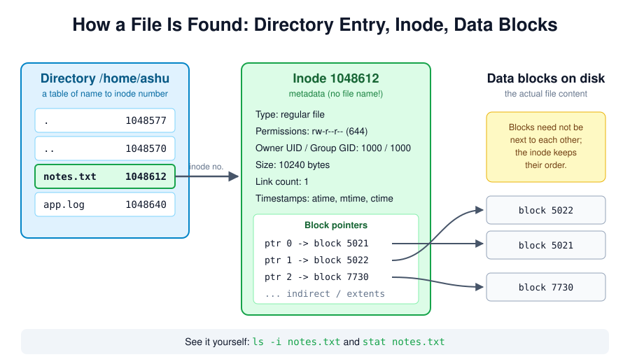

# Paths aur Inodes

Absolute vs relative paths, special names ., .. aur ~, pwd aur cd se ghoomna, aur inodes har naam ke peeche file ka metadata kaise store karte hain.

## Absolute vs Relative Paths

**Path** batata hai ki file [directory tree](README.md) mein kahan rehti hai.

| Type | Kisse start hota hai | Matlab | Example |
| :--- | :--- | :--- | :--- |
| Absolute | `/` | Root se poora path; kahin se bhi kaam karta hai | `/var/log/nginx/error.log` |
| Relative | kuch aur | Current directory se path | `log/nginx/error.log` (jab `/var` mein ho) |

```bash
cd /var
cat /var/log/syslog      # absolute: same result from any directory
cat log/syslog           # relative: works only because we are in /var
```

Scripts, cron jobs aur systemd units mein absolute paths use karo, kyunki unki working directory aksar woh nahi hoti jo tum soch rahe ho.

## Special Path Names

| Symbol | Matlab | Example |
| :--- | :--- | :--- |
| `.` | Current directory | `./deploy.sh` yahan ki script chalata hai |
| `..` | Parent directory | `cd ../..` do level upar jaata hai |
| `~` | Current user ki home directory | `cd ~/projects` |
| `~user` | `user` ki home directory | `ls ~ubuntu` |
| `-` | Pichli directory (`cd` ke saath) | `cd -` wapas toggle karta hai |

## pwd aur cd

```bash
$ pwd
/home/ashu
$ cd /etc/nginx          # absolute
$ cd sites-available     # relative
$ pwd
/etc/nginx/sites-available
$ cd ..                  # up one level
$ cd -                   # back to sites-available
/etc/nginx/sites-available
$ cd                     # no argument: go home
$ pwd -P                 # physical path, symlinks resolved
```

## Inode Kya Hai?

ext4, XFS jaise filesystems par har file aur directory ka ek **inode** (index node) hota hai: ek chhota record jise ek number se pehchana jaata hai. Inode file ke baare mein **sab kuch store karta hai, sirf naam aur content ko chhod kar**.

| Inode mein stored | Inode mein nahi |
| :--- | :--- |
| File type (file, dir, link, device) | File ka naam |
| Permissions (mode) | Asli data |
| Owner UID aur group GID | |
| Size bytes mein | |
| Link count | |
| Timestamps: atime, mtime, ctime | |
| Data blocks ke pointers | |

**Naam** directory mein rehta hai. Directory bas ek table hai jo names ko inode numbers se map karti hai. File kholne ka matlab: directory mein naam dhoondo, inode number lo, inode padho, phir uske block pointers follow karke data tak pahuncho.



Isi design ki wajah se same filesystem mein file rename karna instant hota hai (sirf directory entry badalti hai) aur [hard links](links.md) possible hain (do naam, ek inode).

## Inodes Ko Inspect Karna

### ls -i

```bash
$ ls -i notes.txt
1048612 notes.txt
$ ls -li
1048612 -rw-r--r-- 1 ashu ashu 10240 Nov 27 10:15 notes.txt
1048640 -rw-r--r-- 1 ashu ashu  2048 Nov 27 10:20 app.log
```

### stat

```bash
$ stat notes.txt
  File: notes.txt
  Size: 10240      Blocks: 24         IO Block: 4096   regular file
Device: 803h/2051d Inode: 1048612     Links: 1
Access: (0644/-rw-r--r--)  Uid: ( 1000/ ashu)   Gid: ( 1000/ ashu)
Access: 2026-11-27 10:16:02.000000000 +0530
Modify: 2026-11-27 10:15:40.000000000 +0530
Change: 2026-11-27 10:15:40.000000000 +0530
```

- **Access (atime)**: aakhri baar padha gaya.
- **Modify (mtime)**: content mein aakhri badlav.
- **Change (ctime)**: inode mein aakhri badlav (permissions, owner, link count). Yeh creation time nahi hai.

### df -i: inodes khatam hona

Filesystem mein inodes ki ginti fixed hoti hai, jo use banate waqt set hoti hai. Laakhon chhoti files (cache, sessions, mail queue) saare inodes kha sakti hain jabki disk space abhi bhi free ho, aur tab `No space left on device` aata hai.

```bash
$ df -i /
Filesystem      Inodes   IUsed   IFree IUse% Mounted on
/dev/sda1      6553600 6553600       0  100% /

# find the directory with the most files
$ sudo du --inodes -x / 2>/dev/null | sort -n | tail -5
```

## Common Mistakes

**Q1. Cron script haath se chalti hai par cron mein fail hoti hai. Kyun?**
Woh relative paths use karti hai. Cron home directory mein minimal environment ke saath start hota hai. Absolute paths use karo ya script ke top par `cd "$(dirname "$0")"` likho.

**Q2. "No space left on device" aa raha hai par `df -h` free space dikhata hai. Ab kya?**
`df -i` check karo. Filesystem ke inodes khatam ho gaye hain; bahut saari chhoti files delete ya archive karo.

**Q3. Kya ctime creation time hai?**
Nahi. ctime inode change time hai. Creation (birth) time `stat` mein `Birth:` ke roop mein sirf un filesystems aur kernels par dikhta hai jo ise support karte hain.

**Q4. Kya same filesystem mein `mv` data copy karta hai?**
Nahi. Woh sirf directory entries update karta hai; inode number same rehta hai. Alag filesystems ke beech woh copy karke delete karta hai, isliye inode badal jaata hai.

**Q5. Kya inode file ka naam store karta hai?**
Nahi. Naam directory entries mein rehte hain, isiliye ek inode ke kai naam ho sakte hain.
