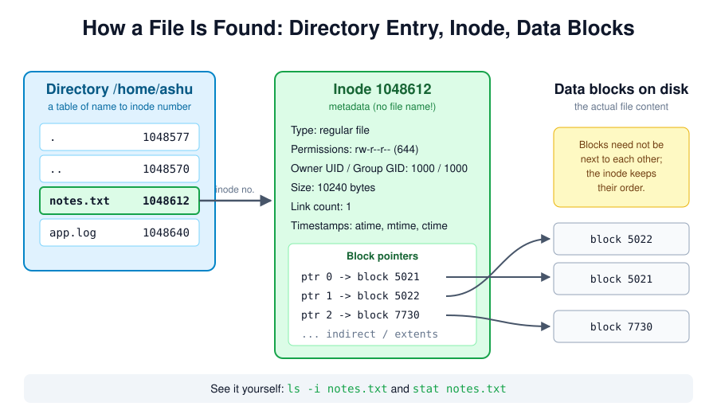

# Paths and Inodes

Absolute vs relative paths, the special names ., .. and ~, moving around with pwd and cd, and how inodes store file metadata behind every name.

## Absolute vs Relative Paths

A **path** tells the system where a file lives in the [directory tree](README.md).

| Type | Starts with | Meaning | Example |
| :--- | :--- | :--- | :--- |
| Absolute | `/` | Full path from root; works from anywhere | `/var/log/nginx/error.log` |
| Relative | anything else | Path from the current directory | `log/nginx/error.log` (when in `/var`) |

```bash
cd /var
cat /var/log/syslog      # absolute: same result from any directory
cat log/syslog           # relative: works only because we are in /var
```

Use absolute paths in scripts, cron jobs and systemd units, because their working directory is often not what you expect.

## Special Path Names

| Symbol | Meaning | Example |
| :--- | :--- | :--- |
| `.` | Current directory | `./deploy.sh` runs a script here |
| `..` | Parent directory | `cd ../..` goes up two levels |
| `~` | Home directory of current user | `cd ~/projects` |
| `~user` | Home directory of `user` | `ls ~ubuntu` |
| `-` | Previous directory (with `cd`) | `cd -` toggles back |

## pwd and cd

```bash
$ pwd
/home/ashu
$ cd /etc/nginx          # absolute
$ cd sites-available     # relative
$ pwd
/etc/nginx/sites-available
$ cd ..                  # up one level
$ cd -                   # back to sites-available
/etc/nginx/sites-available
$ cd                     # no argument: go home
$ pwd -P                 # physical path, symlinks resolved
```

## What Is an Inode?

Every file and directory on ext4, XFS and similar filesystems has an **inode** (index node): a small record identified by a number. The inode stores **everything about the file except its name and its content**.

| Stored in the inode | Not stored in the inode |
| :--- | :--- |
| File type (file, dir, link, device) | File name |
| Permissions (mode) | The data itself |
| Owner UID and group GID | |
| Size in bytes | |
| Link count | |
| Timestamps: atime, mtime, ctime | |
| Pointers to data blocks | |

The **name** lives in the directory. A directory is just a table mapping names to inode numbers. Opening a file means: look up the name in the directory, get the inode number, read the inode, then follow its block pointers to the data.



This design is why renaming a file in the same filesystem is instant (only the directory entry changes) and why [hard links](links.md) are possible (two names, one inode).

## Inspecting Inodes

### ls -i

```bash
$ ls -i notes.txt
1048612 notes.txt
$ ls -li
1048612 -rw-r--r-- 1 ashu ashu 10240 Nov 27 10:15 notes.txt
1048640 -rw-r--r-- 1 ashu ashu  2048 Nov 27 10:20 app.log
```

### stat

```bash
$ stat notes.txt
  File: notes.txt
  Size: 10240      Blocks: 24         IO Block: 4096   regular file
Device: 803h/2051d Inode: 1048612     Links: 1
Access: (0644/-rw-r--r--)  Uid: ( 1000/ ashu)   Gid: ( 1000/ ashu)
Access: 2026-11-27 10:16:02.000000000 +0530
Modify: 2026-11-27 10:15:40.000000000 +0530
Change: 2026-11-27 10:15:40.000000000 +0530
```

- **Access (atime)**: last read.
- **Modify (mtime)**: last change to the content.
- **Change (ctime)**: last change to the inode (permissions, owner, link count). It is not the creation time.

### df -i: running out of inodes

A filesystem has a fixed number of inodes, set when it is created. Millions of tiny files (cache, sessions, mail queue) can use them all while disk space is still free, and you get `No space left on device`.

```bash
$ df -i /
Filesystem      Inodes   IUsed   IFree IUse% Mounted on
/dev/sda1      6553600 6553600       0  100% /

# find the directory with the most files
$ sudo du --inodes -x / 2>/dev/null | sort -n | tail -5
```

## Common Mistakes

**Q1. A cron script works by hand but fails in cron. Why?**
It uses relative paths. Cron starts in the home directory with a minimal environment. Use absolute paths or `cd "$(dirname "$0")"` at the top of the script.

**Q2. "No space left on device" but `df -h` shows free space. What now?**
Check `df -i`. The filesystem is out of inodes; delete or archive the many small files.

**Q3. Is ctime the creation time?**
No. ctime is the inode change time. Creation (birth) time is shown as `Birth:` in `stat` only on filesystems and kernels that support it.

**Q4. Does `mv` copy data within the same filesystem?**
No. It only updates directory entries; the inode number stays the same. Across filesystems it copies and deletes, so the inode changes.

**Q5. Does the inode store the file name?**
No. Names live in directory entries, which is why one inode can have several names.
