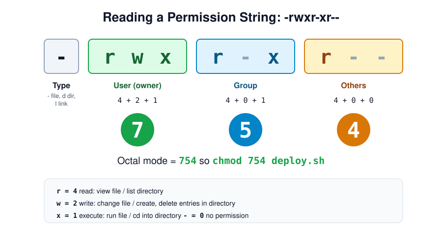

# Linux में फ़ाइल Permissions

User, group और others के लिए read, write और execute: ls -l पढ़ना, chmod symbolic और octal रूप में, chown, chgrp, umask और special bits।

## कौन और क्या

हर फ़ाइल का एक **owner (user)** और एक **group** होता है। बाकी सब **others** हैं। तीनों classes को तीन-तीन permission bits मिलते हैं।

| Bit | फ़ाइल पर | डायरेक्टरी पर | Octal |
| :--- | :--- | :--- | :---: |
| `r` read | Content देखना | नाम list करना (`ls`) | 4 |
| `w` write | Content बदलना | Entries बनाना, हटाना, rename करना | 2 |
| `x` execute | Program/script की तरह चलाना | अंदर जाना (`cd`) और फ़ाइलें access करना | 1 |

## ls -l पढ़ना

```bash
$ ls -l deploy.sh
-rwxr-xr-- 1 ashu devops 512 Nov 27 11:00 deploy.sh
```

| Field | Value | अर्थ |
| :--- | :--- | :--- |
| Type | `-` | regular file (`d` directory, `l` link, `c`/`b` device) |
| User | `rwx` | owner पढ़, लिख और चला सकता है |
| Group | `r-x` | group `devops` पढ़ और चला सकता है |
| Others | `r--` | बाकी सब सिर्फ़ पढ़ सकते हैं |
| Links | `1` | hard link count |
| Owner / Group | `ashu devops` | |



हर class के मान जोड़ें: `rwx` = 4+2+1 = 7, `r-x` = 4+1 = 5, `r--` = 4। तो mode है **754**।

## chmod

### Symbolic mode

कौन: `u` user, `g` group, `o` others, `a` all। Operator: `+` जोड़ें, `-` हटाएँ, `=` ठीक यही सेट करें।

```bash
chmod u+x deploy.sh        # owner can execute
chmod go-w config.yml      # remove write from group and others
chmod a=r readme.txt       # everyone read-only
chmod u=rwx,g=rx,o= app    # explicit for each class
chmod -R g+w shared/       # recursive
```

### Octal mode

```bash
chmod 755 script.sh        # rwxr-xr-x  scripts, directories
chmod 644 index.html       # rw-r--r--  normal files
chmod 600 ~/.ssh/id_rsa    # rw-------  private keys
chmod 400 key.pem          # r--------  AWS key pair (ssh refuses looser)
chmod 700 ~/.ssh           # rwx------  private directory
```

## chown और chgrp

Owner बदलने के लिए root चाहिए।

```bash
sudo chown ubuntu app.log            # change owner
sudo chown ubuntu:www-data app.log   # owner and group
sudo chown -R www-data:www-data /var/www/html
sudo chgrp devops deploy.sh          # change group only
```

Groups के बारे में [users and groups](../07_System_Administration/users-and-groups.md) में पढ़ें।

## umask: डिफ़ॉल्ट Permissions

नई फ़ाइलें `666` से और नई डायरेक्टरीज़ `777` से शुरू होती हैं; **umask** कुछ bits हटा देता है।

```bash
$ umask
0022
$ touch a.txt; mkdir d
$ ls -ld a.txt d
-rw-r--r-- 1 ashu ashu    0 Nov 27 11:10 a.txt    # 666 - 022 = 644
drwxr-xr-x 2 ashu ashu 4096 Nov 27 11:10 d        # 777 - 022 = 755
$ umask 077        # private: new files 600, dirs 700 (this shell only)
```

किसी user के लिए स्थायी बनाने के लिए `umask` को `~/.bashrc` में डालें।

## Special Bits: setuid, setgid, sticky

| Bit | Octal | कैसे दिखता है | प्रभाव |
| :--- | :---: | :--- | :--- |
| setuid | 4000 | user x में `s` | फ़ाइल owner के privileges से चलती है, जैसे `/usr/bin/passwd` |
| setgid | 2000 | group x में `s` | फ़ाइल group के privileges से चलती है; डायरेक्टरी पर नई फ़ाइलें डायरेक्टरी का group लेती हैं |
| sticky | 1000 | others x में `t` | डायरेक्टरी में सिर्फ़ फ़ाइल का owner (या root) फ़ाइल हटा सकता है, जैसे `/tmp` |

```bash
$ ls -l /usr/bin/passwd
-rwsr-xr-x 1 root root 68208 /usr/bin/passwd
$ ls -ld /tmp
drwxrwxrwt 18 root root 4096 /tmp
chmod g+s /srv/shared      # team folder: files keep the group
chmod 2775 /srv/shared     # same in octal
chmod +t /srv/upload       # sticky bit
```

Capital `S` या `T` का मतलब है special bit सेट है पर संबंधित `x` नहीं।

## आम गलतियाँ

**Q1. "Permission denied" ठीक करने के लिए बस `chmod 777` क्यों नहीं?**
इससे कोई भी user या compromised process फ़ाइल बदल या replace कर सकता है। `chown` से सही owner सेट करें और न्यूनतम mode दें (अक्सर 644 या 755)।

**Q2. ssh "UNPROTECTED PRIVATE KEY FILE" कहता है। समाधान?**
`chmod 400 key.pem` (या 600)। ssh उन keys को अस्वीकार करता है जिन्हें group या others पढ़ सकते हैं।

**Q3. User के पास डायरेक्टरी पर `r` है पर वह `cd` नहीं कर पाता। क्यों?**
`cd` के लिए डायरेक्टरी पर `x` चाहिए। `r` सिर्फ़ नाम list करने देता है।

**Q4. क्या user ऐसी फ़ाइल हटा सकता है जिस पर उसके पास write permission नहीं है?**
हाँ, अगर डायरेक्टरी पर `w` और `x` है, क्योंकि हटाना डायरेक्टरी को बदलता है, फ़ाइल को नहीं। Sticky bit इसे रोकता है।

**Q5. `chmod 4755` क्या है?**
setuid (4) और `rwxr-xr-x` (755)। Program अपने owner के रूप में चलता है; इसका कम उपयोग करें, यह privilege-escalation का आम निशाना है।
