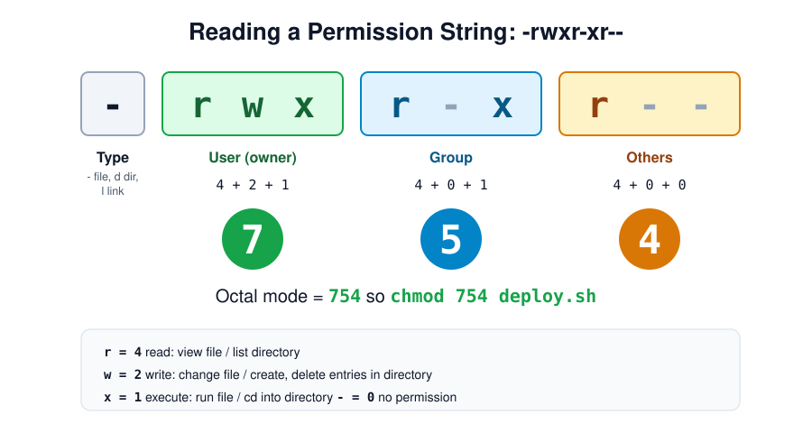

# Linux Mein File Permissions

User, group aur others ke liye read, write aur execute: ls -l padhna, chmod symbolic aur octal form mein, chown, chgrp, umask aur special bits.

## Kaun Aur Kya

Har file ka ek **owner (user)** aur ek **group** hota hai. Baaki sab **others** hain. Teeno classes ko teen-teen permission bits milte hain.

| Bit | File par | Directory par | Octal |
| :--- | :--- | :--- | :---: |
| `r` read | Content dekhna | Names list karna (`ls`) | 4 |
| `w` write | Content badalna | Entries create, delete, rename karna | 2 |
| `x` execute | Program/script ki tarah chalana | Andar jaana (`cd`) aur files access karna | 1 |

## ls -l Padhna

```bash
$ ls -l deploy.sh
-rwxr-xr-- 1 ashu devops 512 Nov 27 11:00 deploy.sh
```

| Field | Value | Matlab |
| :--- | :--- | :--- |
| Type | `-` | regular file (`d` directory, `l` link, `c`/`b` device) |
| User | `rwx` | owner read, write, execute kar sakta hai |
| Group | `r-x` | group `devops` read aur execute kar sakta hai |
| Others | `r--` | baaki sab sirf read kar sakte hain |
| Links | `1` | hard link count |
| Owner / Group | `ashu devops` | |



Har class ki values jodo: `rwx` = 4+2+1 = 7, `r-x` = 4+1 = 5, `r--` = 4. Toh mode hai **754**.

## chmod

### Symbolic mode

Kaun: `u` user, `g` group, `o` others, `a` all. Operator: `+` add, `-` remove, `=` exactly set.

```bash
chmod u+x deploy.sh        # owner can execute
chmod go-w config.yml      # remove write from group and others
chmod a=r readme.txt       # everyone read-only
chmod u=rwx,g=rx,o= app    # explicit for each class
chmod -R g+w shared/       # recursive
```

### Octal mode

```bash
chmod 755 script.sh        # rwxr-xr-x  scripts, directories
chmod 644 index.html       # rw-r--r--  normal files
chmod 600 ~/.ssh/id_rsa    # rw-------  private keys
chmod 400 key.pem          # r--------  AWS key pair (ssh refuses looser)
chmod 700 ~/.ssh           # rwx------  private directory
```

## chown aur chgrp

Owner badalne ke liye root chahiye.

```bash
sudo chown ubuntu app.log            # change owner
sudo chown ubuntu:www-data app.log   # owner and group
sudo chown -R www-data:www-data /var/www/html
sudo chgrp devops deploy.sh          # change group only
```

Groups ke baare mein [users and groups](../07_System_Administration/users-and-groups.md) mein padho.

## umask: Default Permissions

Nayi files `666` se aur nayi directories `777` se start hoti hain; **umask** bits hata deta hai.

```bash
$ umask
0022
$ touch a.txt; mkdir d
$ ls -ld a.txt d
-rw-r--r-- 1 ashu ashu    0 Nov 27 11:10 a.txt    # 666 - 022 = 644
drwxr-xr-x 2 ashu ashu 4096 Nov 27 11:10 d        # 777 - 022 = 755
$ umask 077        # private: new files 600, dirs 700 (this shell only)
```

User ke liye permanent karna ho toh `umask` ko `~/.bashrc` mein daalo.

## Special Bits: setuid, setgid, sticky

| Bit | Octal | Kaise dikhta hai | Effect |
| :--- | :---: | :--- | :--- |
| setuid | 4000 | user x mein `s` | File owner ke privileges ke saath chalti hai, jaise `/usr/bin/passwd` |
| setgid | 2000 | group x mein `s` | File group ke privileges ke saath chalti hai; directory par nayi files directory ka group le leti hain |
| sticky | 1000 | others x mein `t` | Directory mein sirf file owner (ya root) file delete kar sakta hai, jaise `/tmp` |

```bash
$ ls -l /usr/bin/passwd
-rwsr-xr-x 1 root root 68208 /usr/bin/passwd
$ ls -ld /tmp
drwxrwxrwt 18 root root 4096 /tmp
chmod g+s /srv/shared      # team folder: files keep the group
chmod 2775 /srv/shared     # same in octal
chmod +t /srv/upload       # sticky bit
```

Capital `S` ya `T` ka matlab hai special bit set hai par matching `x` nahi.

## Common Mistakes

**Q1. "Permission denied" theek karne ke liye bas `chmod 777` kyun nahi?**
Isse koi bhi user ya compromised process file badal ya replace kar sakta hai. `chown` se sahi owner set karo aur minimum mode do (aksar 644 ya 755).

**Q2. ssh "UNPROTECTED PRIVATE KEY FILE" bolta hai. Fix?**
`chmod 400 key.pem` (ya 600). ssh un keys ko reject karta hai jo group ya others padh sakte hain.

**Q3. User ke paas directory par `r` hai par woh `cd` nahi kar paata. Kyun?**
`cd` ke liye directory par `x` chahiye. `r` sirf names list karne deta hai.

**Q4. Kya user aisi file delete kar sakta hai jis par uske paas write permission nahi?**
Haan, agar directory par `w` aur `x` hai, kyunki delete karna directory ko badalta hai, file ko nahi. Sticky bit isse rokta hai.

**Q5. `chmod 4755` kya hai?**
setuid (4) plus `rwxr-xr-x` (755). Program apne owner ke roop mein chalta hai; ise kam use karo, yeh privilege-escalation ka common target hai.
