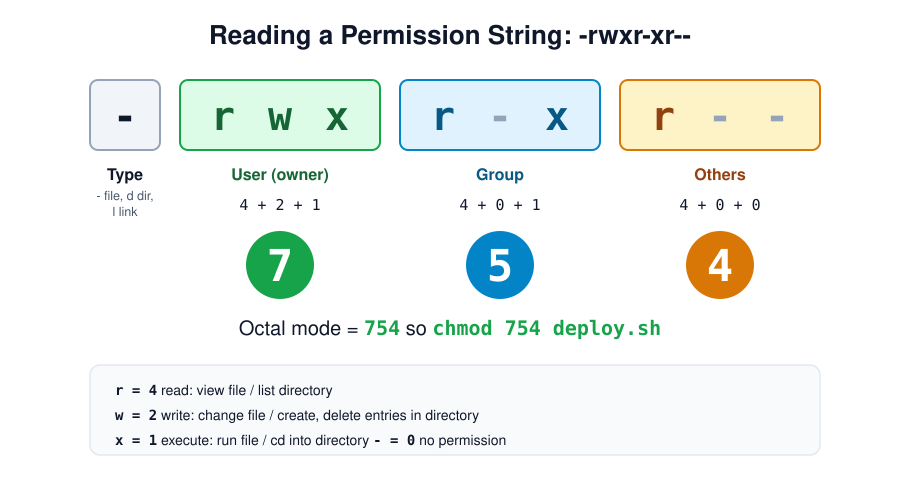

# File Permissions in Linux

Read, write and execute permissions for user, group and others: reading ls -l, chmod in symbolic and octal form, chown, chgrp, umask and special bits.

## Who and What

Every file has an **owner (user)** and a **group**. Everyone else is **others**. Each of the three classes gets three permission bits.

| Bit | On a file | On a directory | Octal |
| :--- | :--- | :--- | :---: |
| `r` read | View content | List names (`ls`) | 4 |
| `w` write | Modify content | Create, delete, rename entries | 2 |
| `x` execute | Run as program/script | Enter it (`cd`) and access files inside | 1 |

## Reading ls -l

```bash
$ ls -l deploy.sh
-rwxr-xr-- 1 ashu devops 512 Nov 27 11:00 deploy.sh
```

| Field | Value | Meaning |
| :--- | :--- | :--- |
| Type | `-` | regular file (`d` directory, `l` link, `c`/`b` device) |
| User | `rwx` | owner can read, write, execute |
| Group | `r-x` | group `devops` can read and execute |
| Others | `r--` | everyone else can only read |
| Links | `1` | hard link count |
| Owner / Group | `ashu devops` | |



Add the values per class: `rwx` = 4+2+1 = 7, `r-x` = 4+1 = 5, `r--` = 4. So the mode is **754**.

## chmod

### Symbolic mode

Who: `u` user, `g` group, `o` others, `a` all. Operator: `+` add, `-` remove, `=` set exactly.

```bash
chmod u+x deploy.sh        # owner can execute
chmod go-w config.yml      # remove write from group and others
chmod a=r readme.txt       # everyone read-only
chmod u=rwx,g=rx,o= app    # explicit for each class
chmod -R g+w shared/       # recursive
```

### Octal mode

```bash
chmod 755 script.sh        # rwxr-xr-x  scripts, directories
chmod 644 index.html       # rw-r--r--  normal files
chmod 600 ~/.ssh/id_rsa    # rw-------  private keys
chmod 400 key.pem          # r--------  AWS key pair (ssh refuses looser)
chmod 700 ~/.ssh           # rwx------  private directory
```

## chown and chgrp

Changing the owner needs root.

```bash
sudo chown ubuntu app.log            # change owner
sudo chown ubuntu:www-data app.log   # owner and group
sudo chown -R www-data:www-data /var/www/html
sudo chgrp devops deploy.sh          # change group only
```

Groups themselves are covered in [users and groups](../07_System_Administration/users-and-groups.md).

## umask: Default Permissions

New files start from `666` and new directories from `777`; the **umask** removes bits.

```bash
$ umask
0022
$ touch a.txt; mkdir d
$ ls -ld a.txt d
-rw-r--r-- 1 ashu ashu    0 Nov 27 11:10 a.txt    # 666 - 022 = 644
drwxr-xr-x 2 ashu ashu 4096 Nov 27 11:10 d        # 777 - 022 = 755
$ umask 077        # private: new files 600, dirs 700 (this shell only)
```

Put `umask` in `~/.bashrc` to make it permanent for a user.

## Special Bits: setuid, setgid, sticky

| Bit | Octal | Shows as | Effect |
| :--- | :---: | :--- | :--- |
| setuid | 4000 | `s` in user x | File runs with the owner's privileges, e.g. `/usr/bin/passwd` |
| setgid | 2000 | `s` in group x | File runs with the group's privileges; on a directory, new files inherit the directory's group |
| sticky | 1000 | `t` in others x | In a directory, only the file owner (or root) can delete files, e.g. `/tmp` |

```bash
$ ls -l /usr/bin/passwd
-rwsr-xr-x 1 root root 68208 /usr/bin/passwd
$ ls -ld /tmp
drwxrwxrwt 18 root root 4096 /tmp
chmod g+s /srv/shared      # team folder: files keep the group
chmod 2775 /srv/shared     # same in octal
chmod +t /srv/upload       # sticky bit
```

A capital `S` or `T` means the special bit is set but the matching `x` is not.

## Common Mistakes

**Q1. Why not just `chmod 777` to fix "Permission denied"?**
It lets any user or compromised process modify or replace the file. Find the right owner with `chown` and give the minimum mode (often 644 or 755).

**Q2. ssh says "UNPROTECTED PRIVATE KEY FILE". Fix?**
`chmod 400 key.pem` (or 600). ssh refuses keys readable by group or others.

**Q3. A user has `r` on a directory but cannot `cd` into it. Why?**
`cd` needs `x` on the directory. `r` only allows listing names.

**Q4. Can a user delete a file they have no write permission on?**
Yes, if they have `w` and `x` on the directory, because deleting changes the directory, not the file. The sticky bit prevents this.

**Q5. What is `chmod 4755`?**
setuid (4) plus `rwxr-xr-x` (755). The program runs as its owner; use it rarely, as it is a common privilege-escalation target.
