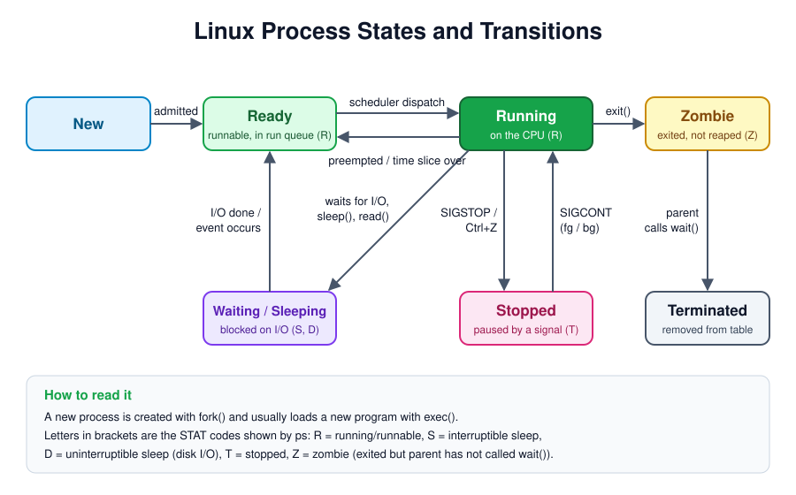

# Linux में प्रोसेस

जानें कि Linux प्रोसेस क्या है, PID और PPID कैसे काम करते हैं, प्रोसेस की अवस्थाएँ क्या हैं, और ps, top व pstree से प्रोसेस कैसे देखें।

## प्रोसेस क्या है?

**प्रोग्राम** डिस्क पर रखी एक फ़ाइल है (जैसे `/usr/bin/nginx`)। **प्रोसेस** उस प्रोग्राम का चलता हुआ instance है, जिसकी अपनी memory, खुली फ़ाइलें और CPU state होती है। `nginx` को तीन बार चलाएँ तो एक ही प्रोग्राम से तीन प्रोसेस बनेंगे।

हर प्रोसेस को मिलता है:

| Attribute | अर्थ |
| :--- | :--- |
| **PID** | Process ID, kernel द्वारा दिया गया unique नंबर |
| **PPID** | Parent Process ID, यानी उस प्रोसेस का PID जिसने इसे बनाया |
| **UID / GID** | वह user और group जिसके रूप में प्रोसेस चलता है (इसकी [permissions](../02_Filesystem/permissions.md) तय करता है) |
| **Priority / nice** | Scheduler इसे कितना CPU time देगा |
| **TTY** | वह terminal जिससे यह जुड़ा है (daemons के लिए `?`) |

PID 1 पहला user-space प्रोसेस है (ज़्यादातर नए distros पर `systemd`, पुराने पर `init`)। बाकी सभी प्रोसेस इसी के वंशज हैं। PID 1 कैसे शुरू होता है, यह [boot process](../01_Introduction/boot-process.md) में देखें।

## Process Context

**Process context** वह सब कुछ है जिसे kernel को किसी प्रोसेस को रोकने और बाद में फिर से चलाने के लिए save और restore करना पड़ता है:

- **User context**: code (text), data, heap और stack segments।
- **Register context**: program counter, stack pointer, CPU registers।
- **System context**: kernel की process table entry, खुले file descriptors, signal handlers, current directory, environment।

जब scheduler CPU को एक प्रोसेस से दूसरे पर ले जाता है, तो वह **context switch** करता है: पुराना context save करके नया load करता है। बहुत ज़्यादा context switches (`vmstat 1` में `cs` कॉलम) CPU time बर्बाद करते हैं।

## प्रोसेस की अवस्थाएँ और बदलाव



| अवस्था | `ps` STAT | विवरण |
| :--- | :---: | :--- |
| New | - | `fork()` से बन रहा है; अभी चलने को तैयार नहीं |
| Ready | R | चलने योग्य, run queue में CPU का इंतज़ार |
| Running | R | अभी CPU पर चल रहा है |
| Waiting / Sleeping | S / D | किसी event पर रुका है: I/O, timer, lock। `D` = uninterruptible (आमतौर पर disk I/O) |
| Stopped | T | `SIGSTOP` या Ctrl+Z से रुका; `SIGCONT` से फिर चलता है |
| Zombie | Z | ख़त्म हो चुका, पर parent ने अभी `wait()` से exit status नहीं पढ़ा |
| Terminated | - | Exit status ले लिया गया; process table से entry हट गई |

मुख्य बदलाव: scheduler dispatch करे तो **Ready से Running**, time slice ख़त्म हो तो **Running से Ready**, I/O पर **Running से Waiting**, I/O पूरा होने पर **Waiting से Ready**, और `exit()` पर **Running से Zombie**।

## fork() और exec()

Unix प्रोसेस दो चरणों में बनाता है:

1. **`fork()`** बुलाने वाले प्रोसेस की copy बनाता है। Child को नया PID मिलता है, पर parent की memory, खुली फ़ाइलें और environment की copy मिलती है।
2. **`exec()`** child के प्रोग्राम को नए प्रोग्राम से बदल देता है (PID वही, code नया)।

जब आप Bash में `ls` लिखते हैं, तो shell एक child fork करता है, child `/usr/bin/ls` को exec करता है, और parent shell उसके ख़त्म होने तक `wait()` करता है।

```bash
echo "shell PID: $$"           # PID of the current shell
bash -c 'echo "child PID: $$, parent: $PPID"'
# shell PID: 4120
# child PID: 4388, parent: 4120
```

अगर parent पहले मर जाए, तो child **orphan** बन जाता है और PID 1 (या कोई subreaper) उसे गोद ले लेता है और बाद में reap करता है।

## प्रोसेस देखना

### ps: एक snapshot

```bash
ps                     # processes in the current terminal
ps aux                 # every process, BSD style (user, %CPU, %MEM, STAT)
ps -ef                 # every process, System V style (shows PPID)
ps -o pid,ppid,stat,cmd -p $$
ps aux --sort=-%mem | head -5    # top memory users
pgrep -a nginx         # PIDs and command lines matching a name
```

`ps -ef` का sample output:

```text
UID        PID  PPID  C STIME TTY          TIME CMD
root         1     0  0 09:01 ?        00:00:02 /sbin/init
root       812     1  0 09:01 ?        00:00:00 nginx: master process
www-data   813   812  0 09:01 ?        00:00:00 nginx: worker process
ashu      4120  4119  0 10:15 pts/0    00:00:00 -bash
```

### top / htop: live view

```bash
top                    # press P (sort by CPU), M (memory), k (kill), q (quit)
top -u www-data        # only one user's processes
htop                   # friendlier, if installed
```

Header में load average, हर अवस्था के tasks की गिनती (running, sleeping, stopped, zombie) और CPU/memory usage दिखता है।

### pstree: परिवार का पेड़

```bash
pstree -p              # tree with PIDs
pstree -p 812          # subtree under nginx master
# nginx(812)---nginx(813)
```

Background jobs और signals के लिए [job control](job-control.md) देखें; तय समय पर काम चलाने के लिए [scheduling](scheduling.md) देखें। विस्तृत monitoring [monitoring and security](../07_System_Administration/monitoring-and-security.md) में है।

## Interview प्रश्न

**Q1. प्रोग्राम और प्रोसेस में क्या अंतर है?**
प्रोग्राम डिस्क पर एक निष्क्रिय फ़ाइल है; प्रोसेस उसका सक्रिय, चलता हुआ instance है जिसका अपना PID, memory और state है।

**Q2. Zombie प्रोसेस क्या है और इसे कैसे हटाएँ?**
ऐसा child जो ख़त्म हो चुका है पर parent ने `wait()` नहीं बुलाया। Zombie को kill नहीं किया जा सकता; parent को ठीक करें या restart करें (या parent को kill करें ताकि PID 1 child को गोद लेकर reap कर दे)।

**Q3. `fork()` और `exec()` में क्या अंतर है?**
`fork()` caller की copy के रूप में नया प्रोसेस बनाता है। `exec()` मौजूदा प्रोसेस की image को नए प्रोग्राम से बदलता है, PID वही रहता है।

**Q4. `ps` में state `D` का क्या मतलब है?**
Uninterruptible sleep, आमतौर पर disk या NFS I/O का इंतज़ार। ऐसा प्रोसेस I/O लौटने तक signals को, `SIGKILL` को भी, नज़रअंदाज़ करता है।

**Q5. किसी प्रोसेस का parent कैसे पता करें?**
`ps -o ppid= -p <PID>`, या `ps -ef` का PPID कॉलम देखें, या `pstree -p -s <PID>` चलाएँ।
