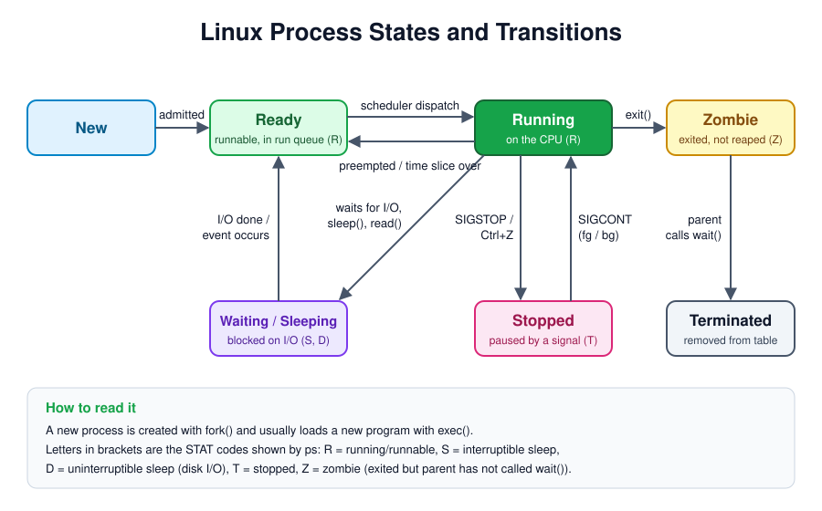

# Linux mein Processes

Samjho Linux process kya hai, PID aur PPID kaise kaam karte hain, process states aur transitions kya hain, aur ps, top aur pstree se processes kaise dekhein.

## Process Kya Hai?

**Program** disk par padi ek file hai (jaise `/usr/bin/nginx`). **Process** us program ka running instance hai, jiski apni memory, open files aur CPU state hoti hai. `nginx` ko teen baar chalao to ek hi program se teen processes ban jaate hain.

Har process ko milta hai:

| Attribute | Matlab |
| :--- | :--- |
| **PID** | Process ID, kernel ka diya hua unique number |
| **PPID** | Parent Process ID, yaani us process ka PID jisne isse banaya |
| **UID / GID** | Woh user aur group jiske roop mein process chalta hai (iski [permissions](../02_Filesystem/permissions.md) decide karta hai) |
| **Priority / nice** | Scheduler isse kitna CPU time dega |
| **TTY** | Woh terminal jisse yeh juda hai (daemons ke liye `?`) |

PID 1 pehla user-space process hai (zyaadatar naye distros par `systemd`, purane par `init`). Baaki saare processes isi ke descendants hain. PID 1 kaise start hota hai, yeh [boot process](../01_Introduction/boot-process.md) mein dekho.

## Process Context

**Process context** woh sab kuch hai jo kernel ko kisi process ko rokne aur baad mein resume karne ke liye save aur restore karna padta hai:

- **User context**: code (text), data, heap aur stack segments.
- **Register context**: program counter, stack pointer, CPU registers.
- **System context**: kernel ki process table entry, open file descriptors, signal handlers, current directory, environment.

Jab scheduler CPU ko ek process se doosre par le jaata hai, to woh **context switch** karta hai: purana context save karke naya load karta hai. Bahut zyaada context switches (`vmstat 1` mein `cs` column) CPU time waste karte hain.

## Process States aur Transitions



| State | `ps` STAT | Description |
| :--- | :---: | :--- |
| New | - | `fork()` se ban raha hai; abhi run hone ko ready nahi |
| Ready | R | Runnable, run queue mein CPU ka wait kar raha hai |
| Running | R | Abhi CPU par chal raha hai |
| Waiting / Sleeping | S / D | Kisi event par ruka hai: I/O, timer, lock. `D` = uninterruptible (aksar disk I/O) |
| Stopped | T | `SIGSTOP` ya Ctrl+Z se ruka; `SIGCONT` se phir chalta hai |
| Zombie | Z | Khatam ho gaya, par parent ne abhi tak `wait()` se exit status nahi padha |
| Terminated | - | Exit status le liya gaya; process table se entry hat gayi |

Common transitions: scheduler dispatch kare to **Ready se Running**, time slice khatam ho to **Running se Ready**, I/O par **Running se Waiting**, I/O complete hone par **Waiting se Ready**, aur `exit()` par **Running se Zombie**.

## fork() aur exec()

Unix process do steps mein banata hai:

1. **`fork()`** calling process ka clone banata hai. Child ko naya PID milta hai, par parent ki memory, open files aur environment ki copy milti hai.
2. **`exec()`** child ke program ko naye program se replace kar deta hai (PID wahi, code naya).

Jab tum Bash mein `ls` likhte ho, shell ek child fork karta hai, child `/usr/bin/ls` ko exec karta hai, aur parent shell uske khatam hone tak `wait()` karta hai.

```bash
echo "shell PID: $$"           # PID of the current shell
bash -c 'echo "child PID: $$, parent: $PPID"'
# shell PID: 4120
# child PID: 4388, parent: 4120
```

Agar parent pehle mar jaaye, to child **orphan** ban jaata hai aur PID 1 (ya koi subreaper) use adopt karke baad mein reap kar deta hai.

## Processes Inspect Karna

### ps: ek snapshot

```bash
ps                     # processes in the current terminal
ps aux                 # every process, BSD style (user, %CPU, %MEM, STAT)
ps -ef                 # every process, System V style (shows PPID)
ps -o pid,ppid,stat,cmd -p $$
ps aux --sort=-%mem | head -5    # top memory users
pgrep -a nginx         # PIDs and command lines matching a name
```

`ps -ef` ka sample output:

```text
UID        PID  PPID  C STIME TTY          TIME CMD
root         1     0  0 09:01 ?        00:00:02 /sbin/init
root       812     1  0 09:01 ?        00:00:00 nginx: master process
www-data   813   812  0 09:01 ?        00:00:00 nginx: worker process
ashu      4120  4119  0 10:15 pts/0    00:00:00 -bash
```

### top / htop: live view

```bash
top                    # press P (sort by CPU), M (memory), k (kill), q (quit)
top -u www-data        # only one user's processes
htop                   # friendlier, if installed
```

Header mein load average, har state ke tasks ka count (running, sleeping, stopped, zombie) aur CPU/memory usage dikhta hai.

### pstree: family tree

```bash
pstree -p              # tree with PIDs
pstree -p 812          # subtree under nginx master
# nginx(812)---nginx(813)
```

Background jobs aur signals ke liye [job control](job-control.md) dekho; schedule par tasks chalane ke liye [scheduling](scheduling.md) dekho. Detailed monitoring [monitoring and security](../07_System_Administration/monitoring-and-security.md) mein hai.

## Interview Questions

**Q1. Program aur process mein kya fark hai?**
Program disk par ek passive file hai; process uska active, running instance hai jiska apna PID, memory aur state hota hai.

**Q2. Zombie process kya hai aur use kaise hatayein?**
Aisa child jo exit ho chuka hai par parent ne `wait()` call nahi kiya. Zombie ko kill nahi kar sakte; parent ko fix ya restart karo (ya parent ko kill karo taaki PID 1 child ko adopt karke reap kar de).

**Q3. `fork()` aur `exec()` mein kya fark hai?**
`fork()` caller ki copy ke roop mein naya process banata hai. `exec()` current process image ko naye program se replace karta hai, PID wahi rehta hai.

**Q4. `ps` mein state `D` ka kya matlab hai?**
Uninterruptible sleep, aksar disk ya NFS I/O ka wait. Aisa process I/O return hone tak signals ko, `SIGKILL` ko bhi, ignore karta hai.

**Q5. Kisi process ka parent kaise pata karein?**
`ps -o ppid= -p <PID>`, ya `ps -ef` ka PPID column dekho, ya `pstree -p -s <PID>` chalao.
