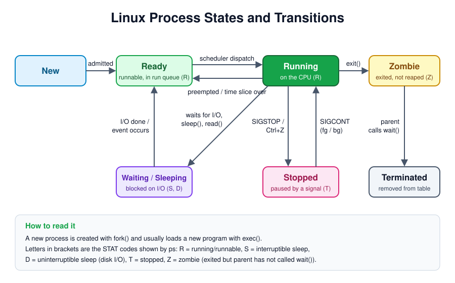

# Processes in Linux

Learn what a Linux process is, how PID and PPID work, the process states and their transitions, and how to inspect processes with ps, top and pstree.

## What Is a Process?

A **program** is a file on disk (for example `/usr/bin/nginx`). A **process** is a running instance of that program, with its own memory, open files and CPU state. Run `nginx` three times and you get three processes from one program.

Every process gets:

| Attribute | Meaning |
| :--- | :--- |
| **PID** | Process ID, a unique number assigned by the kernel |
| **PPID** | Parent Process ID, the PID of the process that created it |
| **UID / GID** | The user and group the process runs as (decides its [permissions](../02_Filesystem/permissions.md)) |
| **Priority / nice** | How much CPU time the scheduler gives it |
| **TTY** | The terminal it is attached to (`?` for daemons) |

PID 1 is the first user-space process (`systemd` on most modern distros, `init` on older ones). Every other process is its descendant. See the [boot process](../01_Introduction/boot-process.md) for how PID 1 starts.

## Process Context

The **process context** is everything the kernel must save and restore to pause a process and resume it later:

- **User context**: code (text), data, heap and stack segments.
- **Register context**: program counter, stack pointer, CPU registers.
- **System context**: the kernel's process table entry, open file descriptors, signal handlers, current directory, environment.

When the scheduler switches the CPU from one process to another it performs a **context switch**: it saves the old context and loads the new one. Too many context switches (visible as `cs` in `vmstat 1`) waste CPU time.

## Process States and Transitions



| State | `ps` STAT | Description |
| :--- | :---: | :--- |
| New | - | Being created by `fork()`; not yet ready to run |
| Ready | R | Runnable, waiting in the run queue for a CPU |
| Running | R | Currently executing on a CPU |
| Waiting / Sleeping | S / D | Blocked on an event: I/O, timer, lock. `D` = uninterruptible (usually disk I/O) |
| Stopped | T | Paused by `SIGSTOP` or Ctrl+Z; resumed by `SIGCONT` |
| Zombie | Z | Finished, but the parent has not yet read its exit status with `wait()` |
| Terminated | - | Exit status collected; entry removed from the process table |

Typical transitions: **Ready to Running** when the scheduler dispatches it, **Running to Ready** when its time slice ends, **Running to Waiting** on I/O, **Waiting to Ready** when the I/O completes, **Running to Zombie** on `exit()`.

## fork() and exec()

Unix creates processes in two steps:

1. **`fork()`** clones the calling process. The child gets a new PID but a copy of the parent's memory, open files and environment.
2. **`exec()`** replaces the child's program with a new one (same PID, new code).

When you type `ls` in Bash, the shell forks a child, the child execs `/usr/bin/ls`, and the parent shell `wait()`s for it to finish.

```bash
echo "shell PID: $$"           # PID of the current shell
bash -c 'echo "child PID: $$, parent: $PPID"'
# shell PID: 4120
# child PID: 4388, parent: 4120
```

If a parent dies first, the child becomes an **orphan** and is adopted by PID 1 (or a subreaper), which reaps it later.

## Inspecting Processes

### ps: a snapshot

```bash
ps                     # processes in the current terminal
ps aux                 # every process, BSD style (user, %CPU, %MEM, STAT)
ps -ef                 # every process, System V style (shows PPID)
ps -o pid,ppid,stat,cmd -p $$
ps aux --sort=-%mem | head -5    # top memory users
pgrep -a nginx         # PIDs and command lines matching a name
```

Sample `ps -ef` output:

```text
UID        PID  PPID  C STIME TTY          TIME CMD
root         1     0  0 09:01 ?        00:00:02 /sbin/init
root       812     1  0 09:01 ?        00:00:00 nginx: master process
www-data   813   812  0 09:01 ?        00:00:00 nginx: worker process
ashu      4120  4119  0 10:15 pts/0    00:00:00 -bash
```

### top / htop: live view

```bash
top                    # press P (sort by CPU), M (memory), k (kill), q (quit)
top -u www-data        # only one user's processes
htop                   # friendlier, if installed
```

The header shows load average, task counts per state (running, sleeping, stopped, zombie) and CPU/memory usage.

### pstree: the family tree

```bash
pstree -p              # tree with PIDs
pstree -p 812          # subtree under nginx master
# nginx(812)---nginx(813)
```

For background jobs and signals see [job control](job-control.md); for running tasks on a schedule see [scheduling](scheduling.md). Wider monitoring is covered in [monitoring and security](../07_System_Administration/monitoring-and-security.md).

## Interview Questions

**Q1. What is the difference between a program and a process?**
A program is a passive file on disk; a process is an active, running instance of it with its own PID, memory and state.

**Q2. What is a zombie process and how do you remove it?**
A child that has exited but whose parent has not called `wait()`. You cannot kill a zombie; fix or restart the parent (or kill it so PID 1 adopts and reaps the child).

**Q3. What is the difference between `fork()` and `exec()`?**
`fork()` creates a new process as a copy of the caller. `exec()` replaces the current process image with a new program, keeping the PID.

**Q4. What does state `D` in `ps` mean?**
Uninterruptible sleep, usually waiting on disk or NFS I/O. Such a process ignores signals, even `SIGKILL`, until the I/O returns.

**Q5. How do you find the parent of a process?**
`ps -o ppid= -p <PID>`, or look at the PPID column in `ps -ef`, or use `pstree -p -s <PID>`.
