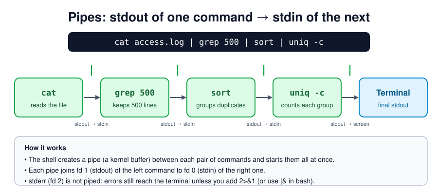

# Filters और Pipes

grep, sort, uniq, cut, wc, tr और tee जैसे छोटे Linux tools को pipes से जोड़कर terminal में ही logs और text का विश्लेषण करें।

## Pipe क्या है?

Pipe `|` एक कमांड के **stdout** को अगली कमांड के **stdin** से जोड़ता है। Shell सभी कमांड्स एक साथ चालू करता है और kernel उनके बीच data को buffer करता है, इसलिए temporary फ़ाइलों की ज़रूरत नहीं पड़ती।



**Filter** वह program है जो stdin से पढ़ता है, text को बदलता है और stdout पर लिखता है। यही Unix philosophy है: छोटे tools जो एक काम अच्छी तरह करें।

## आम Filters

| Filter | काम | उदाहरण |
| :--- | :--- | :--- |
| `head` | शुरू की lines (default 10) | `head -n 5 app.log` |
| `tail` | आख़िरी lines, बढ़ती फ़ाइल को follow करे | `tail -n 100 -f app.log` |
| `wc` | Lines, words, bytes गिने | `wc -l users.csv` |
| `sort` | Lines को sort करे | `sort -t, -k3 -n data.csv` |
| `uniq` | लगातार आने वाली duplicate lines हटाए | `sort ips.txt \| uniq -c` |
| `cut` | Columns / characters चुने | `cut -d: -f1 /etc/passwd` |
| `grep` | Pattern से match होने वाली lines ढूँढे | `grep -i error app.log` |
| `tr` | Characters बदले या हटाए | `tr 'a-z' 'A-Z'` |
| `tee` | फ़ाइल और stdout दोनों पर लिखे | `cmd \| tee out.txt` |
| `diff` | दो फ़ाइलों का अंतर दिखाए | `diff -u old.conf new.conf` |

### head, tail, wc

```bash
head -n 3 /etc/passwd
tail -f /var/log/nginx/error.log      # live stream, Ctrl+C to stop
tail -n +2 data.csv                   # skip the header line
$ wc -l /etc/passwd
32 /etc/passwd
```

### sort और uniq

`uniq` सिर्फ़ **पास-पास** की duplicate lines हटाता है, इसलिए पहले sort करें।

```bash
sort names.txt               # alphabetical
sort -n sizes.txt            # numeric
sort -rn sizes.txt           # numeric, descending
sort -u names.txt            # sort + unique
sort -t, -k2 -n data.csv     # comma separated, by column 2
uniq -c                      # prefix each line with its count
uniq -d                      # only duplicated lines
```

### cut और tr

```bash
$ cut -d: -f1,7 /etc/passwd | head -2
root:/bin/bash
daemon:/usr/sbin/nologin
cut -c1-8 file.txt             # characters 1 to 8
echo "Hello" | tr 'a-z' 'A-Z'  # HELLO
tr -d '\r' < win.txt > unix.txt  # remove Windows line endings
tr -s ' ' < report.txt         # squeeze repeated spaces
```

### grep के रोज़ काम आने वाले flags

| Flag | मतलब |
| :--- | :--- |
| `-i` | Case ignore करे |
| `-v` | उल्टा: जो lines match नहीं करतीं |
| `-n` | Line नंबर दिखाए |
| `-c` | Match होने वाली lines गिने |
| `-r` | Directories में recursively खोजे |
| `-l` | सिर्फ़ फ़ाइल-नाम दिखाए |
| `-w` | पूरे शब्द से match करे |
| `-E` | Extended regex (`a\|b`, `+`, `?`) |
| `-A 3` / `-B 3` / `-C 3` | बाद / पहले / आसपास की lines का context |

```bash
grep -rn "TODO" src/
grep -E "ERROR|FATAL" app.log
grep -v "^#" nginx.conf | grep -v "^$"   # config without comments/blank lines
```

Regex की गहराई [sed](../06_Sed_and_Awk/sed.md) और [awk](../06_Sed_and_Awk/awk.md) में है।

### diff और tee

```bash
$ diff old.conf new.conf
3c3
< port=80
---
> port=8080
diff -u old.conf new.conf          # unified format, like git
./build.sh | tee build.log         # watch output and save it
echo "nameserver 1.1.1.1" | sudo tee -a /etc/resolv.conf
```

## असली Log-Analysis Pipelines

मान लें Nginx की `access.log` है जिसमें field 1 client IP है और field 9 status code।

```bash
# Top 10 IPs by request count
cut -d' ' -f1 access.log | sort | uniq -c | sort -rn | head

# How many 500 errors?
grep -c '" 500 ' access.log

# Count requests per status code
awk '{print $9}' access.log | sort | uniq -c | sort -rn

# Most requested URLs that returned 404
grep '" 404 ' access.log | awk '{print $7}' | sort | uniq -c | sort -rn | head -5

# Unique users in a CSV (skip header, column 2)
tail -n +2 users.csv | cut -d, -f2 | sort -u | wc -l

# Watch a live log for errors only
tail -f app.log | grep --line-buffered -i error
```

Status code वाली pipeline का sample output:

```text
  9120 200
   412 304
    87 404
    12 500
```

## आम गलतियाँ

**Q1. `uniq` फिर भी duplicates क्यों दिखाता है?**
यह सिर्फ़ पड़ोसी lines की तुलना करता है। `sort | uniq` या `sort -u` इस्तेमाल करें।

**Q2. मेरी pipe errors को filter क्यों नहीं करती?**
Pipe में सिर्फ़ stdout जाता है। `cmd 2>&1 | grep x` इस्तेमाल करें ([redirection](redirection.md) देखें)।

**Q3. क्या `cat file | grep x` गलत है?**
चलता है, पर एक process बेकार जाता है; `grep x file` ज़्यादा सरल है।

**Q4. `sort` 10 को 9 से पहले क्यों रखता है?**
Default sort text के हिसाब से होता है। Numbers के लिए `sort -n` और `2K`, `1G` जैसे sizes के लिए `sort -h` इस्तेमाल करें।

**Q5. `sudo echo x > /etc/file` permission denied क्यों देता है?**
Redirect आपका non-root shell करता है। `echo x | sudo tee /etc/file` इस्तेमाल करें।
