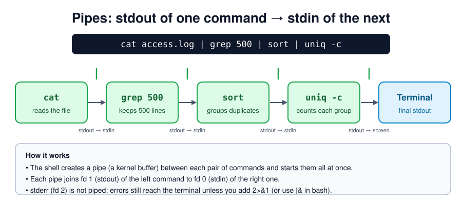

# Filters aur Pipes

grep, sort, uniq, cut, wc, tr aur tee jaise chhote Linux tools ko pipes se jodkar terminal mein hi logs aur text analyse karein.

## Pipe Kya Hai?

Pipe `|` ek command ke **stdout** ko agli command ke **stdin** se jodta hai. Shell saari commands ek saath start karta hai aur kernel unke beech data buffer karta hai, isliye temporary files ki zaroorat nahi padti.



**Filter** woh program hai jo stdin se padhta hai, text ko transform karta hai aur stdout par likhta hai. Yahi Unix philosophy hai: chhote tools jo ek kaam achhe se karein.

## Common Filters

| Filter | Kaam | Example |
| :--- | :--- | :--- |
| `head` | Shuru ki lines (default 10) | `head -n 5 app.log` |
| `tail` | Aakhri lines, badhti file ko follow kare | `tail -n 100 -f app.log` |
| `wc` | Lines, words, bytes gine | `wc -l users.csv` |
| `sort` | Lines sort kare | `sort -t, -k3 -n data.csv` |
| `uniq` | Lagatar aane wali duplicate lines hataye | `sort ips.txt \| uniq -c` |
| `cut` | Columns / characters chune | `cut -d: -f1 /etc/passwd` |
| `grep` | Pattern match karne wali lines dhoondhe | `grep -i error app.log` |
| `tr` | Characters badle ya hataye | `tr 'a-z' 'A-Z'` |
| `tee` | File aur stdout dono par likhe | `cmd \| tee out.txt` |
| `diff` | Do files ka difference dikhaye | `diff -u old.conf new.conf` |

### head, tail, wc

```bash
head -n 3 /etc/passwd
tail -f /var/log/nginx/error.log      # live stream, Ctrl+C to stop
tail -n +2 data.csv                   # skip the header line
$ wc -l /etc/passwd
32 /etc/passwd
```

### sort aur uniq

`uniq` sirf **paas-paas** wali duplicate lines hatata hai, isliye pehle sort karein.

```bash
sort names.txt               # alphabetical
sort -n sizes.txt            # numeric
sort -rn sizes.txt           # numeric, descending
sort -u names.txt            # sort + unique
sort -t, -k2 -n data.csv     # comma separated, by column 2
uniq -c                      # prefix each line with its count
uniq -d                      # only duplicated lines
```

### cut aur tr

```bash
$ cut -d: -f1,7 /etc/passwd | head -2
root:/bin/bash
daemon:/usr/sbin/nologin
cut -c1-8 file.txt             # characters 1 to 8
echo "Hello" | tr 'a-z' 'A-Z'  # HELLO
tr -d '\r' < win.txt > unix.txt  # remove Windows line endings
tr -s ' ' < report.txt         # squeeze repeated spaces
```

### grep ke roz kaam aane wale flags

| Flag | Matlab |
| :--- | :--- |
| `-i` | Case ignore kare |
| `-v` | Ulta: jo lines match NAHI karti |
| `-n` | Line numbers dikhaye |
| `-c` | Match hone wali lines gine |
| `-r` | Directories mein recursively search kare |
| `-l` | Sirf file names dikhaye |
| `-w` | Poore word se match kare |
| `-E` | Extended regex (`a\|b`, `+`, `?`) |
| `-A 3` / `-B 3` / `-C 3` | Baad / pehle / aas-paas ki lines ka context |

```bash
grep -rn "TODO" src/
grep -E "ERROR|FATAL" app.log
grep -v "^#" nginx.conf | grep -v "^$"   # config without comments/blank lines
```

Regex ki details [sed](../06_Sed_and_Awk/sed.md) aur [awk](../06_Sed_and_Awk/awk.md) mein hain.

### diff aur tee

```bash
$ diff old.conf new.conf
3c3
< port=80
---
> port=8080
diff -u old.conf new.conf          # unified format, like git
./build.sh | tee build.log         # watch output and save it
echo "nameserver 1.1.1.1" | sudo tee -a /etc/resolv.conf
```

## Real Log-Analysis Pipelines

Maan lijiye Nginx ki `access.log` hai jismein field 1 client IP hai aur field 9 status code.

```bash
# Top 10 IPs by request count
cut -d' ' -f1 access.log | sort | uniq -c | sort -rn | head

# How many 500 errors?
grep -c '" 500 ' access.log

# Count requests per status code
awk '{print $9}' access.log | sort | uniq -c | sort -rn

# Most requested URLs that returned 404
grep '" 404 ' access.log | awk '{print $7}' | sort | uniq -c | sort -rn | head -5

# Unique users in a CSV (skip header, column 2)
tail -n +2 users.csv | cut -d, -f2 | sort -u | wc -l

# Watch a live log for errors only
tail -f app.log | grep --line-buffered -i error
```

Status code wali pipeline ka sample output:

```text
  9120 200
   412 304
    87 404
    12 500
```

## Common Mistakes

**Q1. `uniq` phir bhi duplicates kyun dikhata hai?**
Yeh sirf padosi lines compare karta hai. `sort | uniq` ya `sort -u` use karein.

**Q2. Meri pipe errors ko filter kyun nahi karti?**
Pipe mein sirf stdout jaata hai. `cmd 2>&1 | grep x` use karein ([redirection](redirection.md) dekhein).

**Q3. Kya `cat file | grep x` galat hai?**
Chalta hai, par ek process waste hota hai; `grep x file` zyada simple hai.

**Q4. `sort` 10 ko 9 se pehle kyun rakhta hai?**
Default sort text order mein hota hai. Numbers ke liye `sort -n` aur `2K`, `1G` jaise sizes ke liye `sort -h` use karein.

**Q5. `sudo echo x > /etc/file` permission denied kyun deta hai?**
Redirect aapka non-root shell karta hai. `echo x | sudo tee /etc/file` use karein.
