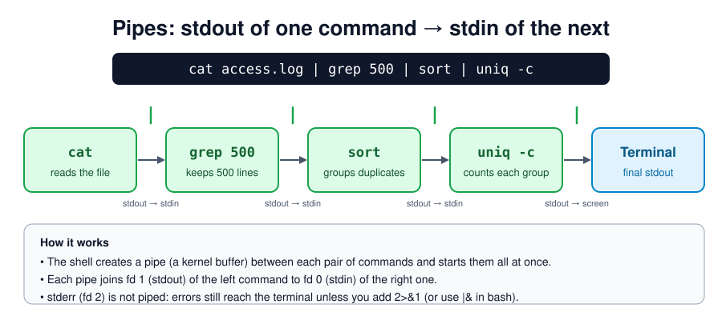

# Filters and Pipes

Chain small Linux tools with pipes and filters like grep, sort, uniq, cut, wc, tr and tee to slice logs and text right from the terminal.

## What Is a Pipe?

A pipe `|` connects the **stdout** of one command to the **stdin** of the next. The shell starts all commands at the same time and the kernel buffers data between them, so no temporary files are needed.



A **filter** is a program that reads from stdin, transforms the text and writes to stdout. That design is the Unix philosophy: small tools that do one thing well.

## Common Filters

| Filter | Purpose | Example |
| :--- | :--- | :--- |
| `head` | First lines (default 10) | `head -n 5 app.log` |
| `tail` | Last lines, follow a growing file | `tail -n 100 -f app.log` |
| `wc` | Count lines, words, bytes | `wc -l users.csv` |
| `sort` | Sort lines | `sort -t, -k3 -n data.csv` |
| `uniq` | Collapse adjacent duplicate lines | `sort ips.txt \| uniq -c` |
| `cut` | Pick columns / characters | `cut -d: -f1 /etc/passwd` |
| `grep` | Find lines matching a pattern | `grep -i error app.log` |
| `tr` | Translate or delete characters | `tr 'a-z' 'A-Z'` |
| `tee` | Write to a file and stdout | `cmd \| tee out.txt` |
| `diff` | Show differences between files | `diff -u old.conf new.conf` |

### head, tail, wc

```bash
head -n 3 /etc/passwd
tail -f /var/log/nginx/error.log      # live stream, Ctrl+C to stop
tail -n +2 data.csv                   # skip the header line
$ wc -l /etc/passwd
32 /etc/passwd
```

### sort and uniq

`uniq` only removes **adjacent** duplicates, so sort first.

```bash
sort names.txt               # alphabetical
sort -n sizes.txt            # numeric
sort -rn sizes.txt           # numeric, descending
sort -u names.txt            # sort + unique
sort -t, -k2 -n data.csv     # comma separated, by column 2
uniq -c                      # prefix each line with its count
uniq -d                      # only duplicated lines
```

### cut and tr

```bash
$ cut -d: -f1,7 /etc/passwd | head -2
root:/bin/bash
daemon:/usr/sbin/nologin
cut -c1-8 file.txt             # characters 1 to 8
echo "Hello" | tr 'a-z' 'A-Z'  # HELLO
tr -d '\r' < win.txt > unix.txt  # remove Windows line endings
tr -s ' ' < report.txt         # squeeze repeated spaces
```

### grep flags you will use daily

| Flag | Meaning |
| :--- | :--- |
| `-i` | Ignore case |
| `-v` | Invert: lines that do NOT match |
| `-n` | Show line numbers |
| `-c` | Count matching lines |
| `-r` | Search directories recursively |
| `-l` | Print only file names |
| `-w` | Match whole words |
| `-E` | Extended regex (`a\|b`, `+`, `?`) |
| `-A 3` / `-B 3` / `-C 3` | Lines of context after / before / around |

```bash
grep -rn "TODO" src/
grep -E "ERROR|FATAL" app.log
grep -v "^#" nginx.conf | grep -v "^$"   # config without comments/blank lines
```

Regex details are covered in [sed](../06_Sed_and_Awk/sed.md) and [awk](../06_Sed_and_Awk/awk.md).

### diff and tee

```bash
$ diff old.conf new.conf
3c3
< port=80
---
> port=8080
diff -u old.conf new.conf          # unified format, like git
./build.sh | tee build.log         # watch output and save it
echo "nameserver 1.1.1.1" | sudo tee -a /etc/resolv.conf
```

## Real Log-Analysis Pipelines

Assume an Nginx `access.log` where field 1 is the client IP and field 9 is the status code.

```bash
# Top 10 IPs by request count
cut -d' ' -f1 access.log | sort | uniq -c | sort -rn | head

# How many 500 errors?
grep -c '" 500 ' access.log

# Count requests per status code
awk '{print $9}' access.log | sort | uniq -c | sort -rn

# Most requested URLs that returned 404
grep '" 404 ' access.log | awk '{print $7}' | sort | uniq -c | sort -rn | head -5

# Unique users in a CSV (skip header, column 2)
tail -n +2 users.csv | cut -d, -f2 | sort -u | wc -l

# Watch a live log for errors only
tail -f app.log | grep --line-buffered -i error
```

Sample output of the status code pipeline:

```text
  9120 200
   412 304
    87 404
    12 500
```

## Common Mistakes

**Q1. Why does `uniq` still show duplicates?**
It only compares neighbouring lines. Use `sort | uniq` or `sort -u`.

**Q2. Why are errors not filtered by my pipe?**
Only stdout is piped. Use `cmd 2>&1 | grep x` (see [redirection](redirection.md)).

**Q3. Is `cat file | grep x` wrong?**
It works but wastes a process; `grep x file` is simpler.

**Q4. Why does `sort` put 10 before 9?**
Default sort is text order. Use `sort -n` for numbers and `sort -h` for sizes like `2K`, `1G`.

**Q5. `sudo echo x > /etc/file` says permission denied. Why?**
The redirect is done by your non-root shell. Use `echo x | sudo tee /etc/file`.
