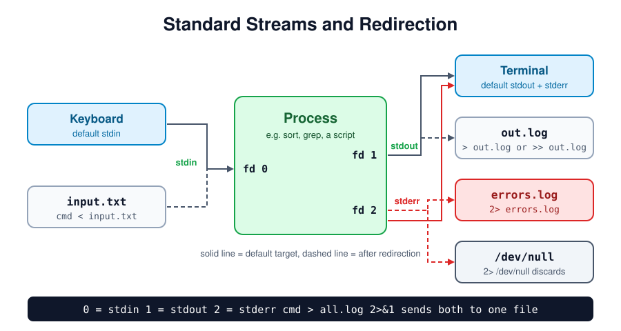

# Input/Output Redirection

Linux में stdin, stdout और stderr कैसे काम करते हैं, और उन्हें files, /dev/null, here-docs व here-strings में redirect कैसे करें।

## Standard Streams और File Descriptors

हर process तीन खुले file descriptors (fd) के साथ शुरू होता है:

| fd | नाम | Default | आम उपयोग |
| :---: | :--- | :--- | :--- |
| 0 | stdin | Keyboard | Input data |
| 1 | stdout | Terminal | सामान्य output |
| 2 | stderr | Terminal | Error और diagnostic messages |



Redirection कमांड चलने से पहले shell करता है। कमांड बस fd 1 या fd 2 पर लिखती है और उसे पता नहीं होता कि data कहाँ जा रहा है।

## Redirection Operators

| Operator | मतलब | उदाहरण |
| :--- | :--- | :--- |
| `>` | stdout फ़ाइल में (overwrite) | `ls > files.txt` |
| `>>` | stdout फ़ाइल में (append) | `date >> run.log` |
| `<` | stdin फ़ाइल से | `wc -l < users.txt` |
| `2>` | stderr फ़ाइल में | `find / -name x 2> err.txt` |
| `2>>` | stderr append | `./job.sh 2>> err.log` |
| `2>&1` | stderr वहीं जहाँ stdout जा रहा है | `cmd > all.log 2>&1` |
| `&>` | stdout और stderr दोनों फ़ाइल में (bash) | `cmd &> all.log` |
| `&>>` | दोनों, append (bash) | `cmd &>> all.log` |
| `<<EOF` | Here-document | कई lines का stdin |
| `<<<` | Here-string (bash) | `grep x <<< "$var"` |

## Output Redirection

```bash
echo "hello" > greet.txt      # create or truncate
echo "world" >> greet.txt     # append
$ cat greet.txt
hello
world
> empty.log                   # truncate a file to 0 bytes
set -o noclobber              # stop > from overwriting existing files
echo hi >| greet.txt          # force overwrite even with noclobber
```

## Input Redirection

```bash
$ wc -l < /etc/passwd          # wc gets data on stdin, prints no file name
32
sort < names.txt > sorted.txt  # input and output in one command
mysql mydb < backup.sql        # restore a database dump
```

## stderr को Redirect करना

```bash
$ ls /etc /nope
ls: cannot access '/nope': No such file or directory
/etc:
...
ls /etc /nope > out.txt 2> err.txt   # split the two streams
ls /etc /nope > all.txt 2>&1         # both into one file
find / -name "*.conf" 2> /dev/null   # hide permission errors
```

### 2>&1 में क्रम (order) मायने रखता है

`2>&1` उस **समय** fd 1 जहाँ point कर रहा है, वही copy करता है।

```bash
cmd > all.log 2>&1   # correct: stdout -> file, then stderr -> same file
cmd 2>&1 > all.log   # stderr -> terminal (old stdout), only stdout -> file
cmd 2>&1 | grep err  # send both streams into a pipe
```

## /dev/null

`/dev/null` एक special फ़ाइल है जो उसमें लिखा सब कुछ फेंक देती है और पढ़ने पर EOF लौटाती है।

```bash
command > /dev/null 2>&1          # silence completely
grep -q root /etc/passwd && echo "found"   # -q avoids needing /dev/null
```

एक classic cron line ([scheduling](../03_Processes/scheduling.md) देखें):

```bash
0 2 * * * /opt/backup.sh >> /var/log/backup.log 2>&1
```

## Here-Documents

Here-doc delimiter line आने तक कई lines stdin को देता है।

```bash
cat <<EOF > /etc/motd
Welcome to $(hostname)
Deployed on $(date +%F)
EOF

cat <<'EOF' > script.sh     # quoted delimiter: no variable expansion
echo "$HOME stays literal"
EOF

ssh web1 <<EOF              # run several commands remotely
sudo systemctl restart nginx
systemctl is-active nginx
EOF
```

`<<-EOF` शुरू के tabs हटा देता है, जो indented [shell scripts](../05_Shell_Scripting/README.md) में काम आता है।

## Here-Strings

```bash
$ grep -o "[0-9]*" <<< "build 42 passed"
42
$ read -r user host <<< "deploy web01"
$ echo "$host"
web01
$ bc <<< "scale=2; 22/7"
3.14
```

## Interview प्रश्न

**Q1. `>` और `>>` में क्या फ़र्क है?**
`>` पहले फ़ाइल को खाली (truncate) करता है; `>>` अंत में जोड़ता है।

**Q2. `cmd > out.log 2>&1` और `cmd 2>&1 > out.log` क्या करते हैं?**
पहला दोनों streams को फ़ाइल में भेजता है। दूसरा सिर्फ़ stdout को फ़ाइल में भेजता है; stderr फिर भी terminal पर जाता है।

**Q3. किसी कमांड का पूरा output कैसे discard करें?**
`cmd > /dev/null 2>&1` या bash में `cmd &> /dev/null`।

**Q4. `sort file > file` के बाद फ़ाइल खाली क्यों हो जाती है?**
`sort` के पढ़ने से पहले ही shell `file` को truncate कर देता है। Temp फ़ाइल में लिखें, या `sort -o file file` इस्तेमाल करें।

**Q5. `echo` की जगह here-doc कब इस्तेमाल करें?**
कई lines वाले input के लिए: config files, SQL, या `ssh` पर भेजी जाने वाली कमांड्स, बिना ढेर सारी `echo` lines के।
