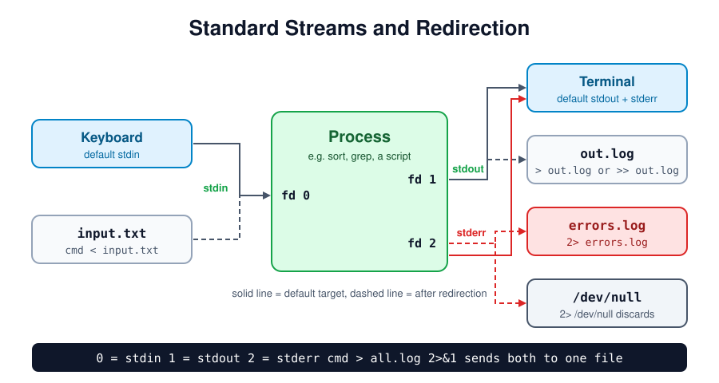

# Input/Output Redirection

Linux mein stdin, stdout aur stderr kaise kaam karte hain, aur unhe files, /dev/null, here-docs aur here-strings mein redirect kaise karein.

## Standard Streams aur File Descriptors

Har process teen open file descriptors (fd) ke saath start hota hai:

| fd | Naam | Default | Common use |
| :---: | :--- | :--- | :--- |
| 0 | stdin | Keyboard | Input data |
| 1 | stdout | Terminal | Normal output |
| 2 | stderr | Terminal | Error aur diagnostic messages |



Redirection command chalne se pehle shell karta hai. Command bas fd 1 ya fd 2 par likhti hai aur use pata nahi hota ki data kahan ja raha hai.

## Redirection Operators

| Operator | Matlab | Example |
| :--- | :--- | :--- |
| `>` | stdout file mein (overwrite) | `ls > files.txt` |
| `>>` | stdout file mein (append) | `date >> run.log` |
| `<` | stdin file se | `wc -l < users.txt` |
| `2>` | stderr file mein | `find / -name x 2> err.txt` |
| `2>>` | stderr append | `./job.sh 2>> err.log` |
| `2>&1` | stderr wahin jahan stdout ja raha hai | `cmd > all.log 2>&1` |
| `&>` | stdout aur stderr dono file mein (bash) | `cmd &> all.log` |
| `&>>` | Dono, append (bash) | `cmd &>> all.log` |
| `<<EOF` | Here-document | multi-line stdin |
| `<<<` | Here-string (bash) | `grep x <<< "$var"` |

## Output Redirection

```bash
echo "hello" > greet.txt      # create or truncate
echo "world" >> greet.txt     # append
$ cat greet.txt
hello
world
> empty.log                   # truncate a file to 0 bytes
set -o noclobber              # stop > from overwriting existing files
echo hi >| greet.txt          # force overwrite even with noclobber
```

## Input Redirection

```bash
$ wc -l < /etc/passwd          # wc gets data on stdin, prints no file name
32
sort < names.txt > sorted.txt  # input and output in one command
mysql mydb < backup.sql        # restore a database dump
```

## stderr ko Redirect Karna

```bash
$ ls /etc /nope
ls: cannot access '/nope': No such file or directory
/etc:
...
ls /etc /nope > out.txt 2> err.txt   # split the two streams
ls /etc /nope > all.txt 2>&1         # both into one file
find / -name "*.conf" 2> /dev/null   # hide permission errors
```

### 2>&1 mein order matter karta hai

`2>&1` us **waqt** fd 1 jahan point kar raha hai, wahi copy karta hai.

```bash
cmd > all.log 2>&1   # correct: stdout -> file, then stderr -> same file
cmd 2>&1 > all.log   # stderr -> terminal (old stdout), only stdout -> file
cmd 2>&1 | grep err  # send both streams into a pipe
```

## /dev/null

`/dev/null` ek special file hai jo usmein likha sab kuch phenk deti hai aur padhne par EOF return karti hai.

```bash
command > /dev/null 2>&1          # silence completely
grep -q root /etc/passwd && echo "found"   # -q avoids needing /dev/null
```

Ek classic cron line ([scheduling](../03_Processes/scheduling.md) dekhein):

```bash
0 2 * * * /opt/backup.sh >> /var/log/backup.log 2>&1
```

## Here-Documents

Here-doc delimiter line aane tak kai lines stdin ko deta hai.

```bash
cat <<EOF > /etc/motd
Welcome to $(hostname)
Deployed on $(date +%F)
EOF

cat <<'EOF' > script.sh     # quoted delimiter: no variable expansion
echo "$HOME stays literal"
EOF

ssh web1 <<EOF              # run several commands remotely
sudo systemctl restart nginx
systemctl is-active nginx
EOF
```

`<<-EOF` shuru ke tabs hata deta hai, jo indented [shell scripts](../05_Shell_Scripting/README.md) mein kaam aata hai.

## Here-Strings

```bash
$ grep -o "[0-9]*" <<< "build 42 passed"
42
$ read -r user host <<< "deploy web01"
$ echo "$host"
web01
$ bc <<< "scale=2; 22/7"
3.14
```

## Interview Questions

**Q1. `>` aur `>>` mein kya farq hai?**
`>` pehle file ko khaali (truncate) karta hai; `>>` end mein jodta hai.

**Q2. `cmd > out.log 2>&1` aur `cmd 2>&1 > out.log` kya karte hain?**
Pehla dono streams ko file mein bhejta hai. Doosra sirf stdout ko file mein bhejta hai; stderr phir bhi terminal par jaata hai.

**Q3. Kisi command ka poora output kaise discard karein?**
`cmd > /dev/null 2>&1` ya bash mein `cmd &> /dev/null`.

**Q4. `sort file > file` ke baad file khaali kyun ho jaati hai?**
`sort` ke padhne se pehle hi shell `file` ko truncate kar deta hai. Temp file mein likhein, ya `sort -o file file` use karein.

**Q5. `echo` ki jagah here-doc kab use karein?**
Multi-line input ke liye: config files, SQL, ya `ssh` par bheji jaane wali commands, bina dher saari `echo` lines ke.
