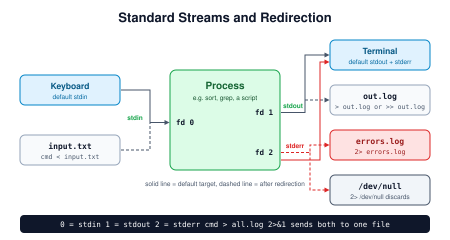

# Input/Output Redirection

How stdin, stdout and stderr work in Linux, and how to redirect them to files, /dev/null, here-docs and here-strings in scripts and on servers.

## Standard Streams and File Descriptors

Every process starts with three open file descriptors (fd):

| fd | Name | Default | Typical use |
| :---: | :--- | :--- | :--- |
| 0 | stdin | Keyboard | Input data |
| 1 | stdout | Terminal | Normal output |
| 2 | stderr | Terminal | Error and diagnostic messages |



Redirection is done by the shell before the command runs. The command itself just writes to fd 1 or fd 2 and does not know where the data goes.

## Redirection Operators

| Operator | Meaning | Example |
| :--- | :--- | :--- |
| `>` | stdout to file (overwrite) | `ls > files.txt` |
| `>>` | stdout to file (append) | `date >> run.log` |
| `<` | stdin from file | `wc -l < users.txt` |
| `2>` | stderr to file | `find / -name x 2> err.txt` |
| `2>>` | stderr append | `./job.sh 2>> err.log` |
| `2>&1` | stderr to wherever stdout goes | `cmd > all.log 2>&1` |
| `&>` | stdout and stderr to file (bash) | `cmd &> all.log` |
| `&>>` | Both, append (bash) | `cmd &>> all.log` |
| `<<EOF` | Here-document | multi-line stdin |
| `<<<` | Here-string (bash) | `grep x <<< "$var"` |

## Output Redirection

```bash
echo "hello" > greet.txt      # create or truncate
echo "world" >> greet.txt     # append
$ cat greet.txt
hello
world
> empty.log                   # truncate a file to 0 bytes
set -o noclobber              # stop > from overwriting existing files
echo hi >| greet.txt          # force overwrite even with noclobber
```

## Input Redirection

```bash
$ wc -l < /etc/passwd          # wc gets data on stdin, prints no file name
32
sort < names.txt > sorted.txt  # input and output in one command
mysql mydb < backup.sql        # restore a database dump
```

## Redirecting stderr

```bash
$ ls /etc /nope
ls: cannot access '/nope': No such file or directory
/etc:
...
ls /etc /nope > out.txt 2> err.txt   # split the two streams
ls /etc /nope > all.txt 2>&1         # both into one file
find / -name "*.conf" 2> /dev/null   # hide permission errors
```

### Order matters with 2>&1

`2>&1` copies wherever fd 1 points **at that moment**.

```bash
cmd > all.log 2>&1   # correct: stdout -> file, then stderr -> same file
cmd 2>&1 > all.log   # stderr -> terminal (old stdout), only stdout -> file
cmd 2>&1 | grep err  # send both streams into a pipe
```

## /dev/null

`/dev/null` is a special file that throws away everything written to it and returns EOF when read.

```bash
command > /dev/null 2>&1          # silence completely
grep -q root /etc/passwd && echo "found"   # -q avoids needing /dev/null
```

A classic cron line (see [scheduling](../03_Processes/scheduling.md)):

```bash
0 2 * * * /opt/backup.sh >> /var/log/backup.log 2>&1
```

## Here-Documents

A here-doc feeds multiple lines to stdin until the delimiter line.

```bash
cat <<EOF > /etc/motd
Welcome to $(hostname)
Deployed on $(date +%F)
EOF

cat <<'EOF' > script.sh     # quoted delimiter: no variable expansion
echo "$HOME stays literal"
EOF

ssh web1 <<EOF              # run several commands remotely
sudo systemctl restart nginx
systemctl is-active nginx
EOF
```

Use `<<-EOF` to strip leading tabs, handy inside indented [shell scripts](../05_Shell_Scripting/README.md).

## Here-Strings

```bash
$ grep -o "[0-9]*" <<< "build 42 passed"
42
$ read -r user host <<< "deploy web01"
$ echo "$host"
web01
$ bc <<< "scale=2; 22/7"
3.14
```

## Interview Questions

**Q1. What is the difference between `>` and `>>`?**
`>` truncates the file first; `>>` appends to the end.

**Q2. What do `cmd > out.log 2>&1` and `cmd 2>&1 > out.log` each do?**
The first sends both streams to the file. The second sends only stdout to the file; stderr still goes to the terminal.

**Q3. How do you discard all output of a command?**
`cmd > /dev/null 2>&1` or, in bash, `cmd &> /dev/null`.

**Q4. Why does `sort file > file` leave an empty file?**
The shell truncates `file` before `sort` reads it. Write to a temp file, or use `sort -o file file`.

**Q5. When would you use a here-doc instead of `echo`?**
For multi-line input: config files, SQL, or commands sent over `ssh`, without many `echo` lines.
