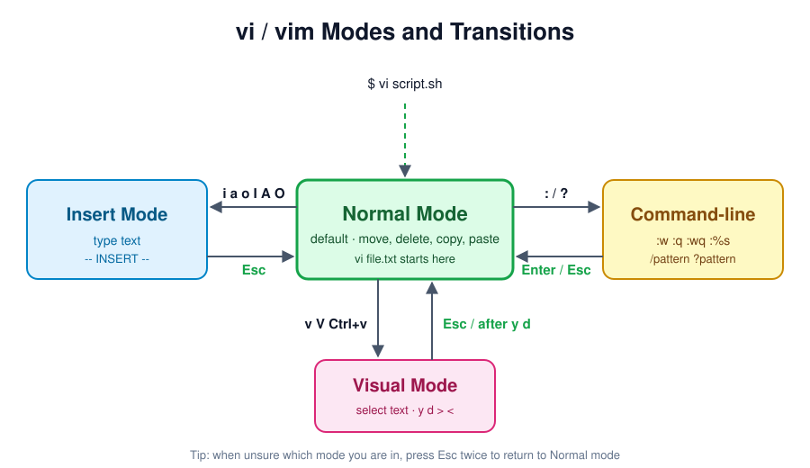

# vi और vim एडिटर

किसी भी Linux server पर vi और vim सीखें: तीन modes, cursor movement, editing, save और quit, search और replace, साथ में एक काम की cheat sheet।



## vi क्यों सीखें?

`vi` (और उसका बेहतर रूप `vim`) लगभग हर Unix/Linux system पर installed होता है, जिसमें minimal servers और containers भी शामिल हैं जहाँ `nano` नहीं होता। जब आप किसी production machine पर SSH करके config file या script ठीक करते हैं, तो अक्सर vi ही अकेला editor होता है।

```bash
vi script.sh          # फ़ाइल खोलें (या नई बनाएँ)
vim +25 app.conf      # लाइन 25 पर खोलें
vi -R /etc/passwd     # read-only खोलें (यही है: view /etc/passwd)
```

## Modes

| Mode | काम | कैसे जाएँ | कैसे निकलें |
| :--- | :--- | :--- | :--- |
| Normal (command) | Move, delete, copy, paste | शुरुआत में default; `Esc` | `i`, `:`, `v` |
| Insert | टेक्स्ट टाइप करना | `i` `a` `o` `I` `A` `O` | `Esc` |
| Command-line (ex) | Save, quit, search/replace, settings | `:` `/` `?` | `Enter` या `Esc` |
| Visual | टेक्स्ट select करके उस पर action | `v` (chars), `V` (lines), `Ctrl+v` (block) | `Esc` |

Normal mode में टाइप की गई keys commands होती हैं, टेक्स्ट नहीं। Beginners के लिए यही सबसे बड़ी उलझन है।

## Insert mode में जाना

| Key | कहाँ insert होगा |
| :--- | :--- |
| `i` / `I` | Cursor से पहले / लाइन की शुरुआत में |
| `a` / `A` | Cursor के बाद / लाइन के अंत में |
| `o` / `O` | नीचे नई लाइन / ऊपर नई लाइन |

## Cursor चलाना (Normal mode)

| Key | कहाँ जाएगा |
| :--- | :--- |
| `h` `j` `k` `l` | बाएँ, नीचे, ऊपर, दाएँ |
| `w` / `b` / `e` | अगला word / पिछला word / word का अंत |
| `0` / `^` / `$` | लाइन की शुरुआत / पहला non-blank / लाइन का अंत |
| `gg` / `G` / `42G` | पहली लाइन / आख़िरी लाइन / लाइन 42 |
| `Ctrl+f` / `Ctrl+b` | Page down / page up |
| `%` | Matching bracket `( ) { } [ ]` |

ज़्यादातर commands के साथ count दिया जा सकता है: `5j` पाँच लाइन नीचे जाता है, `3dd` तीन लाइनें delete करता है।

## Editing (Normal mode)

| Key | Action |
| :--- | :--- |
| `x` | Cursor के नीचे का character delete |
| `dd` / `dw` / `d$` | लाइन / word / लाइन के अंत तक delete |
| `yy` / `yw` | लाइन / word copy (yank) |
| `p` / `P` | Cursor के बाद / पहले paste |
| `cw` / `cc` | Word / पूरी लाइन बदलें (delete करके Insert mode) |
| `r` | एक character replace |
| `J` | अगली लाइन को मौजूदा लाइन से जोड़ें |
| `u` / `Ctrl+r` | Undo / redo |
| `.` | पिछला change दोहराएँ |
| `>>` / `<<` | लाइन indent / unindent |

## Save और quit

| Command | Action |
| :--- | :--- |
| `:w` | Save |
| `:w newname.sh` | दूसरी फ़ाइल के नाम से save |
| `:q` | Quit (unsaved changes हों तो fail) |
| `:wq` या `:x` या `ZZ` | Save करके quit |
| `:q!` | Changes छोड़कर quit |
| `:w !sudo tee %` | बिना `sudo` खोली गई फ़ाइल save करें (vim) |

## Search और replace

```text
/error          "error" को आगे की ओर खोजें   (n = अगला, N = पिछला)
?error          पीछे की ओर खोजें
*               cursor के नीचे वाला word खोजें

:s/old/new/            मौजूदा लाइन पर पहला match replace
:s/old/new/g           मौजूदा लाइन पर सारे matches replace
:%s/old/new/g          पूरी फ़ाइल में replace
:%s/old/new/gc         पूरी फ़ाइल, हर replace से पहले confirm
:10,20s/http/https/g   सिर्फ़ लाइन 10 से 20
:%s/\s\+$//e           trailing whitespace हटाएँ
```

उदाहरण: config file में हर `localhost` को `db.internal` में बदलने के लिए `:%s/localhost/db.internal/g`, फिर `:wq`।

## काम की settings

```text
:set number        line numbers दिखाएँ   (छिपाने के लिए :set nonumber)
:set paste         auto-indent गड़बड़ी के बिना paste
:syntax on         syntax highlighting (vim)
:set list          tabs और line endings दिखाएँ
```

इन्हें हमेशा के लिए `~/.vimrc` में डालें।

## Cheat sheet

| काम | Keys |
| :--- | :--- |
| टाइप करना शुरू | `i` |
| टाइप करना बंद | `Esc` |
| Save करके बाहर | `:wq` |
| बिना save बाहर | `:q!` |
| लाइन delete | `dd` |
| लाइन copy और paste | `yy` फिर `p` |
| Undo | `u` |
| लाइन 100 पर जाएँ | `100G` या `:100` |
| टेक्स्ट खोजें | `/text` फिर `n` |
| हर जगह replace | `:%s/old/new/g` |

## आम गलतियाँ

**Q1. मैंने टेक्स्ट टाइप किया और अजीब चीज़ें हुईं। क्यों?**
आप Normal mode में थे, इसलिए letters commands की तरह चले। `Esc` दबाएँ, फिर undo के लिए `u`, फिर insert के लिए `i`।

**Q2. `:q` कहता है "No write since last change"। अब क्या?**
Save करके quit के लिए `:wq` या changes छोड़ने के लिए `:q!` इस्तेमाल करें।

**Q3. Paste किए गए code में सीढ़ी जैसा indentation आ गया।**
Paste से पहले `:set paste` चलाएँ (और बाद में `:set nopaste`), या clipboard support वाले vim में `"+p` इस्तेमाल करें।

**Q4. सिर्फ़ पूरे words को replace कैसे करें?**
Word boundaries इस्तेमाल करें: `:%s/\<cat\>/dog/g` `cat` बदलता है पर `concat` नहीं।

**Q5. ".swp file already exists" warning आती है।**
कोई दूसरा vi session फ़ाइल खोले हुए है, या कोई crash हुआ था। `vi -r file` से recover करें, या पक्का होने पर `.file.swp` delete करें।
