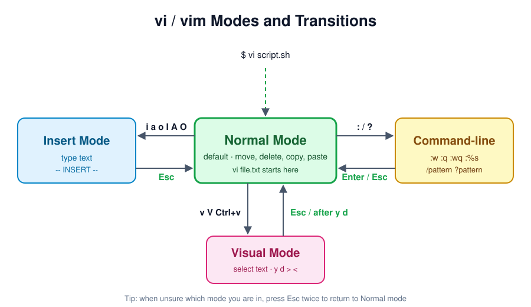

# vi aur vim Editor

Kisi bhi Linux server par vi aur vim seekhiye: teen modes, cursor movement, editing, save aur quit, search aur replace, saath mein ek handy cheat sheet.



## vi kyun seekhein?

`vi` (aur uska improved version `vim`) almost har Unix/Linux system par installed hota hai, minimal servers aur containers mein bhi jahan `nano` nahi hota. Jab aap kisi production box par SSH karke config file ya script fix karte ho, to aksar vi hi akela editor available hota hai.

```bash
vi script.sh          # file kholo (ya nayi banao)
vim +25 app.conf      # line 25 par kholo
vi -R /etc/passwd     # read-only kholo (same as: view /etc/passwd)
```

## Modes

| Mode | Kaam | Kaise enter karein | Kaise niklein |
| :--- | :--- | :--- | :--- |
| Normal (command) | Move, delete, copy, paste | Start par default; `Esc` | `i`, `:`, `v` |
| Insert | Text type karna | `i` `a` `o` `I` `A` `O` | `Esc` |
| Command-line (ex) | Save, quit, search/replace, settings | `:` `/` `?` | `Enter` ya `Esc` |
| Visual | Text select karke us par action | `v` (chars), `V` (lines), `Ctrl+v` (block) | `Esc` |

Normal mode mein type ki gayi keys commands hoti hain, text nahi. Beginners ke liye yahi sabse bada confusion hai.

## Insert mode mein jaana

| Key | Kahan insert hoga |
| :--- | :--- |
| `i` / `I` | Cursor se pehle / line ki shuruaat mein |
| `a` / `A` | Cursor ke baad / line ke end mein |
| `o` / `O` | Neeche nayi line / upar nayi line |

## Cursor move karna (Normal mode)

| Key | Kahan jaayega |
| :--- | :--- |
| `h` `j` `k` `l` | Left, down, up, right |
| `w` / `b` / `e` | Next word / previous word / word ka end |
| `0` / `^` / `$` | Line ki start / pehla non-blank / line ka end |
| `gg` / `G` / `42G` | Pehli line / last line / line 42 |
| `Ctrl+f` / `Ctrl+b` | Page down / page up |
| `%` | Matching bracket `( ) { } [ ]` |

Zyadatar commands count accept karti hain: `5j` paanch line neeche jaata hai, `3dd` teen lines delete karta hai.

## Editing (Normal mode)

| Key | Action |
| :--- | :--- |
| `x` | Cursor ke neeche ka character delete |
| `dd` / `dw` / `d$` | Line / word / line ke end tak delete |
| `yy` / `yw` | Line / word copy (yank) |
| `p` / `P` | Cursor ke baad / pehle paste |
| `cw` / `cc` | Word / poori line change (delete karke Insert mode) |
| `r` | Ek character replace |
| `J` | Agli line ko current line se join karo |
| `u` / `Ctrl+r` | Undo / redo |
| `.` | Last change repeat karo |
| `>>` / `<<` | Line indent / unindent |

## Save aur quit

| Command | Action |
| :--- | :--- |
| `:w` | Save |
| `:w newname.sh` | Doosri file ke naam se save |
| `:q` | Quit (unsaved changes hon to fail) |
| `:wq` ya `:x` ya `ZZ` | Save karke quit |
| `:q!` | Changes discard karke quit |
| `:w !sudo tee %` | Bina `sudo` kholi file save karo (vim) |

## Search aur replace

```text
/error          "error" ko aage ki taraf search karo   (n = next, N = previous)
?error          peeche ki taraf search karo
*               cursor ke neeche wala word search karo

:s/old/new/            current line par pehla match replace
:s/old/new/g           current line par saare matches replace
:%s/old/new/g          poori file mein replace
:%s/old/new/gc         poori file, har replace se pehle confirm
:10,20s/http/https/g   sirf line 10 se 20
:%s/\s\+$//e           trailing whitespace hatao
```

Example: config file mein har `localhost` ko `db.internal` banane ke liye `:%s/localhost/db.internal/g`, phir `:wq`.

## Useful settings

```text
:set number        line numbers dikhao   (hide karne ke liye :set nonumber)
:set paste         auto-indent gadbad ke bina paste
:syntax on         syntax highlighting (vim)
:set list          tabs aur line endings dikhao
```

Inhe permanent banane ke liye `~/.vimrc` mein daalo.

## Cheat sheet

| Kaam | Keys |
| :--- | :--- |
| Typing shuru | `i` |
| Typing band | `Esc` |
| Save karke exit | `:wq` |
| Bina save exit | `:q!` |
| Line delete | `dd` |
| Line copy aur paste | `yy` phir `p` |
| Undo | `u` |
| Line 100 par jao | `100G` ya `:100` |
| Text search | `/text` phir `n` |
| Har jagah replace | `:%s/old/new/g` |

## Common mistakes

**Q1. Maine text type kiya aur ajeeb cheezein hui. Kyun?**
Aap Normal mode mein the, isliye letters commands ki tarah chale. `Esc` dabao, phir undo ke liye `u`, phir insert ke liye `i`.

**Q2. `:q` bolta hai "No write since last change". Ab kya?**
Save karke quit ke liye `:wq`, ya changes discard karne ke liye `:q!` use karo.

**Q3. Paste kiye code mein seedhi jaisa indentation aa gaya.**
Paste se pehle `:set paste` chalao (aur baad mein `:set nopaste`), ya clipboard support wale vim mein `"+p` use karo.

**Q4. Sirf poore words ko replace kaise karein?**
Word boundaries use karo: `:%s/\<cat\>/dog/g` `cat` ko badalta hai par `concat` ko nahi.

**Q5. ".swp file already exists" warning aati hai.**
Koi doosra vi session file khole hue hai, ya koi crash hua tha. `vi -r file` se recover karo, ya pakka hone par `.file.swp` delete karo.
