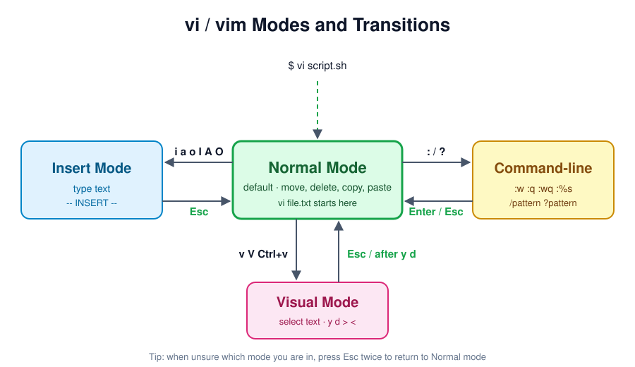

# The vi and vim Editor

Master vi and vim on any Linux server: the three modes, cursor movement, editing, saving, quitting, search and replace, plus a handy cheat sheet.



## Why learn vi?

`vi` (and its improved version `vim`) is installed on almost every Unix/Linux system, including minimal servers and containers where `nano` may be missing. When you SSH into a production box to fix a config file or a script, vi is often the only editor available.

```bash
vi script.sh          # open (or create) a file
vim +25 app.conf      # open at line 25
vi -R /etc/passwd     # open read-only (same as: view /etc/passwd)
```

## The modes

| Mode | Purpose | How to enter | How to leave |
| :--- | :--- | :--- | :--- |
| Normal (command) | Move, delete, copy, paste | Default on start; `Esc` | `i`, `:`, `v` |
| Insert | Type text | `i` `a` `o` `I` `A` `O` | `Esc` |
| Command-line (ex) | Save, quit, search/replace, settings | `:` `/` `?` | `Enter` or `Esc` |
| Visual | Select text, then act on it | `v` (chars), `V` (lines), `Ctrl+v` (block) | `Esc` |

Keys you type in Normal mode are commands, not text. That is the number one source of confusion for beginners.

## Entering Insert mode

| Key | Inserts |
| :--- | :--- |
| `i` / `I` | Before the cursor / at start of line |
| `a` / `A` | After the cursor / at end of line |
| `o` / `O` | New line below / above |

## Moving the cursor (Normal mode)

| Key | Moves to |
| :--- | :--- |
| `h` `j` `k` `l` | Left, down, up, right |
| `w` / `b` / `e` | Next word / previous word / end of word |
| `0` / `^` / `$` | Start of line / first non-blank / end of line |
| `gg` / `G` / `42G` | First line / last line / line 42 |
| `Ctrl+f` / `Ctrl+b` | Page down / page up |
| `%` | Matching bracket `( ) { } [ ]` |

Most commands accept a count: `5j` moves down five lines, `3dd` deletes three lines.

## Editing (Normal mode)

| Key | Action |
| :--- | :--- |
| `x` | Delete character under cursor |
| `dd` / `dw` / `d$` | Delete line / word / to end of line |
| `yy` / `yw` | Copy (yank) line / word |
| `p` / `P` | Paste after / before cursor |
| `cw` / `cc` | Change word / whole line (deletes, then Insert mode) |
| `r` | Replace one character |
| `J` | Join next line to current |
| `u` / `Ctrl+r` | Undo / redo |
| `.` | Repeat last change |
| `>>` / `<<` | Indent / unindent line |

## Saving and quitting

| Command | Action |
| :--- | :--- |
| `:w` | Save |
| `:w newname.sh` | Save as another file |
| `:q` | Quit (fails if there are unsaved changes) |
| `:wq` or `:x` or `ZZ` | Save and quit |
| `:q!` | Quit and discard changes |
| `:w !sudo tee %` | Save a file you opened without `sudo` (vim) |

## Search and replace

```text
/error          search forward for "error"   (n = next, N = previous)
?error          search backward
*               search for the word under the cursor

:s/old/new/            replace first match on current line
:s/old/new/g           replace all matches on current line
:%s/old/new/g          replace in the whole file
:%s/old/new/gc         whole file, ask to confirm each one
:10,20s/http/https/g   only lines 10 to 20
:%s/\s\+$//e           remove trailing whitespace
```

Example: switch every `localhost` to `db.internal` in a config file with `:%s/localhost/db.internal/g`, then `:wq`.

## Useful settings

```text
:set number        show line numbers   (:set nonumber to hide)
:set paste         paste without auto-indent mess
:syntax on         syntax highlighting (vim)
:set list          show tabs and line endings
```

Put them in `~/.vimrc` to make them permanent.

## Cheat sheet

| Task | Keys |
| :--- | :--- |
| Start typing | `i` |
| Stop typing | `Esc` |
| Save and exit | `:wq` |
| Exit without saving | `:q!` |
| Delete line | `dd` |
| Copy and paste line | `yy` then `p` |
| Undo | `u` |
| Go to line 100 | `100G` or `:100` |
| Find text | `/text` then `n` |
| Replace everywhere | `:%s/old/new/g` |

## Common mistakes

**Q1. I typed text and strange things happened. Why?**
You were in Normal mode, so letters ran as commands. Press `Esc`, then `u` to undo, then `i` to insert.

**Q2. `:q` says "No write since last change". What now?**
Use `:wq` to save and quit, or `:q!` to discard your changes.

**Q3. Pasted code has a staircase of indentation.**
Run `:set paste` before pasting (and `:set nopaste` after), or use `"+p` in vim with clipboard support.

**Q4. How do I replace only whole words?**
Use word boundaries: `:%s/\<cat\>/dog/g` replaces `cat` but not `concat`.

**Q5. A ".swp file already exists" warning appears.**
Another vi session has the file open, or one crashed. Recover with `vi -r file`, or delete the `.file.swp` once you are sure.
