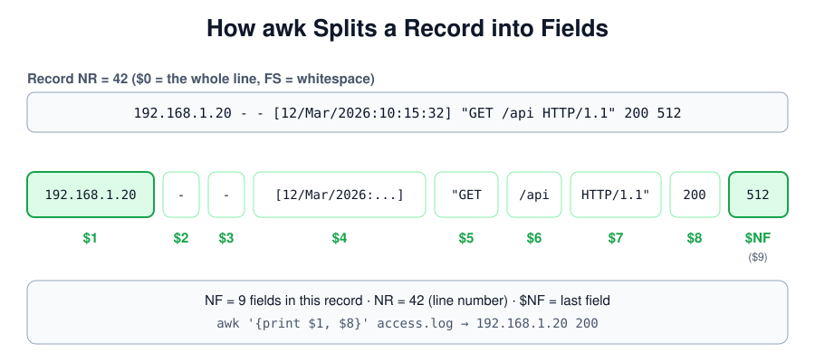

# awk: फ़ील्ड, पैटर्न और रिपोर्ट

awk हर लाइन को फ़ील्ड में बाँटता है ताकि आप लॉग, CSV फ़ाइलों और कमांड आउटपुट के columns को filter, count, sum और format कर सकें।

## awk क्या करता है

`awk` टेक्स्ट के लिए एक छोटी प्रोग्रामिंग भाषा है। यह input को एक बार में एक **record** (लाइन) पढ़ता है, उसे **fields** (columns) में बाँटता है और उस पर `pattern { action }` नियम चलाता है। जब columns, totals या जल्दी से एक report चाहिए, तो यही सबसे सही टूल है।

```bash
awk 'pattern { action }' file
command | awk '{ print $1 }'
```

## Records और Fields



| Variable | अर्थ |
| :--- | :--- |
| `$0` | पूरी मौजूदा लाइन |
| `$1`, `$2`, ... | Field 1, field 2, ... |
| `$NF` | आख़िरी field (`$(NF-1)` उससे पहले वाला) |
| `NF` | मौजूदा लाइन में fields की संख्या |
| `NR` | मौजूदा लाइन (record) नंबर |
| `FS` | Input field separator (डिफ़ॉल्ट: spaces/tabs) |
| `OFS` | Output field separator (डिफ़ॉल्ट: एक space) |

```bash
$ echo "alice 30 dev" | awk '{print $1, $NF, NF}'
alice dev 3
```

## Field Separator: -F

```bash
awk -F: '{print $1, $7}' /etc/passwd        # user and login shell
awk -F, '{print $2}' users.csv              # second CSV column
awk 'BEGIN{FS=":"; OFS=" -> "} {print $1, $6}' /etc/passwd
```

## Patterns और Actions

Pattern तय करता है **कौन सी** लाइनें; action तय करता है **क्या** करना है। Pattern छोड़ दें तो हर लाइन पर चलेगा; action छोड़ दें तो लाइन print होगी।

```bash
awk '/ERROR/' app.log                 # regex pattern, default action = print
awk '$3 > 80 {print $1}' usage.txt    # comparison on a field
awk 'NR==1' file                      # first line only
awk 'NR>1' data.csv                   # skip the header
awk 'NF' file                         # skip empty lines (NF is 0)
awk '$9 ~ /^5/' access.log            # field matches regex
```

## BEGIN और END

`BEGIN` कोई भी input पढ़ने से पहले एक बार चलता है, `END` आख़िरी लाइन के बाद एक बार।

```bash
awk 'BEGIN {print "User Shell"} {print $1, $7} END {print NR " users"}' FS=: /etc/passwd
```

## print बनाम printf

`print` items के बीच `OFS` और अंत में newline जोड़ता है। `printf` पूरा नियंत्रण देता है और newline **नहीं** जोड़ता।

```bash
awk -F: '{print $1, $3}' /etc/passwd
awk -F: '{printf "%-15s %5d\n", $1, $3}' /etc/passwd
```

| Format | अर्थ |
| :--- | :--- |
| `%s` | String |
| `%d` | Integer |
| `%.2f` | 2 दशमलव वाली संख्या |
| `%-15s` | Left-aligned, 15 चौड़ा |

## Variables और Arrays

Variables को declare करने की ज़रूरत नहीं, वे 0 या खाली से शुरू होते हैं। गिनती के लिए associative arrays सबसे अच्छे हैं।

```bash
# Count lines per log level
awk '{count[$3]++} END {for (lvl in count) print lvl, count[lvl]}' app.log
```

## असली उदाहरण

```bash
# Top 5 client IPs in an nginx access log
awk '{print $1}' /var/log/nginx/access.log | sort | uniq -c | sort -rn | head -5

# Same, done inside awk
awk '{ip[$1]++} END {for (i in ip) print ip[i], i}' access.log | sort -rn | head -5

# Count requests by HTTP status (field 9 in the combined log format)
awk '{s[$9]++} END {for (c in s) print c, s[c]}' access.log

# Total bytes sent (field 10)
awk '{sum += $10} END {print sum/1024/1024 " MB"}' access.log

# Sum and average a CSV column, skipping the header
awk -F, 'NR>1 {total += $3; n++} END {printf "total=%d avg=%.2f\n", total, total/n}' sales.csv

# Processes using more than 5% memory
ps aux | awk 'NR>1 && $4 > 5 {print $2, $4, $11}'

# Filesystems over 80% full
df -h | awk 'NR>1 {gsub("%","",$5); if ($5 > 80) print $6, $5"%"}'
```

Top IPs वाली command का नमूना आउटपुट:

```bash
   1520 192.168.1.20
    874 10.0.0.5
    233 172.16.4.9
```

ध्यान दें: असली nginx लॉग में timezone field (`+0000]`) भी होता है, इसलिए status `$9` और bytes `$10` हैं, यानी diagram से एक ज़्यादा। `sort` और `uniq` के लिए देखें [filters और pipes](../04_Commands/filters-and-pipes.md)।

## इंटरव्यू प्रश्न

**Q: `NR` और `NF` में क्या अंतर है?**
A: `NR` पूरे input में मौजूदा लाइन नंबर है; `NF` मौजूदा लाइन में fields की संख्या है।

**Q: हर लाइन का आख़िरी column कैसे print करें?**
A: `awk '{print $NF}' file`।

**Q: `awk -F, '{print $1 $2}'` fields को चिपका क्यों देता है?**
A: Comma के बिना `OFS` नहीं लगता। `print $1, $2` इस्तेमाल करें।

**Q: sed की जगह awk कब चुनें?**
A: जब काम columns, numbers या गिनती (sum, average, group-by) का हो। Substitution और line edits के लिए sed बेहतर है।

**Q: `BEGIN` और `END` blocks क्या करते हैं?**
A: `BEGIN` input से पहले चलता है (`FS` सेट करना, header print करना); `END` input के बाद चलता है (totals print करना)।
