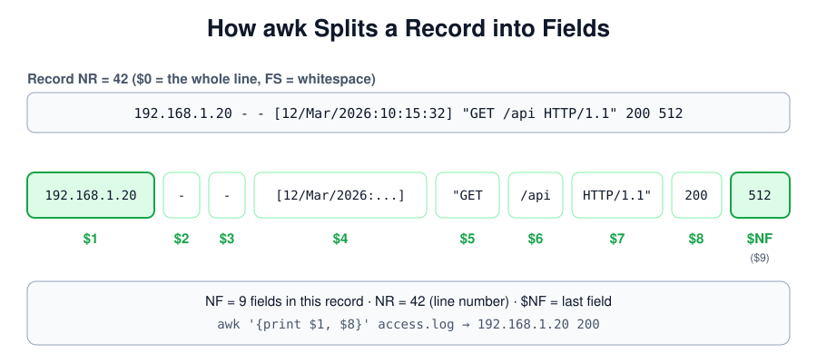

# awk: Fields, Patterns aur Reports

awk har line ko fields mein todta hai taaki tum logs, CSV files aur command output ke columns ko filter, count, sum aur format kar sako.

## awk kya karta hai

`awk` text ke liye ek chhoti programming language hai. Ye input ko ek time pe ek **record** (line) padhta hai, use **fields** (columns) mein split karta hai aur us pe `pattern { action }` rules chalata hai. Jab columns, totals ya ek quick report chahiye, tab yahi go-to tool hai.

```bash
awk 'pattern { action }' file
command | awk '{ print $1 }'
```

## Records aur Fields



| Variable | Matlab |
| :--- | :--- |
| `$0` | Poori current line |
| `$1`, `$2`, ... | Field 1, field 2, ... |
| `$NF` | Last field (`$(NF-1)` usse pehle wala) |
| `NF` | Current line mein fields ki ginti |
| `NR` | Current line (record) number |
| `FS` | Input field separator (default: spaces/tabs) |
| `OFS` | Output field separator (default: ek space) |

```bash
$ echo "alice 30 dev" | awk '{print $1, $NF, NF}'
alice dev 3
```

## Field Separator: -F

```bash
awk -F: '{print $1, $7}' /etc/passwd        # user and login shell
awk -F, '{print $2}' users.csv              # second CSV column
awk 'BEGIN{FS=":"; OFS=" -> "} {print $1, $6}' /etc/passwd
```

## Patterns aur Actions

Pattern decide karta hai **kaun si** lines; action decide karta hai **kya** karna hai. Pattern chhod do toh har line pe chalega; action chhod do toh line print hogi.

```bash
awk '/ERROR/' app.log                 # regex pattern, default action = print
awk '$3 > 80 {print $1}' usage.txt    # comparison on a field
awk 'NR==1' file                      # first line only
awk 'NR>1' data.csv                   # skip the header
awk 'NF' file                         # skip empty lines (NF is 0)
awk '$9 ~ /^5/' access.log            # field matches regex
```

## BEGIN aur END

`BEGIN` koi bhi input padhne se pehle ek baar chalta hai, `END` last line ke baad ek baar.

```bash
awk 'BEGIN {print "User Shell"} {print $1, $7} END {print NR " users"}' FS=: /etc/passwd
```

## print vs printf

`print` items ke beech `OFS` aur end mein newline lagata hai. `printf` full control deta hai aur newline **nahi** lagata.

```bash
awk -F: '{print $1, $3}' /etc/passwd
awk -F: '{printf "%-15s %5d\n", $1, $3}' /etc/passwd
```

| Format | Matlab |
| :--- | :--- |
| `%s` | String |
| `%d` | Integer |
| `%.2f` | 2 decimals wala number |
| `%-15s` | Left-aligned, 15 wide |

## Variables aur Arrays

Variables ko declare nahi karna padta, ye 0 ya empty se shuru hote hain. Counting ke liye associative arrays best hain.

```bash
# Count lines per log level
awk '{count[$3]++} END {for (lvl in count) print lvl, count[lvl]}' app.log
```

## Real Examples

```bash
# Top 5 client IPs in an nginx access log
awk '{print $1}' /var/log/nginx/access.log | sort | uniq -c | sort -rn | head -5

# Same, done inside awk
awk '{ip[$1]++} END {for (i in ip) print ip[i], i}' access.log | sort -rn | head -5

# Count requests by HTTP status (field 9 in the combined log format)
awk '{s[$9]++} END {for (c in s) print c, s[c]}' access.log

# Total bytes sent (field 10)
awk '{sum += $10} END {print sum/1024/1024 " MB"}' access.log

# Sum and average a CSV column, skipping the header
awk -F, 'NR>1 {total += $3; n++} END {printf "total=%d avg=%.2f\n", total, total/n}' sales.csv

# Processes using more than 5% memory
ps aux | awk 'NR>1 && $4 > 5 {print $2, $4, $11}'

# Filesystems over 80% full
df -h | awk 'NR>1 {gsub("%","",$5); if ($5 > 80) print $6, $5"%"}'
```

Top IPs wali command ka sample output:

```bash
   1520 192.168.1.20
    874 10.0.0.5
    233 172.16.4.9
```

Dhyan do: real nginx log mein timezone field (`+0000]`) bhi hota hai, isliye status `$9` aur bytes `$10` hain, yaani diagram se ek zyada. `sort` aur `uniq` ke liye dekho [filters aur pipes](../04_Commands/filters-and-pipes.md).

## Interview Questions

**Q: `NR` aur `NF` mein kya difference hai?**
A: `NR` poore input mein current line number hai; `NF` current line mein fields ki ginti hai.

**Q: Har line ka last column kaise print karein?**
A: `awk '{print $NF}' file`.

**Q: `awk -F, '{print $1 $2}'` fields ko chipka kyun deta hai?**
A: Comma ke bina `OFS` nahi lagta. `print $1, $2` use karo.

**Q: sed ki jagah awk kab choose karein?**
A: Jab kaam columns, numbers ya counting (sum, average, group-by) ka ho. Substitution aur line edits ke liye sed better hai.

**Q: `BEGIN` aur `END` blocks kya karte hain?**
A: `BEGIN` input se pehle chalta hai (`FS` set karna, header print karna); `END` input ke baad chalta hai (totals print karna).
