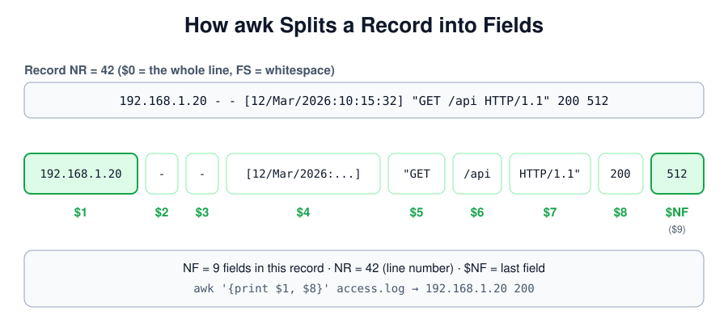

# awk: Fields, Patterns and Reports

awk splits each line into fields so you can filter, count, sum and format columns of logs, CSV files and command output.

## What awk Does

`awk` is a small programming language for text. It reads input one **record** (line) at a time, splits it into **fields** (columns), and runs `pattern { action }` rules on it. It is the go-to tool when you need columns, totals or a quick report.

```bash
awk 'pattern { action }' file
command | awk '{ print $1 }'
```

## Records and Fields



| Variable | Meaning |
| :--- | :--- |
| `$0` | The whole current line |
| `$1`, `$2`, ... | Field 1, field 2, ... |
| `$NF` | The last field (`$(NF-1)` is the one before) |
| `NF` | Number of fields in the current line |
| `NR` | Current line (record) number |
| `FS` | Input field separator (default: spaces/tabs) |
| `OFS` | Output field separator (default: one space) |

```bash
$ echo "alice 30 dev" | awk '{print $1, $NF, NF}'
alice dev 3
```

## Field Separator: -F

```bash
awk -F: '{print $1, $7}' /etc/passwd        # user and login shell
awk -F, '{print $2}' users.csv              # second CSV column
awk 'BEGIN{FS=":"; OFS=" -> "} {print $1, $6}' /etc/passwd
```

## Patterns and Actions

A pattern decides **which** lines; the action decides **what** to do. Leave out the pattern to run on every line; leave out the action to print the line.

```bash
awk '/ERROR/' app.log                 # regex pattern, default action = print
awk '$3 > 80 {print $1}' usage.txt    # comparison on a field
awk 'NR==1' file                      # first line only
awk 'NR>1' data.csv                   # skip the header
awk 'NF' file                         # skip empty lines (NF is 0)
awk '$9 ~ /^5/' access.log            # field matches regex
```

## BEGIN and END

`BEGIN` runs once before any input is read, `END` runs once after the last line.

```bash
awk 'BEGIN {print "User Shell"} {print $1, $7} END {print NR " users"}' FS=: /etc/passwd
```

## print vs printf

`print` adds `OFS` between items and a newline at the end. `printf` gives full control and does **not** add a newline.

```bash
awk -F: '{print $1, $3}' /etc/passwd
awk -F: '{printf "%-15s %5d\n", $1, $3}' /etc/passwd
```

| Format | Meaning |
| :--- | :--- |
| `%s` | String |
| `%d` | Integer |
| `%.2f` | Number with 2 decimals |
| `%-15s` | Left-aligned, 15 wide |

## Variables and Arrays

Variables need no declaration and start as 0 or empty. Associative arrays are ideal for counting.

```bash
# Count lines per log level
awk '{count[$3]++} END {for (lvl in count) print lvl, count[lvl]}' app.log
```

## Real Examples

```bash
# Top 5 client IPs in an nginx access log
awk '{print $1}' /var/log/nginx/access.log | sort | uniq -c | sort -rn | head -5

# Same, done inside awk
awk '{ip[$1]++} END {for (i in ip) print ip[i], i}' access.log | sort -rn | head -5

# Count requests by HTTP status (field 9 in the combined log format)
awk '{s[$9]++} END {for (c in s) print c, s[c]}' access.log

# Total bytes sent (field 10)
awk '{sum += $10} END {print sum/1024/1024 " MB"}' access.log

# Sum and average a CSV column, skipping the header
awk -F, 'NR>1 {total += $3; n++} END {printf "total=%d avg=%.2f\n", total, total/n}' sales.csv

# Processes using more than 5% memory
ps aux | awk 'NR>1 && $4 > 5 {print $2, $4, $11}'

# Filesystems over 80% full
df -h | awk 'NR>1 {gsub("%","",$5); if ($5 > 80) print $6, $5"%"}'
```

Sample output of the top IPs command:

```bash
   1520 192.168.1.20
    874 10.0.0.5
    233 172.16.4.9
```

Note: the real nginx log has a timezone field (`+0000]`), so status is `$9` and bytes are `$10`, one more than in the diagram. See [filters and pipes](../04_Commands/filters-and-pipes.md) for `sort` and `uniq`.

## Interview Questions

**Q: What is the difference between `NR` and `NF`?**
A: `NR` is the current line number across the input; `NF` is the number of fields in the current line.

**Q: How do you print the last column of every line?**
A: `awk '{print $NF}' file`.

**Q: Why does `awk -F, '{print $1 $2}'` glue the fields together?**
A: Without a comma there is no `OFS`. Use `print $1, $2`.

**Q: When would you choose awk over sed?**
A: When the job is about columns, numbers or counting (sums, averages, group-by). sed is better for substitutions and line edits.

**Q: What do `BEGIN` and `END` blocks do?**
A: `BEGIN` runs before input (set `FS`, print headers); `END` runs after input (print totals).
