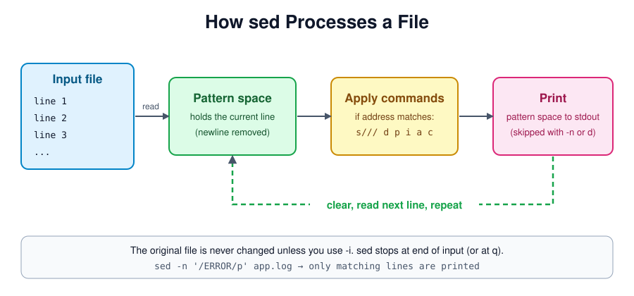

# sed: स्ट्रीम एडिटर

sed बिना एडिटर खोले टेक्स्ट को लाइन-दर-लाइन बदलता है: फ़ाइलों, pipes और scripts में लाइनें replace, delete, insert और print करता है।

## sed क्या करता है

`sed` (stream editor) input को एक बार में एक लाइन पढ़ता है, आपकी commands लागू करता है और नतीजा standard output पर लिखता है। यह scripts, CI pipelines और Dockerfiles में automated edits के लिए बढ़िया है, जहाँ कोई [vi](../05_Shell_Scripting/vi-editor.md) नहीं खोल सकता।

```bash
sed [options] 'commands' file...
command | sed 'commands'
```

## sed कैसे काम करता है



1. एक लाइन को **pattern space** (एक buffer) में पढ़ो।
2. हर वह command चलाओ जिसका address उस लाइन से मैच करता है।
3. Pattern space को print करो (जब तक `-n` न लगा हो या लाइन delete न हुई हो)।
4. उसे खाली करो और अगली लाइन के साथ दोहराओ।

जब तक आप `-i` इस्तेमाल न करें, input फ़ाइल नहीं बदलती।

## Addressing

Address तय करता है कि command किन लाइनों पर लागू होगी। Address न हो तो हर लाइन पर।

| Address | क्या चुनता है | उदाहरण |
| :--- | :--- | :--- |
| `N` | लाइन N | `sed -n '5p'` |
| `$` | आख़िरी लाइन | `sed -n '$p'` |
| `N,M` | लाइन N से M तक | `sed '2,4d'` |
| `/re/` | Regex से मैच होने वाली लाइनें | `sed '/^#/d'` |
| `/a/,/b/` | `a` के मैच से `b` के मैच तक | `sed -n '/BEGIN/,/END/p'` |
| `N,+K` | लाइन N और उसके बाद की K लाइनें (GNU) | `sed -n '10,+2p'` |
| `addr!` | हर वह लाइन जो मैच नहीं करती | `sed '/^#/!d'` |

## बुनियादी Commands

| Command | काम | उदाहरण |
| :--- | :--- | :--- |
| `p` | लाइन print करो | `sed -n '/ERROR/p' app.log` |
| `d` | लाइन delete करो | `sed '/^$/d' file` |
| `i text` | लाइन से पहले text डालो | `sed '1i # header' file` |
| `a text` | लाइन के बाद text जोड़ो | `sed '/^\[main\]/a debug=true' app.ini` |
| `c text` | पूरी लाइन बदल दो | `sed '/^PORT=/c PORT=9090' .env` |
| `q` | बाहर निकलो | `sed '10q' file` (`head` जैसा) |

### -n Option

डिफ़ॉल्ट रूप से sed हर लाइन print करता है। `-n` इसे बंद करता है, इसलिए सिर्फ़ वही लाइनें दिखती हैं जिन्हें आप `p` से print करें:

```bash
sed -n '3,5p' /etc/passwd      # print lines 3-5 only
sed -n '/nginx/p' /etc/passwd  # behaves like grep nginx
```

## Substitution: s///

```bash
sed 's/old/new/' file          # first match on each line
sed 's/old/new/g' file         # every match on each line
sed 's/old/new/2' file         # only the 2nd match
sed 's/error/ERROR/gI' file    # global + case-insensitive (GNU)
sed -n 's/foo/bar/p' file      # print only lines that changed
```

| Flag | अर्थ |
| :--- | :--- |
| `g` | लाइन के सभी मैच बदलो |
| `N` | सिर्फ़ N-वाँ मैच बदलो |
| `p` | Replacement हुआ हो तो लाइन print करो |
| `I` | Case ignore करो (GNU) |

जब text में slash हों तो दूसरा delimiter लें, और मैच हुए text को दोबारा इस्तेमाल करने के लिए `&` / `\1` लें:

```bash
sed 's|/var/www|/srv/www|g' nginx.conf
sed 's/[0-9]\+/[&]/' file                       # & = the whole match
sed -E 's/([a-z]+)@([a-z.]+)/\2 user \1/' emails # \1 \2 = groups
```

## -i से In-place Editing

```bash
sed -i 's/8080/9090/' app.conf          # edit the file directly
sed -i.bak 's/8080/9090/' app.conf      # keep app.conf.bak as backup
```

हमेशा पहले बिना `-i` के चलाकर आउटपुट जाँचें। macOS/BSD sed में `-i` को argument चाहिए: `sed -i '' 's/a/b/' file`।

## -f से sed Scripts

कई commands एक फ़ाइल में रखें, हर लाइन में एक:

```bash
$ cat cleanup.sed
/^[[:space:]]*#/d
/^$/d
s/[[:space:]]\+$//
$ sed -f cleanup.sed app.conf
```

Commands को `-e` या `;` से भी जोड़ सकते हैं: `sed -e '/^#/d' -e 's/foo/bar/'`।

## असली उदाहरण

```bash
# Change a config value in place (keep a backup)
sed -i.bak 's/^max_connections = .*/max_connections = 500/' postgresql.conf

# Comment out a line in sshd_config
sudo sed -i 's/^PermitRootLogin yes/#&/' /etc/ssh/sshd_config

# Remove ANSI colour codes from a CI log
sed -E 's/\x1b\[[0-9;]*m//g' build.log > build-clean.log

# Mask passwords before sharing a log
sed -E 's/(password=)[^ &]+/\1****/g' app.log

# Show only one time window of a log
sed -n '/10:00:00/,/10:05:00/p' app.log

# Replace a placeholder in a template during deployment
sed "s/__VERSION__/$VERSION/" deploy.tpl.yaml > deploy.yaml
```

आख़िरी उदाहरण में double quotes पर ध्यान दें: इनसे shell `$VERSION` को expand कर पाता है। देखें [variables](../05_Shell_Scripting/variables.md)।

## इंटरव्यू प्रश्न

**Q: Pattern space क्या है?**
A: वह buffer जिसमें sed commands चलते समय मौजूदा लाइन रखता है। हर cycle के अंत में यह print होता है, जब तक `-n` न लगा हो या लाइन delete न हुई हो।

**Q: `sed -n 's/a/b/'` कुछ भी print क्यों नहीं करता?**
A: `-n` automatic printing बंद कर देता है। `p` flag जोड़ें: `sed -n 's/a/b/p'`।

**Q: फ़ाइल को सुरक्षित तरीके से in place कैसे edit करें?**
A: पहले command बिना `-i` के चलाएँ, फिर `sed -i.bak` इस्तेमाल करें ताकि backup बना रहे।

**Q: `/` वाला path कैसे replace करें?**
A: दूसरा delimiter इस्तेमाल करें, जैसे `sed 's|/old/path|/new/path|g'`।

**Q: `sed '/x/d'` और `grep -v x` में क्या अंतर है?**
A: आउटपुट एक जैसा है, लेकिन sed delete के साथ दूसरे edits भी एक ही pass में कर सकता है और फ़ाइल को in place बदल सकता है।
