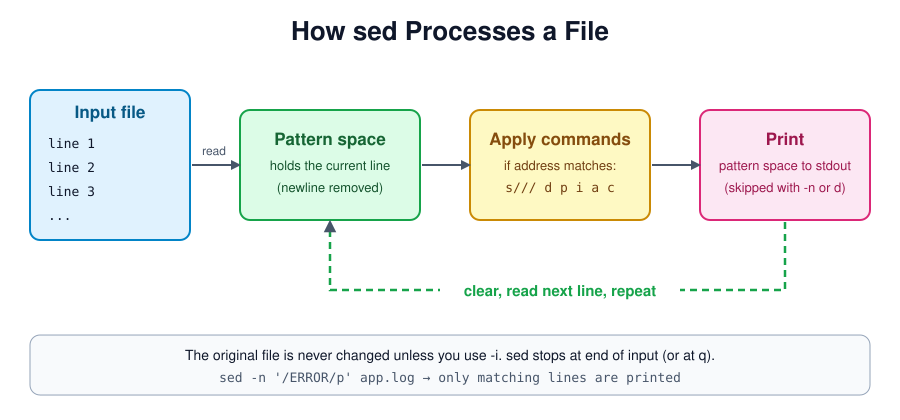

# sed: Stream Editor

sed bina editor khole text ko line by line badalta hai: files, pipes aur scripts mein lines replace, delete, insert aur print karta hai.

## sed kya karta hai

`sed` (stream editor) input ko ek time pe ek line padhta hai, tumhari commands apply karta hai aur result standard output pe likhta hai. Ye scripts, CI pipelines aur Dockerfiles mein automated edits ke liye perfect hai, jahan koi [vi](../05_Shell_Scripting/vi-editor.md) nahi khol sakta.

```bash
sed [options] 'commands' file...
command | sed 'commands'
```

## sed kaise kaam karta hai



1. Ek line ko **pattern space** (ek buffer) mein padho.
2. Har woh command chalao jiska address us line se match karta hai.
3. Pattern space ko print karo (jab tak `-n` na laga ho ya line delete na hui ho).
4. Use clear karo aur next line ke saath repeat karo.

Jab tak `-i` use nahi karte, input file change nahi hoti.

## Addressing

Address decide karta hai ki command kin lines pe lagegi. Address na ho toh har line pe.

| Address | Kya select karta hai | Example |
| :--- | :--- | :--- |
| `N` | Line N | `sed -n '5p'` |
| `$` | Last line | `sed -n '$p'` |
| `N,M` | Line N se M tak | `sed '2,4d'` |
| `/re/` | Regex se match hone wali lines | `sed '/^#/d'` |
| `/a/,/b/` | `a` ke match se `b` ke match tak | `sed -n '/BEGIN/,/END/p'` |
| `N,+K` | Line N aur uske baad ki K lines (GNU) | `sed -n '10,+2p'` |
| `addr!` | Har woh line jo match NAHI karti | `sed '/^#/!d'` |

## Basic Commands

| Command | Kaam | Example |
| :--- | :--- | :--- |
| `p` | Line print karo | `sed -n '/ERROR/p' app.log` |
| `d` | Line delete karo | `sed '/^$/d' file` |
| `i text` | Line se pehle text daalo | `sed '1i # header' file` |
| `a text` | Line ke baad text jodo | `sed '/^\[main\]/a debug=true' app.ini` |
| `c text` | Poori line replace karo | `sed '/^PORT=/c PORT=9090' .env` |
| `q` | Quit | `sed '10q' file` (`head` jaisa) |

### -n Option

Default mein sed har line print karta hai. `-n` ise band kar deta hai, toh sirf wahi lines dikhti hain jo tum `p` se print karo:

```bash
sed -n '3,5p' /etc/passwd      # print lines 3-5 only
sed -n '/nginx/p' /etc/passwd  # behaves like grep nginx
```

## Substitution: s///

```bash
sed 's/old/new/' file          # first match on each line
sed 's/old/new/g' file         # every match on each line
sed 's/old/new/2' file         # only the 2nd match
sed 's/error/ERROR/gI' file    # global + case-insensitive (GNU)
sed -n 's/foo/bar/p' file      # print only lines that changed
```

| Flag | Matlab |
| :--- | :--- |
| `g` | Line ke saare matches replace karo |
| `N` | Sirf Nth match replace karo |
| `p` | Replacement hua ho toh line print karo |
| `I` | Case ignore karo (GNU) |

Jab text mein slashes hon toh dusra delimiter use karo, aur matched text reuse karne ke liye `&` / `\1` use karo:

```bash
sed 's|/var/www|/srv/www|g' nginx.conf
sed 's/[0-9]\+/[&]/' file                       # & = the whole match
sed -E 's/([a-z]+)@([a-z.]+)/\2 user \1/' emails # \1 \2 = groups
```

## -i se In-place Editing

```bash
sed -i 's/8080/9090/' app.conf          # edit the file directly
sed -i.bak 's/8080/9090/' app.conf      # keep app.conf.bak as backup
```

Hamesha pehle bina `-i` ke chala ke output check karo. macOS/BSD sed mein `-i` ko argument chahiye: `sed -i '' 's/a/b/' file`.

## -f se sed Scripts

Kai commands ek file mein rakho, har line mein ek:

```bash
$ cat cleanup.sed
/^[[:space:]]*#/d
/^$/d
s/[[:space:]]\+$//
$ sed -f cleanup.sed app.conf
```

Commands ko `-e` ya `;` se bhi chain kar sakte ho: `sed -e '/^#/d' -e 's/foo/bar/'`.

## Real Examples

```bash
# Change a config value in place (keep a backup)
sed -i.bak 's/^max_connections = .*/max_connections = 500/' postgresql.conf

# Comment out a line in sshd_config
sudo sed -i 's/^PermitRootLogin yes/#&/' /etc/ssh/sshd_config

# Remove ANSI colour codes from a CI log
sed -E 's/\x1b\[[0-9;]*m//g' build.log > build-clean.log

# Mask passwords before sharing a log
sed -E 's/(password=)[^ &]+/\1****/g' app.log

# Show only one time window of a log
sed -n '/10:00:00/,/10:05:00/p' app.log

# Replace a placeholder in a template during deployment
sed "s/__VERSION__/$VERSION/" deploy.tpl.yaml > deploy.yaml
```

Last example mein double quotes dekho: inki wajah se shell `$VERSION` ko expand kar pata hai. Dekho [variables](../05_Shell_Scripting/variables.md).

## Interview Questions

**Q: Pattern space kya hai?**
A: Woh buffer jisme sed commands chalte waqt current line rakhta hai. Har cycle ke end mein ye print hota hai, jab tak `-n` na laga ho ya line delete na hui ho.

**Q: `sed -n 's/a/b/'` kuch bhi print kyun nahi karta?**
A: `-n` automatic printing band kar deta hai. `p` flag lagao: `sed -n 's/a/b/p'`.

**Q: File ko safely in place kaise edit karein?**
A: Pehle command bina `-i` ke chalao, phir `sed -i.bak` use karo taaki backup rahe.

**Q: `/` wala path kaise replace karein?**
A: Dusra delimiter use karo, jaise `sed 's|/old/path|/new/path|g'`.

**Q: `sed '/x/d'` aur `grep -v x` mein kya difference hai?**
A: Output same hai, lekin sed delete ke saath dusre edits bhi ek hi pass mein kar sakta hai aur file ko in place badal sakta hai.
