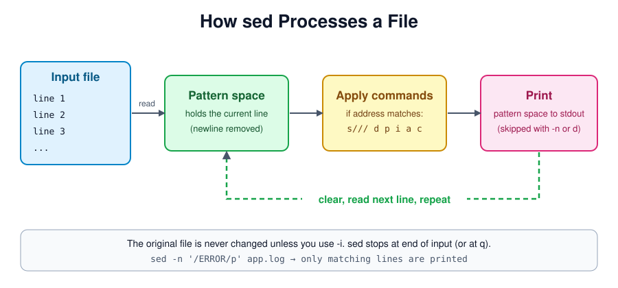

# sed: The Stream Editor

sed edits text line by line without opening an editor: replace, delete, insert and print lines in files, pipes and scripts.

## What sed Does

`sed` (stream editor) reads input one line at a time, applies your commands, and writes the result to standard output. It is perfect for automated edits in scripts, CI pipelines and Dockerfiles where nobody can open [vi](../05_Shell_Scripting/vi-editor.md).

```bash
sed [options] 'commands' file...
command | sed 'commands'
```

## How sed Works



1. Read one line into the **pattern space** (a buffer).
2. Run every command whose address matches that line.
3. Print the pattern space (unless `-n` is used or the line was deleted).
4. Clear it and repeat with the next line.

The input file is not changed unless you use `-i`.

## Addressing

An address selects which lines a command applies to. No address means every line.

| Address | Selects | Example |
| :--- | :--- | :--- |
| `N` | Line N | `sed -n '5p'` |
| `$` | Last line | `sed -n '$p'` |
| `N,M` | Lines N to M | `sed '2,4d'` |
| `/re/` | Lines matching regex | `sed '/^#/d'` |
| `/a/,/b/` | From a match of `a` to a match of `b` | `sed -n '/BEGIN/,/END/p'` |
| `N,+K` | Line N and the next K lines (GNU) | `sed -n '10,+2p'` |
| `addr!` | Every line NOT matching | `sed '/^#/!d'` |

## Basic Commands

| Command | Action | Example |
| :--- | :--- | :--- |
| `p` | Print the line | `sed -n '/ERROR/p' app.log` |
| `d` | Delete the line | `sed '/^$/d' file` |
| `i text` | Insert text before the line | `sed '1i # header' file` |
| `a text` | Append text after the line | `sed '/^\[main\]/a debug=true' app.ini` |
| `c text` | Replace the whole line | `sed '/^PORT=/c PORT=9090' .env` |
| `q` | Quit | `sed '10q' file` (like `head`) |

### The -n Option

By default sed prints every line. `-n` turns that off, so only lines you `p`rint appear:

```bash
sed -n '3,5p' /etc/passwd      # print lines 3-5 only
sed -n '/nginx/p' /etc/passwd  # behaves like grep nginx
```

## Substitution: s///

```bash
sed 's/old/new/' file          # first match on each line
sed 's/old/new/g' file         # every match on each line
sed 's/old/new/2' file         # only the 2nd match
sed 's/error/ERROR/gI' file    # global + case-insensitive (GNU)
sed -n 's/foo/bar/p' file      # print only lines that changed
```

| Flag | Meaning |
| :--- | :--- |
| `g` | Replace all matches in the line |
| `N` | Replace only the Nth match |
| `p` | Print the line if a replacement happened |
| `I` | Ignore case (GNU) |

Use another delimiter when the text has slashes, and `&` / `\1` to reuse matched text:

```bash
sed 's|/var/www|/srv/www|g' nginx.conf
sed 's/[0-9]\+/[&]/' file                       # & = the whole match
sed -E 's/([a-z]+)@([a-z.]+)/\2 user \1/' emails # \1 \2 = groups
```

## In-place Editing with -i

```bash
sed -i 's/8080/9090/' app.conf          # edit the file directly
sed -i.bak 's/8080/9090/' app.conf      # keep app.conf.bak as backup
```

Always test without `-i` first and check the output. On macOS/BSD sed, `-i` needs an argument: `sed -i '' 's/a/b/' file`.

## sed Scripts with -f

Put several commands in a file, one per line:

```bash
$ cat cleanup.sed
/^[[:space:]]*#/d
/^$/d
s/[[:space:]]\+$//
$ sed -f cleanup.sed app.conf
```

You can also chain commands with `-e` or `;`: `sed -e '/^#/d' -e 's/foo/bar/'`.

## Real Examples

```bash
# Change a config value in place (keep a backup)
sed -i.bak 's/^max_connections = .*/max_connections = 500/' postgresql.conf

# Comment out a line in sshd_config
sudo sed -i 's/^PermitRootLogin yes/#&/' /etc/ssh/sshd_config

# Remove ANSI colour codes from a CI log
sed -E 's/\x1b\[[0-9;]*m//g' build.log > build-clean.log

# Mask passwords before sharing a log
sed -E 's/(password=)[^ &]+/\1****/g' app.log

# Show only one time window of a log
sed -n '/10:00:00/,/10:05:00/p' app.log

# Replace a placeholder in a template during deployment
sed "s/__VERSION__/$VERSION/" deploy.tpl.yaml > deploy.yaml
```

Note the double quotes in the last example: they let the shell expand `$VERSION`. See [variables](../05_Shell_Scripting/variables.md).

## Interview Questions

**Q: What is the pattern space?**
A: The buffer where sed keeps the current line while commands run on it. It is printed at the end of each cycle unless `-n` is set or the line is deleted.

**Q: Why does `sed -n 's/a/b/'` print nothing?**
A: `-n` disables automatic printing. Add the `p` flag: `sed -n 's/a/b/p'`.

**Q: How do you edit a file in place safely?**
A: Run the command without `-i` first, then use `sed -i.bak` so a backup is kept.

**Q: How do you replace a path that contains `/`?**
A: Use a different delimiter, for example `sed 's|/old/path|/new/path|g'`.

**Q: Difference between `sed '/x/d'` and `grep -v x`?**
A: The output is the same, but sed can combine the delete with other edits in one pass and can edit the file in place.
