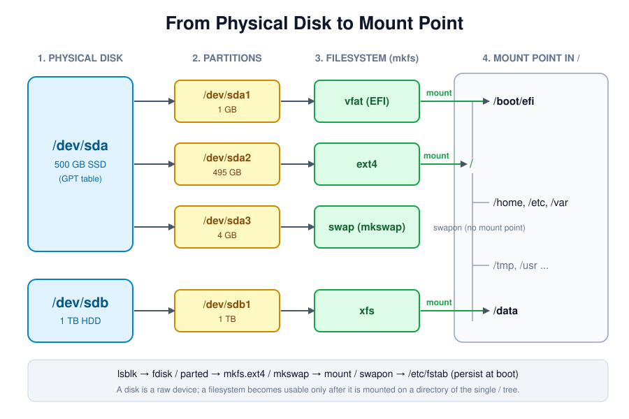

# Disks, Partitions और Mounting

एक raw disk इस्तेमाल लायक storage कैसे बनती है: partitioning, filesystem बनाना, mounting, fstab, जगह जाँचना, swap और LVM का परिचय।

## पूरी तस्वीर

Linux में `/` से शुरू होने वाला **एक ही directory tree** होता है। नई disk तब तक users को नहीं दिखती जब तक आप उसे partition न करें, उस पर filesystem न बनाएँ और उसे किसी directory पर **mount** न करें।



Devices `/dev` में रहते हैं: `sda`, `sdb` (SATA/SCSI/USB), `nvme0n1` (NVMe), `vda`/`xvda` (cloud VMs)। Partitions को एक number मिलता है: `sda1`, `nvme0n1p1`। Tree खुद कैसे काम करता है, यह [paths और inodes](../02_Filesystem/paths-and-inodes.md) में देखें।

## Step 1: Block Devices की list

```bash
$ lsblk -f
NAME   FSTYPE LABEL UUID                                 MOUNTPOINTS
sda
├─sda1 vfat         7A1B-2C3D                            /boot/efi
├─sda2 ext4         3f1c9e2a-5b7d-4e0a-9c11-2d4e6f8a0b1c /
└─sda3 swap         a9d2...                              [SWAP]
sdb                                                       # new, empty disk
```

दूसरे उपयोगी commands: `sudo fdisk -l`, `sudo blkid` (UUIDs), `lsblk -o NAME,SIZE,TYPE,MOUNTPOINTS`।

## Step 2: Disk को Partition करना

```bash
sudo fdisk /dev/sdb          # interactive: n (new), p (print), w (write), q (quit)

# Scriptable alternative with parted (GPT, one partition using the whole disk)
sudo parted /dev/sdb --script mklabel gpt mkpart primary ext4 0% 100%
```

**MBR** में अधिकतम 4 primary partitions और 2 TB तक की disk चलती है; **GPT** 128 partitions और बहुत बड़ी disks support करता है। हर नई disk के लिए GPT इस्तेमाल करें।

## Step 3: Filesystem बनाना

```bash
sudo mkfs.ext4 -L data /dev/sdb1     # ext4 with label "data"
sudo mkfs.xfs /dev/sdb1              # xfs (default on RHEL)
```

`mkfs` partition का सारा data **मिटा** देता है। पहले `lsblk` से device का नाम दोबारा जाँच लें।

## Step 4: Mount और Unmount

```bash
sudo mkdir -p /data
sudo mount /dev/sdb1 /data
mount | grep /data           # or: findmnt /data
sudo umount /data            # note: umount, not "unmount"
```

अगर `umount` कहे `target is busy`, तो देखें कौन इस्तेमाल कर रहा है: `sudo lsof +D /data` या `sudo fuser -vm /data`।

## Step 5: /etc/fstab से स्थायी बनाना

```bash
# <device>                                 <mount>  <type> <options>        <dump> <pass>
UUID=3f1c9e2a-5b7d-4e0a-9c11-2d4e6f8a0b1c  /        ext4   defaults         0      1
UUID=b47e...                               /data    ext4   defaults,nofail  0      2
UUID=a9d2...                               none     swap   sw               0      0
```

| Field | उदाहरण | मतलब |
| :---: | :--- | :--- |
| 1 | `UUID=...` | Device (UUID या LABEL बेहतर; `/dev/sdX` नाम बदल सकते हैं) |
| 2 | `/data` | Mount point (swap के लिए `none`) |
| 3 | `ext4` | Filesystem type |
| 4 | `defaults,nofail` | Mount options (`ro`, `noexec`, `nofail`...) |
| 5 | `0` | `dump` backup flag (लगभग हमेशा 0) |
| 6 | `2` | `fsck` क्रम: `/` के लिए 1, बाकी के लिए 2, skip के लिए 0 |

```bash
sudo mount -a          # mount everything in fstab: TEST before rebooting
```

## जगह जाँचना

```bash
$ df -h
Filesystem      Size  Used Avail Use% Mounted on
/dev/sda2       492G  401G   66G  86% /
/dev/sdb1       916G   12G  858G   2% /data

df -i                          # inode usage (can be full while space is free)
du -sh /var/log                # total size of a directory
du -sh /var/* | sort -h | tail # biggest directories
```

## Swap

Swap disk की वह जगह है जो RAM भर जाने पर इस्तेमाल होती है। यह धीमी है, लेकिन OOM killer को तुरंत processes मारने से रोकती है।

```bash
sudo fallocate -l 2G /swapfile
sudo chmod 600 /swapfile
sudo mkswap /swapfile && sudo swapon /swapfile
echo '/swapfile none swap sw 0 0' | sudo tee -a /etc/fstab
swapon --show; free -h
```

## LVM संक्षेप में

**LVM** (Logical Volume Manager) एक लचीली layer जोड़ता है: physical volumes (PV) को एक volume group (VG) में जोड़ा जाता है, जिससे logical volumes (LV) बनाए जाते हैं जिन्हें online resize किया जा सकता है।

```bash
sudo pvcreate /dev/sdb /dev/sdc
sudo vgcreate vgdata /dev/sdb /dev/sdc
sudo lvcreate -L 100G -n lvapp vgdata
sudo mkfs.ext4 /dev/vgdata/lvapp
sudo lvextend -r -L +50G /dev/vgdata/lvapp   # grow LV and filesystem together
sudo pvs; sudo vgs; sudo lvs
```

## आम गलतियाँ

**Q1. fstab बदलने के बाद server boot नहीं हुआ।**
गलत UUID या typo से boot emergency mode में चला जाता है। Edit के बाद हमेशा `sudo mount -a` चलाएँ और ग़ैर-ज़रूरी disks के लिए `nofail` लगाएँ।

**Q2. `df` 100% दिखाता है लेकिन `du` बहुत कम। क्यों?**
कोई deleted file अभी भी किसी process ने खोल रखी है। `sudo lsof +L1` से ढूँढें और उस process को restart करें।

**Q3. "No space left on device" लेकिन `df -h` में जगह खाली है।**
Inodes ख़त्म हो गए हैं (बहुत सारी छोटी files)। `df -i` जाँचें।

**Q4. fstab में `/dev/sdb1` की जगह UUID क्यों?**
Device नाम detection के क्रम पर निर्भर करते हैं और reboot या नई disk जोड़ने पर बदल सकते हैं; UUID नहीं बदलते।

**Q5. मैंने `/data` पर disk mount की और वहाँ की पुरानी files गायब हो गईं।**
वे छिपी हैं, delete नहीं हुईं। Mount directory की सामग्री को ढक देता है; `umount` करने पर वे फिर दिखेंगी।
