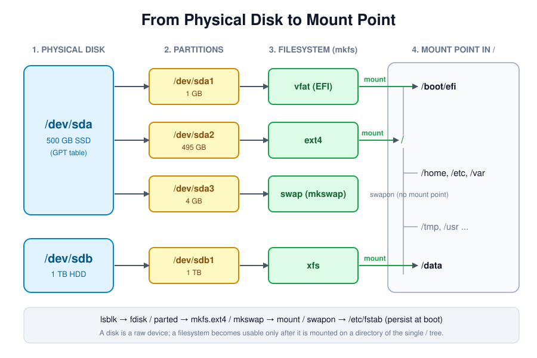

# Disks, Partitions aur Mounting

Ek raw disk usable storage kaise banti hai: partitioning, filesystem banana, mounting, fstab, space check karna, swap aur LVM ka intro.

## Poori Picture

Linux mein `/` se start hone wala **ek hi directory tree** hota hai. Nayi disk tab tak users ko nahi dikhti jab tak aap use partition na karo, us par filesystem na banao aur kisi directory par **mount** na karo.



Devices `/dev` mein rehte hain: `sda`, `sdb` (SATA/SCSI/USB), `nvme0n1` (NVMe), `vda`/`xvda` (cloud VMs). Partitions ko ek number milta hai: `sda1`, `nvme0n1p1`. Tree khud kaise kaam karta hai, ye [paths aur inodes](../02_Filesystem/paths-and-inodes.md) mein dekho.

## Step 1: Block Devices ki list

```bash
$ lsblk -f
NAME   FSTYPE LABEL UUID                                 MOUNTPOINTS
sda
├─sda1 vfat         7A1B-2C3D                            /boot/efi
├─sda2 ext4         3f1c9e2a-5b7d-4e0a-9c11-2d4e6f8a0b1c /
└─sda3 swap         a9d2...                              [SWAP]
sdb                                                       # new, empty disk
```

Dusre useful commands: `sudo fdisk -l`, `sudo blkid` (UUIDs), `lsblk -o NAME,SIZE,TYPE,MOUNTPOINTS`.

## Step 2: Disk ko Partition karna

```bash
sudo fdisk /dev/sdb          # interactive: n (new), p (print), w (write), q (quit)

# Scriptable alternative with parted (GPT, one partition using the whole disk)
sudo parted /dev/sdb --script mklabel gpt mkpart primary ext4 0% 100%
```

**MBR** mein maximum 4 primary partitions aur 2 TB tak ki disk chalti hai; **GPT** 128 partitions aur bahut badi disks support karta hai. Har nayi disk ke liye GPT use karo.

## Step 3: Filesystem banana

```bash
sudo mkfs.ext4 -L data /dev/sdb1     # ext4 with label "data"
sudo mkfs.xfs /dev/sdb1              # xfs (default on RHEL)
```

`mkfs` partition ka saara data **erase** kar deta hai. Pehle `lsblk` se device ka naam double-check karo.

## Step 4: Mount aur Unmount

```bash
sudo mkdir -p /data
sudo mount /dev/sdb1 /data
mount | grep /data           # or: findmnt /data
sudo umount /data            # note: umount, not "unmount"
```

Agar `umount` bole `target is busy`, to dekho kaun use kar raha hai: `sudo lsof +D /data` ya `sudo fuser -vm /data`.

## Step 5: /etc/fstab se Permanent banana

```bash
# <device>                                 <mount>  <type> <options>        <dump> <pass>
UUID=3f1c9e2a-5b7d-4e0a-9c11-2d4e6f8a0b1c  /        ext4   defaults         0      1
UUID=b47e...                               /data    ext4   defaults,nofail  0      2
UUID=a9d2...                               none     swap   sw               0      0
```

| Field | Example | Matlab |
| :---: | :--- | :--- |
| 1 | `UUID=...` | Device (UUID ya LABEL better; `/dev/sdX` naam badal sakte hain) |
| 2 | `/data` | Mount point (swap ke liye `none`) |
| 3 | `ext4` | Filesystem type |
| 4 | `defaults,nofail` | Mount options (`ro`, `noexec`, `nofail`...) |
| 5 | `0` | `dump` backup flag (almost hamesha 0) |
| 6 | `2` | `fsck` order: `/` ke liye 1, baaki ke liye 2, skip ke liye 0 |

```bash
sudo mount -a          # mount everything in fstab: TEST before rebooting
```

## Space Check karna

```bash
$ df -h
Filesystem      Size  Used Avail Use% Mounted on
/dev/sda2       492G  401G   66G  86% /
/dev/sdb1       916G   12G  858G   2% /data

df -i                          # inode usage (can be full while space is free)
du -sh /var/log                # total size of a directory
du -sh /var/* | sort -h | tail # biggest directories
```

## Swap

Swap disk ki wo jagah hai jo RAM full hone par use hoti hai. Ye slow hai, lekin OOM killer ko turant processes kill karne se rokti hai.

```bash
sudo fallocate -l 2G /swapfile
sudo chmod 600 /swapfile
sudo mkswap /swapfile && sudo swapon /swapfile
echo '/swapfile none swap sw 0 0' | sudo tee -a /etc/fstab
swapon --show; free -h
```

## LVM short mein

**LVM** (Logical Volume Manager) ek flexible layer add karta hai: physical volumes (PV) ko ek volume group (VG) mein pool kiya jaata hai, jisse logical volumes (LV) banaye jaate hain jo online resize ho sakte hain.

```bash
sudo pvcreate /dev/sdb /dev/sdc
sudo vgcreate vgdata /dev/sdb /dev/sdc
sudo lvcreate -L 100G -n lvapp vgdata
sudo mkfs.ext4 /dev/vgdata/lvapp
sudo lvextend -r -L +50G /dev/vgdata/lvapp   # grow LV and filesystem together
sudo pvs; sudo vgs; sudo lvs
```

## Common Mistakes

**Q1. fstab edit karne ke baad server boot nahi hua.**
Galat UUID ya typo se boot emergency mode mein chala jaata hai. Edit ke baad hamesha `sudo mount -a` chalao aur non-critical disks ke liye `nofail` lagao.

**Q2. `df` 100% dikhata hai lekin `du` bahut kam. Kyun?**
Koi deleted file abhi bhi kisi process ne open rakhi hai. `sudo lsof +L1` se dhoondo aur us process ko restart karo.

**Q3. "No space left on device" lekin `df -h` mein space free hai.**
Inodes khatam ho gaye hain (bahut saari chhoti files). `df -i` check karo.

**Q4. fstab mein `/dev/sdb1` ki jagah UUID kyun?**
Device names detection order par depend karte hain aur reboot ya nayi disk add karne par badal sakte hain; UUID nahi badalte.

**Q5. Maine `/data` par disk mount ki aur wahan ki purani files gayab ho gayi.**
Wo hidden hain, delete nahi hui. Mount directory ke content ko dhak deta hai; `umount` karne par wo phir dikhengi.
