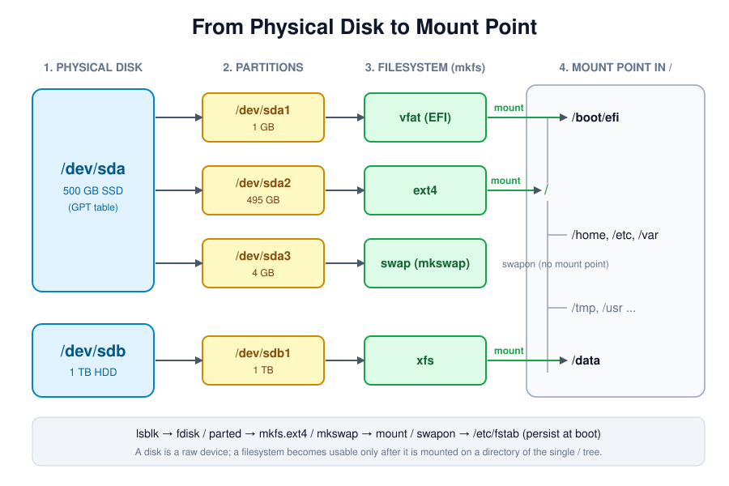

# Disks, Partitions and Mounting

How a raw disk becomes usable storage: partitioning, creating filesystems, mounting, fstab, checking space, swap and an intro to LVM.

## The Big Picture

Linux has a **single directory tree** starting at `/`. A new disk is invisible to users until you partition it, put a filesystem on it and **mount** it on a directory.



Devices live under `/dev`: `sda`, `sdb` (SATA/SCSI/USB), `nvme0n1` (NVMe), `vda`/`xvda` (cloud VMs). Partitions get a number: `sda1`, `nvme0n1p1`. See [paths and inodes](../02_Filesystem/paths-and-inodes.md) for how the tree itself works.

## Step 1: List Block Devices

```bash
$ lsblk -f
NAME   FSTYPE LABEL UUID                                 MOUNTPOINTS
sda
├─sda1 vfat         7A1B-2C3D                            /boot/efi
├─sda2 ext4         3f1c9e2a-5b7d-4e0a-9c11-2d4e6f8a0b1c /
└─sda3 swap         a9d2...                              [SWAP]
sdb                                                       # new, empty disk
```

Other useful commands: `sudo fdisk -l`, `sudo blkid` (UUIDs), `lsblk -o NAME,SIZE,TYPE,MOUNTPOINTS`.

## Step 2: Partition the Disk

```bash
sudo fdisk /dev/sdb          # interactive: n (new), p (print), w (write), q (quit)

# Scriptable alternative with parted (GPT, one partition using the whole disk)
sudo parted /dev/sdb --script mklabel gpt mkpart primary ext4 0% 100%
```

**MBR** supports up to 4 primary partitions and 2 TB disks; **GPT** supports 128 partitions and huge disks. Use GPT for anything new.

## Step 3: Create a Filesystem

```bash
sudo mkfs.ext4 -L data /dev/sdb1     # ext4 with label "data"
sudo mkfs.xfs /dev/sdb1              # xfs (default on RHEL)
```

`mkfs` **erases** everything on the partition. Double-check the device name with `lsblk` first.

## Step 4: Mount and Unmount

```bash
sudo mkdir -p /data
sudo mount /dev/sdb1 /data
mount | grep /data           # or: findmnt /data
sudo umount /data            # note: umount, not "unmount"
```

If `umount` says `target is busy`, find who is using it: `sudo lsof +D /data` or `sudo fuser -vm /data`.

## Step 5: Make It Permanent with /etc/fstab

```bash
# <device>                                 <mount>  <type> <options>        <dump> <pass>
UUID=3f1c9e2a-5b7d-4e0a-9c11-2d4e6f8a0b1c  /        ext4   defaults         0      1
UUID=b47e...                               /data    ext4   defaults,nofail  0      2
UUID=a9d2...                               none     swap   sw               0      0
```

| Field | Example | Meaning |
| :---: | :--- | :--- |
| 1 | `UUID=...` | Device (prefer UUID or LABEL; `/dev/sdX` names can change) |
| 2 | `/data` | Mount point (`none` for swap) |
| 3 | `ext4` | Filesystem type |
| 4 | `defaults,nofail` | Mount options (`ro`, `noexec`, `nofail`...) |
| 5 | `0` | `dump` backup flag (almost always 0) |
| 6 | `2` | `fsck` order: 1 for `/`, 2 for others, 0 to skip |

```bash
sudo mount -a          # mount everything in fstab: TEST before rebooting
```

## Checking Space

```bash
$ df -h
Filesystem      Size  Used Avail Use% Mounted on
/dev/sda2       492G  401G   66G  86% /
/dev/sdb1       916G   12G  858G   2% /data

df -i                          # inode usage (can be full while space is free)
du -sh /var/log                # total size of a directory
du -sh /var/* | sort -h | tail # biggest directories
```

## Swap

Swap is disk space used when RAM is full. It is slow, but it prevents the OOM killer from killing processes immediately.

```bash
sudo fallocate -l 2G /swapfile
sudo chmod 600 /swapfile
sudo mkswap /swapfile && sudo swapon /swapfile
echo '/swapfile none swap sw 0 0' | sudo tee -a /etc/fstab
swapon --show; free -h
```

## LVM in Brief

**LVM** (Logical Volume Manager) adds a flexible layer: physical volumes (PV) are pooled into a volume group (VG), from which you carve logical volumes (LV) that can be resized online.

```bash
sudo pvcreate /dev/sdb /dev/sdc
sudo vgcreate vgdata /dev/sdb /dev/sdc
sudo lvcreate -L 100G -n lvapp vgdata
sudo mkfs.ext4 /dev/vgdata/lvapp
sudo lvextend -r -L +50G /dev/vgdata/lvapp   # grow LV and filesystem together
sudo pvs; sudo vgs; sudo lvs
```

## Common Mistakes

**Q1. The server did not boot after editing fstab.**
A wrong UUID or typo makes boot drop into emergency mode. Always run `sudo mount -a` after editing and use `nofail` for non-critical disks.

**Q2. `df` shows 100% but `du` shows much less. Why?**
A deleted file is still held open by a process. Find it with `sudo lsof +L1` and restart that process.

**Q3. "No space left on device" but `df -h` shows free space.**
Inodes are exhausted (many tiny files). Check `df -i`.

**Q4. Why use UUID instead of `/dev/sdb1` in fstab?**
Device names depend on detection order and can change after a reboot or adding a disk; UUIDs do not.

**Q5. I mounted a disk on `/data` and my old files there disappeared.**
They are hidden, not deleted. Mounting covers the directory's contents; `umount` shows them again.
