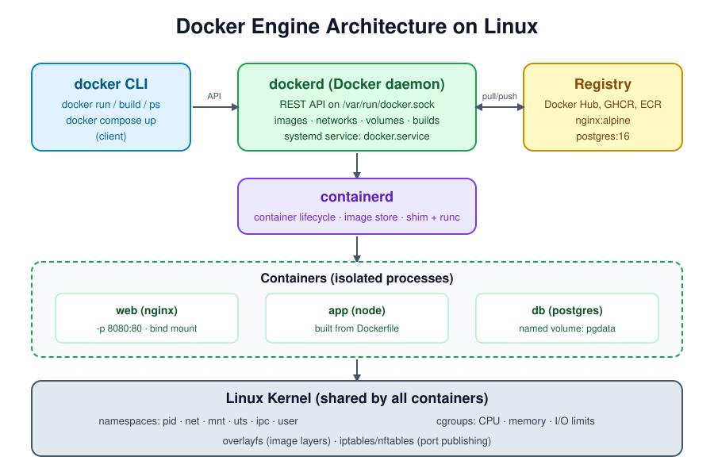

# Ubuntu पर Docker इंस्टॉल करें

Ubuntu पर official repository से Docker Engine इंस्टॉल करें, पहले containers चलाएँ, Dockerfile और Compose file लिखें, और आम errors ठीक करें।



## Use Case

आप Ubuntu 22.04/24.04 server या laptop पर apps को containers में चलाना चाहते हैं: वही image dev, CI और production में चलती है। `docker` CLI एक Unix socket के ज़रिए `dockerd` daemon से बात करता है; `dockerd` containers शुरू करने के लिए `containerd` से कहता है। Containers साधारण Linux processes हैं जिन्हें namespaces अलग रखते हैं और cgroups सीमित करते हैं।

## Installation (Official apt Repository)

### Step 1: टकराने वाले packages हटाएँ

Ubuntu का अपना `docker.io` और पुराने packages Docker के packages से टकराते हैं।

```bash
for pkg in docker.io docker-doc docker-compose docker-compose-v2 podman-docker containerd runc; do
  sudo apt-get remove -y $pkg
done
```

### Step 2: Docker की GPG key जोड़ें

```bash
sudo apt-get update
sudo apt-get install -y ca-certificates curl
sudo install -m 0755 -d /etc/apt/keyrings
sudo curl -fsSL https://download.docker.com/linux/ubuntu/gpg -o /etc/apt/keyrings/docker.asc
sudo chmod a+r /etc/apt/keyrings/docker.asc
```

### Step 3: Repository जोड़ें

```bash
echo "deb [arch=$(dpkg --print-architecture) signed-by=/etc/apt/keyrings/docker.asc] \
https://download.docker.com/linux/ubuntu $(. /etc/os-release && echo "$VERSION_CODENAME") stable" \
  | sudo tee /etc/apt/sources.list.d/docker.list > /dev/null
sudo apt-get update
```

`signed-by` का मतलब है कि इस repo से सिर्फ़ इसी key से signed packages पर भरोसा किया जाएगा। देखें [apt basics](README.md)।

### Step 4: Packages इंस्टॉल करें

```bash
sudo apt-get install -y docker-ce docker-ce-cli containerd.io docker-buildx-plugin docker-compose-plugin
```

### Step 5: जाँचें

```bash
$ sudo docker run hello-world
Unable to find image 'hello-world:latest' locally
latest: Pulling from library/hello-world
Hello from Docker!
This message shows that your installation appears to be working correctly.
```

### Step 6: Post-install

```bash
sudo usermod -aG docker $USER     # run docker without sudo
sudo systemctl enable --now docker containerd   # start on boot; log out and in for the group
```

**Security note:** `docker` group root के बराबर है। इसका कोई भी सदस्य `docker run -v /:/host` चलाकर host की कोई भी file बदल सकता है। सिर्फ़ भरोसेमंद users जोड़ें (देखें [users and groups](../07_System_Administration/users-and-groups.md)); shared servers पर `sudo` या rootless Docker बेहतर है।

Convenience script `curl -fsSL https://get.docker.com | sh` किसी अस्थायी dev VM के लिए ठीक है, पर production में इसका इस्तेमाल न करें: यह non-interactive है, versions खुद चुनता है और इसे audit करना मुश्किल है।

## रोज़ के Commands

| Command | क्या करता है |
| :--- | :--- |
| `docker ps` / `docker ps -a` | चल रहे / सभी containers |
| `docker images` | Local images |
| `docker logs -f web` | Container का output लगातार देखें |
| `docker exec -it web sh` | चल रहे container के अंदर shell खोलें |
| `docker stop web` / `docker start web` | रोकें (पहले SIGTERM, फिर SIGKILL) / शुरू करें |
| `docker rm web` / `docker rmi nginx:alpine` | Container / image हटाएँ |
| `docker system prune` | रुके containers, unused networks, dangling images हटाएँ |
| `docker ps --format '{{.Names}}' \| grep web` | Pipe से output filter करें |

## Port और Volume के साथ Nginx चलाएँ

```bash
mkdir -p ~/site && echo '<h1>Hello from Docker</h1>' > ~/site/index.html
docker run -d --name web -p 8080:80 \
  -v ~/site:/usr/share/nginx/html:ro --restart unless-stopped nginx:alpine
curl localhost:8080
```

`-p 8080:80` host के port 8080 को container के port 80 से जोड़ता है; `-v` host folder को read-only bind-mount करता है; `--restart unless-stopped` reboot के बाद container वापस चालू कर देता है।

## Node App के लिए Dockerfile

```dockerfile
FROM node:20-alpine
WORKDIR /app
COPY package*.json ./
RUN npm ci --omit=dev
COPY . .
USER node
EXPOSE 3000
CMD ["node", "server.js"]
```

```bash
docker build -t myapp:1.0 .
docker run -d --name app -p 3000:3000 myapp:1.0
```

पहले `package*.json` copy करने से, सिर्फ़ source files बदलने पर Docker `npm ci` layer को cache से ले लेता है। `node_modules` और `.git` के साथ एक `.dockerignore` जोड़ें।

## Docker Compose: App + PostgreSQL

```yaml
services:
  app:
    build: .
    ports:
      - "3000:3000"
    environment:
      DATABASE_URL: postgres://app:secret@db:5432/app
    depends_on:
      - db
    restart: unless-stopped
  db:
    image: postgres:16
    environment:
      POSTGRES_USER: app
      POSTGRES_PASSWORD: secret
      POSTGRES_DB: app
    volumes:
      - pgdata:/var/lib/postgresql/data
    restart: unless-stopped
volumes:
  pgdata:
```

```bash
docker compose up -d          # build and start in the background
docker compose logs -f app
docker compose down           # stop and remove containers (volume kept)
docker compose down -v        # also delete the pgdata volume
```

Compose network के अंदर `app` database तक उसके service name `db` से पहुँचता है। Named volume `pgdata` `down` के बाद भी बचा रहता है, इसलिए data नहीं खोता।

## Troubleshooting

| लक्षण | समाधान |
| :--- | :--- |
| `permission denied while trying to connect to the Docker daemon socket` | `sudo` लगाएँ, या खुद को `docker` group में जोड़कर फिर से login करें (`id` में `docker` दिखना चाहिए) |
| `Bind for 0.0.0.0:8080 failed: port is already allocated` | `sudo ss -tulpn \| grep 8080` या `docker ps` से owner ढूँढें, फिर उसे रोकें या दूसरा host port लें |
| `no space left on device` | `docker system df` देखें, फिर सावधानी से `docker system prune -a` (unused images हटाता है) और `docker volume prune` |
| `Cannot connect to the Docker daemon` | `sudo systemctl status docker`, फिर `journalctl -u docker --since "10 min ago"` |

```bash
$ docker system df
TYPE            TOTAL     ACTIVE    SIZE      RECLAIMABLE
Images          14        3         5.2GB     4.1GB (78%)
Containers      5         3         12MB      2MB (16%)
Local Volumes   4         2         1.3GB     600MB (46%)
Build Cache     52        0         2.4GB     2.4GB
```

## Interview Questions

**Q1. Image और container में क्या अंतर है?**
Image layers से बना एक read-only template है; container उस image का चलता (या रुका) instance है जिसकी अपनी writable layer होती है।

**Q2. Host kernel share करने पर भी containers अलग कैसे रहते हैं?**
Namespaces हर container को PIDs, network, mounts और hostname का अपना view देते हैं; cgroups CPU, memory और I/O को सीमित करते हैं।

**Q3. किसी user को `docker` group में जोड़ना security risk क्यों है?**
Daemon root के रूप में चलता है, इसलिए socket तक पहुँच रखने वाला कोई भी व्यक्ति host filesystem को container में mount करके root बन सकता है।

**Q4. Bind mount बनाम named volume?**
Bind mount host का path container में map करता है; named volume को Docker `/var/lib/docker/volumes` के अंदर manage करता है और database data के लिए यही आम पसंद है।
