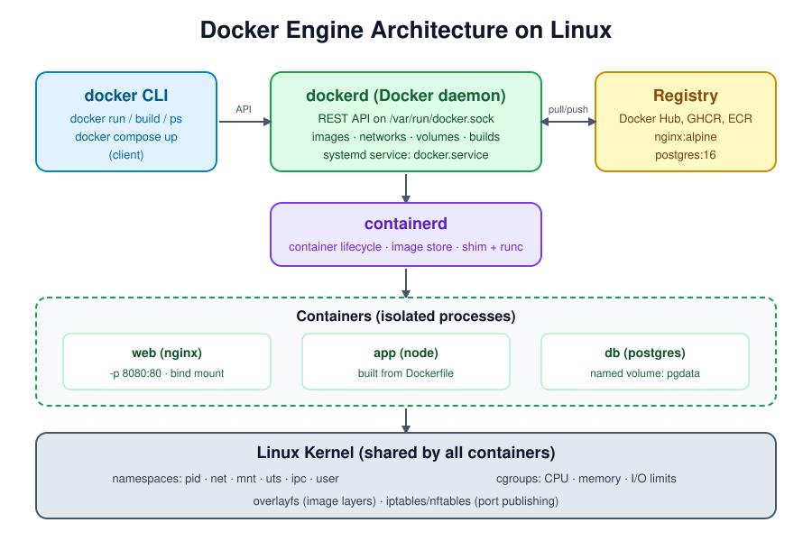

# Ubuntu par Docker Install Karo

Ubuntu par official repository se Docker Engine install karo, pehle containers chalao, Dockerfile aur Compose file likho, aur common errors fix karo.



## Use Case

Tum Ubuntu 22.04/24.04 server ya laptop par apps ko containers mein chalana chahte ho: wahi image dev, CI aur production mein chalti hai. `docker` CLI ek Unix socket ke through `dockerd` daemon se baat karta hai; `dockerd` containers start karne ke liye `containerd` ko bolta hai. Containers normal Linux processes hain jinhe namespaces isolate karte hain aur cgroups limit karte hain.

## Installation (Official apt Repository)

### Step 1: Conflict karne wale packages hatao

Ubuntu ka apna `docker.io` aur purane packages Docker ke packages se conflict karte hain.

```bash
for pkg in docker.io docker-doc docker-compose docker-compose-v2 podman-docker containerd runc; do
  sudo apt-get remove -y $pkg
done
```

### Step 2: Docker ki GPG key add karo

```bash
sudo apt-get update
sudo apt-get install -y ca-certificates curl
sudo install -m 0755 -d /etc/apt/keyrings
sudo curl -fsSL https://download.docker.com/linux/ubuntu/gpg -o /etc/apt/keyrings/docker.asc
sudo chmod a+r /etc/apt/keyrings/docker.asc
```

### Step 3: Repository add karo

```bash
echo "deb [arch=$(dpkg --print-architecture) signed-by=/etc/apt/keyrings/docker.asc] \
https://download.docker.com/linux/ubuntu $(. /etc/os-release && echo "$VERSION_CODENAME") stable" \
  | sudo tee /etc/apt/sources.list.d/docker.list > /dev/null
sudo apt-get update
```

`signed-by` ka matlab hai ki is repo se sirf isi key se signed packages trust honge. Dekho [apt basics](README.md).

### Step 4: Packages install karo

```bash
sudo apt-get install -y docker-ce docker-ce-cli containerd.io docker-buildx-plugin docker-compose-plugin
```

### Step 5: Verify karo

```bash
$ sudo docker run hello-world
Unable to find image 'hello-world:latest' locally
latest: Pulling from library/hello-world
Hello from Docker!
This message shows that your installation appears to be working correctly.
```

### Step 6: Post-install

```bash
sudo usermod -aG docker $USER     # run docker without sudo
sudo systemctl enable --now docker containerd   # start on boot; log out and in for the group
```

**Security note:** `docker` group root ke barabar hai. Isme koi bhi member `docker run -v /:/host` chala ke host ki koi bhi file edit kar sakta hai. Sirf trusted users add karo (dekho [users and groups](../07_System_Administration/users-and-groups.md)); shared servers par `sudo` ya rootless Docker better hai.

Convenience script `curl -fsSL https://get.docker.com | sh` kisi throwaway dev VM ke liye theek hai, lekin production mein mat use karo: ye non-interactive hai, versions khud choose karta hai aur ise audit karna mushkil hai.

## Roz ke Commands

| Command | Kya karta hai |
| :--- | :--- |
| `docker ps` / `docker ps -a` | Running / saare containers |
| `docker images` | Local images |
| `docker logs -f web` | Container ka output follow karo |
| `docker exec -it web sh` | Running container ke andar shell kholo |
| `docker stop web` / `docker start web` | Stop (pehle SIGTERM, phir SIGKILL) / start |
| `docker rm web` / `docker rmi nginx:alpine` | Container / image remove karo |
| `docker system prune` | Stopped containers, unused networks, dangling images delete karo |
| `docker ps --format '{{.Names}}' \| grep web` | Pipe se output filter karo |

## Port aur Volume ke saath Nginx chalao

```bash
mkdir -p ~/site && echo '<h1>Hello from Docker</h1>' > ~/site/index.html
docker run -d --name web -p 8080:80 \
  -v ~/site:/usr/share/nginx/html:ro --restart unless-stopped nginx:alpine
curl localhost:8080
```

`-p 8080:80` host ke port 8080 ko container ke port 80 se map karta hai; `-v` host folder ko read-only bind-mount karta hai; `--restart unless-stopped` reboot ke baad container wapas start kar deta hai.

## Node App ke liye Dockerfile

```dockerfile
FROM node:20-alpine
WORKDIR /app
COPY package*.json ./
RUN npm ci --omit=dev
COPY . .
USER node
EXPOSE 3000
CMD ["node", "server.js"]
```

```bash
docker build -t myapp:1.0 .
docker run -d --name app -p 3000:3000 myapp:1.0
```

Pehle `package*.json` copy karne se, jab sirf source files badalti hain tab Docker `npm ci` layer ko cache se le leta hai. `node_modules` aur `.git` ke saath ek `.dockerignore` add karo.

## Docker Compose: App + PostgreSQL

```yaml
services:
  app:
    build: .
    ports:
      - "3000:3000"
    environment:
      DATABASE_URL: postgres://app:secret@db:5432/app
    depends_on:
      - db
    restart: unless-stopped
  db:
    image: postgres:16
    environment:
      POSTGRES_USER: app
      POSTGRES_PASSWORD: secret
      POSTGRES_DB: app
    volumes:
      - pgdata:/var/lib/postgresql/data
    restart: unless-stopped
volumes:
  pgdata:
```

```bash
docker compose up -d          # build and start in the background
docker compose logs -f app
docker compose down           # stop and remove containers (volume kept)
docker compose down -v        # also delete the pgdata volume
```

Compose network ke andar `app` database tak uske service name `db` se pahunchta hai. Named volume `pgdata` `down` ke baad bhi bacha rehta hai, isliye data lose nahi hota.

## Troubleshooting

| Symptom | Fix |
| :--- | :--- |
| `permission denied while trying to connect to the Docker daemon socket` | `sudo` lagao, ya khud ko `docker` group mein add karke dobara login karo (`id` mein `docker` dikhna chahiye) |
| `Bind for 0.0.0.0:8080 failed: port is already allocated` | `sudo ss -tulpn \| grep 8080` ya `docker ps` se owner dhoondo, phir use stop karo ya doosra host port lo |
| `no space left on device` | `docker system df` dekho, phir dhyan se `docker system prune -a` (unused images hatata hai) aur `docker volume prune` |
| `Cannot connect to the Docker daemon` | `sudo systemctl status docker`, phir `journalctl -u docker --since "10 min ago"` |

```bash
$ docker system df
TYPE            TOTAL     ACTIVE    SIZE      RECLAIMABLE
Images          14        3         5.2GB     4.1GB (78%)
Containers      5         3         12MB      2MB (16%)
Local Volumes   4         2         1.3GB     600MB (46%)
Build Cache     52        0         2.4GB     2.4GB
```

## Interview Questions

**Q1. Image aur container mein kya difference hai?**
Image layers se bana ek read-only template hai; container us image ka running (ya stopped) instance hai jiski apni writable layer hoti hai.

**Q2. Host kernel share karne ke baad bhi containers isolated kaise rehte hain?**
Namespaces har container ko PIDs, network, mounts aur hostname ka apna view dete hain; cgroups CPU, memory aur I/O ko limit karte hain.

**Q3. Kisi user ko `docker` group mein add karna security risk kyun hai?**
Daemon root ke roop mein chalta hai, isliye jo bhi socket se baat kar sakta hai wo host filesystem ko container mein mount karke root ban sakta hai.

**Q4. Bind mount vs named volume?**
Bind mount host ka path container mein map karta hai; named volume ko Docker `/var/lib/docker/volumes` ke andar manage karta hai aur database data ke liye yahi common choice hai.
