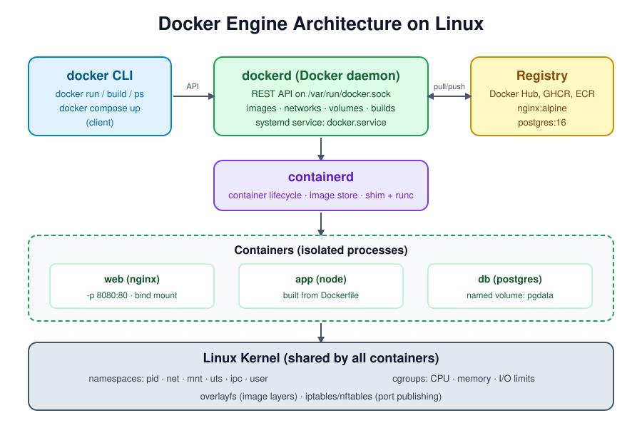

# Install Docker on Ubuntu

Install Docker Engine on Ubuntu from the official repository, run your first containers, write a Dockerfile and a Compose file, and fix common errors.



## Use Case

You want to run apps in containers on an Ubuntu 22.04/24.04 server or laptop: the same image runs in dev, CI and production. The `docker` CLI talks to the `dockerd` daemon over a Unix socket; `dockerd` asks `containerd` to start containers, which are ordinary Linux processes isolated by namespaces and limited by cgroups.

## Installation (Official apt Repository)

### Step 1: Remove conflicting packages

Ubuntu's own `docker.io` and old packages conflict with Docker's packages.

```bash
for pkg in docker.io docker-doc docker-compose docker-compose-v2 podman-docker containerd runc; do
  sudo apt-get remove -y $pkg
done
```

### Step 2: Add Docker's GPG key

```bash
sudo apt-get update
sudo apt-get install -y ca-certificates curl
sudo install -m 0755 -d /etc/apt/keyrings
sudo curl -fsSL https://download.docker.com/linux/ubuntu/gpg -o /etc/apt/keyrings/docker.asc
sudo chmod a+r /etc/apt/keyrings/docker.asc
```

### Step 3: Add the repository

```bash
echo "deb [arch=$(dpkg --print-architecture) signed-by=/etc/apt/keyrings/docker.asc] \
https://download.docker.com/linux/ubuntu $(. /etc/os-release && echo "$VERSION_CODENAME") stable" \
  | sudo tee /etc/apt/sources.list.d/docker.list > /dev/null
sudo apt-get update
```

`signed-by` means only packages signed with this key are trusted from this repo. See [apt basics](README.md).

### Step 4: Install the packages

```bash
sudo apt-get install -y docker-ce docker-ce-cli containerd.io docker-buildx-plugin docker-compose-plugin
```

### Step 5: Verify

```bash
$ sudo docker run hello-world
Unable to find image 'hello-world:latest' locally
latest: Pulling from library/hello-world
Hello from Docker!
This message shows that your installation appears to be working correctly.
```

### Step 6: Post-install

```bash
sudo usermod -aG docker $USER     # run docker without sudo
sudo systemctl enable --now docker containerd   # start on boot; log out and in for the group
```

**Security note:** the `docker` group is root-equivalent. Anyone in it can run `docker run -v /:/host` and edit any file on the host. Only add trusted users (see [users and groups](../07_System_Administration/users-and-groups.md)); on shared servers prefer `sudo` or rootless Docker.

The convenience script `curl -fsSL https://get.docker.com | sh` is fine for a throwaway dev VM, but do not use it in production: it is non-interactive, picks versions for you and is hard to audit.

## Everyday Commands

| Command | What it does |
| :--- | :--- |
| `docker ps` / `docker ps -a` | Running / all containers |
| `docker images` | Local images |
| `docker logs -f web` | Follow a container's output |
| `docker exec -it web sh` | Open a shell inside a running container |
| `docker stop web` / `docker start web` | Stop (SIGTERM, then SIGKILL) / start |
| `docker rm web` / `docker rmi nginx:alpine` | Remove a container / an image |
| `docker system prune` | Delete stopped containers, unused networks, dangling images |
| `docker ps --format '{{.Names}}' \| grep web` | Filter output with a pipe |

## Run Nginx with a Port and a Volume

```bash
mkdir -p ~/site && echo '<h1>Hello from Docker</h1>' > ~/site/index.html
docker run -d --name web -p 8080:80 \
  -v ~/site:/usr/share/nginx/html:ro --restart unless-stopped nginx:alpine
curl localhost:8080
```

`-p 8080:80` maps host port 8080 to container port 80; `-v` bind-mounts a host folder read-only; `--restart unless-stopped` brings it back after a reboot.

## A Dockerfile for a Node App

```dockerfile
FROM node:20-alpine
WORKDIR /app
COPY package*.json ./
RUN npm ci --omit=dev
COPY . .
USER node
EXPOSE 3000
CMD ["node", "server.js"]
```

```bash
docker build -t myapp:1.0 .
docker run -d --name app -p 3000:3000 myapp:1.0
```

Copying `package*.json` first lets Docker cache the `npm ci` layer when only source files change. Add a `.dockerignore` with `node_modules` and `.git`.

## Docker Compose: App + PostgreSQL

```yaml
services:
  app:
    build: .
    ports:
      - "3000:3000"
    environment:
      DATABASE_URL: postgres://app:secret@db:5432/app
    depends_on:
      - db
    restart: unless-stopped
  db:
    image: postgres:16
    environment:
      POSTGRES_USER: app
      POSTGRES_PASSWORD: secret
      POSTGRES_DB: app
    volumes:
      - pgdata:/var/lib/postgresql/data
    restart: unless-stopped
volumes:
  pgdata:
```

```bash
docker compose up -d          # build and start in the background
docker compose logs -f app
docker compose down           # stop and remove containers (volume kept)
docker compose down -v        # also delete the pgdata volume
```

Inside the Compose network, `app` reaches the database by its service name `db`. The named volume `pgdata` survives `down`, so data is not lost.

## Troubleshooting

| Symptom | Fix |
| :--- | :--- |
| `permission denied while trying to connect to the Docker daemon socket` | Use `sudo`, or add yourself to the `docker` group and log in again (`id` should list `docker`) |
| `Bind for 0.0.0.0:8080 failed: port is already allocated` | Find the owner with `sudo ss -tulpn \| grep 8080` or `docker ps`, then stop it or pick another host port |
| `no space left on device` | Check `docker system df`, then `docker system prune -a` (removes unused images) and `docker volume prune` carefully |
| `Cannot connect to the Docker daemon` | `sudo systemctl status docker`, then `journalctl -u docker --since "10 min ago"` |

```bash
$ docker system df
TYPE            TOTAL     ACTIVE    SIZE      RECLAIMABLE
Images          14        3         5.2GB     4.1GB (78%)
Containers      5         3         12MB      2MB (16%)
Local Volumes   4         2         1.3GB     600MB (46%)
Build Cache     52        0         2.4GB     2.4GB
```

## Interview Questions

**Q1. What is the difference between an image and a container?**
An image is a read-only template made of layers; a container is a running (or stopped) instance of an image with its own writable layer.

**Q2. How are containers isolated if they share the host kernel?**
Namespaces give each container its own view of PIDs, network, mounts and hostname; cgroups limit CPU, memory and I/O.

**Q3. Why is adding a user to the `docker` group a security risk?**
The daemon runs as root, so anyone who can talk to the socket can mount the host filesystem into a container and gain root.

**Q4. Bind mount vs named volume?**
A bind mount maps a host path into the container; a named volume is managed by Docker under `/var/lib/docker/volumes` and is the usual choice for database data.
