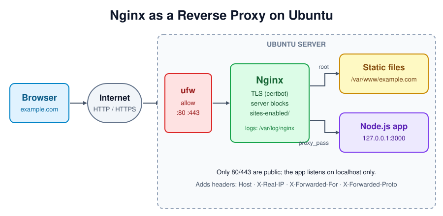

# Nginx इंस्टॉल और कॉन्फ़िगर करना

Ubuntu पर Nginx से static website host करें और Node.js app को reverse-proxy करें, firewall खोलें, certbot से मुफ़्त HTTPS लगाएँ और आम errors ठीक करें।

## Use Case

आपके पास public IP और domain `example.com` वाला एक नया Ubuntu server है। आपको `/var/www` से static site दिखानी है और port 3000 पर चल रही Node.js API को HTTPS के साथ Nginx के पीछे रखना है।



Nginx हर request ports 80/443 पर लेता है और या तो disk से file देता है या request को `127.0.0.1:3000` वाले app को आगे भेजता है। App कभी सीधे internet पर expose नहीं होता।

## 1. Nginx इंस्टॉल करें

पहले index refresh करें, जैसा [package management](README.md) में बताया गया है।

```bash
sudo apt-get update
sudo apt-get install -y nginx
nginx -v
# nginx version: nginx/1.24.0 (Ubuntu)
```

## 2. Service जाँचें और Enable करें

Services systemd से संभाली जाती हैं, देखें [system administration basics](../07_System_Administration/README.md)।

```bash
systemctl status nginx
# ● nginx.service - A high performance web server and a reverse proxy server
#      Active: active (running) since Mon 2026-11-23 10:02:11 UTC
sudo systemctl enable nginx      # start at boot (already enabled on Ubuntu)
curl -I http://localhost
# HTTP/1.1 200 OK
```

## 3. Firewall खोलें

```bash
sudo ufw app list
# Available applications:
#   Nginx Full
#   Nginx HTTP
#   Nginx HTTPS
#   OpenSSH
sudo ufw allow OpenSSH           # do this BEFORE enabling ufw on a remote box
sudo ufw allow 'Nginx Full'      # ports 80 and 443
sudo ufw enable
```

## 4. File Layout

| Path | काम |
| :--- | :--- |
| `/etc/nginx/nginx.conf` | मुख्य config (workers, includes) |
| `/etc/nginx/sites-available/` | हर site की एक file (अभी active नहीं) |
| `/etc/nginx/sites-enabled/` | Active sites के symlinks |
| `/var/www/html/` | Default web root |
| `/var/log/nginx/access.log` | हर request |
| `/var/log/nginx/error.log` | Errors, upstream failures |

## 5. Static Site के लिए Server Block

```bash
sudo mkdir -p /var/www/example.com
echo '<h1>Hello from Nginx</h1>' | sudo tee /var/www/example.com/index.html
sudo chown -R www-data:www-data /var/www/example.com
sudo nano /etc/nginx/sites-available/example.com
```

```nginx
server {
    listen 80;
    server_name example.com www.example.com;

    root /var/www/example.com;
    index index.html;

    location / {
        try_files $uri $uri/ =404;
    }
}
```

```bash
sudo ln -s /etc/nginx/sites-available/example.com /etc/nginx/sites-enabled/
sudo rm /etc/nginx/sites-enabled/default      # optional: disable the welcome page
```

## 6. Node.js App के लिए Reverse-Proxy Server Block

App को `127.0.0.1:3000` पर चलाएँ (जैसे systemd service के रूप में), फिर दूसरी site जोड़ें:

```nginx
server {
    listen 80;
    server_name api.example.com;

    location / {
        proxy_pass http://127.0.0.1:3000;
        proxy_http_version 1.1;
        proxy_set_header Host $host;
        proxy_set_header X-Real-IP $remote_addr;
        proxy_set_header X-Forwarded-For $proxy_add_x_forwarded_for;
        proxy_set_header X-Forwarded-Proto $scheme;
        proxy_set_header Upgrade $http_upgrade;      # WebSockets
        proxy_set_header Connection "upgrade";
    }
}
```

`X-Forwarded-*` headers app को असली client IP बताते हैं और यह भी कि मूल request HTTPS थी या नहीं।

## 7. पहले Test, फिर Reload

```bash
sudo nginx -t
# nginx: the configuration file /etc/nginx/nginx.conf syntax is ok
# nginx: configuration file /etc/nginx/nginx.conf test is successful
sudo systemctl reload nginx
```

हमेशा पहले `nginx -t` चलाएँ: टूटे config के साथ reload मना हो जाता है, लेकिन restart site को बंद कर देगा।

## 8. certbot से मुफ़्त HTTPS

Domain का DNS पहले से server की ओर point होना चाहिए।

```bash
sudo apt-get install -y certbot python3-certbot-nginx
sudo certbot --nginx -d example.com -d www.example.com
# Successfully deployed certificate for example.com to /etc/nginx/sites-enabled/example.com
sudo certbot renew --dry-run     # renewal runs automatically via a systemd timer
```

certbot server block को edit करके 443 पर listen करवाता है और HTTP को HTTPS पर redirect करता है।

## Troubleshooting

| लक्षण | संभावित कारण | समाधान |
| :--- | :--- | :--- |
| `502 Bad Gateway` | Node app बंद है या दूसरे port पर है | `curl 127.0.0.1:3000`, `tail /var/log/nginx/error.log` देखें |
| `403 Forbidden` | Nginx (`www-data`) files नहीं पढ़ पा रहा, या `index` file नहीं है | `namei -l /var/www/example.com/index.html`, `chmod`/`chown` से ठीक करें |
| `bind() to 0.0.0.0:80 failed` | Port पहले से इस्तेमाल में है (Apache, दूसरा Nginx) | `sudo ss -tulpn \| grep ':80'` और वह service बंद करें |
| बदलाव नहीं दिख रहे | Reload भूल गए, या site symlinked नहीं | `ls -l /etc/nginx/sites-enabled/`, `sudo systemctl reload nginx` |
| बाहर से timeout | Firewall या cloud security group | `sudo ufw status`, provider console देखें |

```bash
sudo ss -tulpn | grep -E ':80|:443'
# tcp LISTEN 0 511 0.0.0.0:80 0.0.0.0:* users:(("nginx",pid=1234,fd=6))
```

Directory permissions [permissions](../02_Filesystem/permissions.md) में समझाए गए हैं।

## Interview Questions

**Q1. Reverse proxy क्या है?**
एक server जो client requests लेता है और उन्हें backend apps तक भेजता है। यह TLS, caching, load balancing देता है और backend को छिपाता है।

**Q2. `sites-available` बनाम `sites-enabled`?**
`sites-available` में हर site का config होता है; Nginx सिर्फ़ वही load करता है जो `sites-enabled` में symlinked हैं।

**Q3. 502 Bad Gateway का क्या मतलब है?**
Nginx ठीक है लेकिन upstream app से सही response नहीं मिला (app बंद है, crash हो गया या गलत port पर है)।

**Q4. `restart` की जगह `reload` क्यों?**
`reload` बिना connections तोड़े config दोबारा पढ़ता है, और नया config गलत हो तो पुराना config रखता है।

**Q5. `X-Forwarded-For` क्यों set करते हैं?**
इसके बिना app को हर request `127.0.0.1` से आती दिखेगी, असली client IP नहीं।
