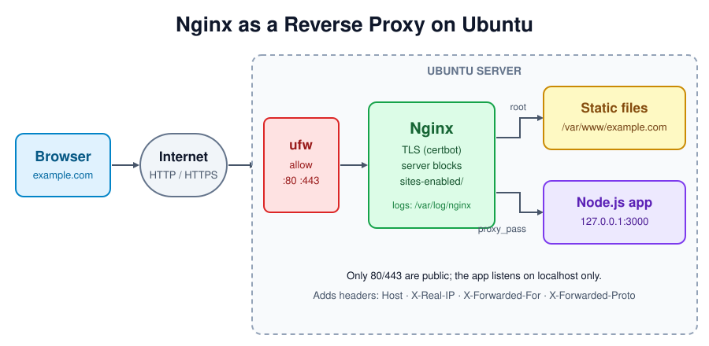

# Nginx Install aur Configure Karna

Ubuntu par Nginx se static website host karo aur Node.js app ko reverse-proxy karo, firewall kholo, certbot se free HTTPS lagao aur common errors fix karo.

## Use Case

Aapke paas public IP aur domain `example.com` wala ek fresh Ubuntu server hai. Aapko `/var/www` se static site serve karni hai aur port 3000 par chalne wali Node.js API ko HTTPS ke saath Nginx ke peeche rakhna hai.



Nginx har request ports 80/443 par leta hai aur ya to disk se file serve karta hai ya request ko `127.0.0.1:3000` wale app ko forward karta hai. App kabhi seedha internet par expose nahi hota.

## 1. Nginx Install Karo

Pehle index refresh karo, jaise [package management](README.md) mein samjhaya hai.

```bash
sudo apt-get update
sudo apt-get install -y nginx
nginx -v
# nginx version: nginx/1.24.0 (Ubuntu)
```

## 2. Service Check aur Enable Karo

Services systemd se manage hoti hain, dekho [system administration basics](../07_System_Administration/README.md).

```bash
systemctl status nginx
# ● nginx.service - A high performance web server and a reverse proxy server
#      Active: active (running) since Mon 2026-11-23 10:02:11 UTC
sudo systemctl enable nginx      # start at boot (already enabled on Ubuntu)
curl -I http://localhost
# HTTP/1.1 200 OK
```

## 3. Firewall Kholo

```bash
sudo ufw app list
# Available applications:
#   Nginx Full
#   Nginx HTTP
#   Nginx HTTPS
#   OpenSSH
sudo ufw allow OpenSSH           # do this BEFORE enabling ufw on a remote box
sudo ufw allow 'Nginx Full'      # ports 80 and 443
sudo ufw enable
```

## 4. File Layout

| Path | Kaam |
| :--- | :--- |
| `/etc/nginx/nginx.conf` | Main config (workers, includes) |
| `/etc/nginx/sites-available/` | Har site ki ek file (abhi active nahi) |
| `/etc/nginx/sites-enabled/` | Active sites ke symlinks |
| `/var/www/html/` | Default web root |
| `/var/log/nginx/access.log` | Har request |
| `/var/log/nginx/error.log` | Errors, upstream failures |

## 5. Static Site ke liye Server Block

```bash
sudo mkdir -p /var/www/example.com
echo '<h1>Hello from Nginx</h1>' | sudo tee /var/www/example.com/index.html
sudo chown -R www-data:www-data /var/www/example.com
sudo nano /etc/nginx/sites-available/example.com
```

```nginx
server {
    listen 80;
    server_name example.com www.example.com;

    root /var/www/example.com;
    index index.html;

    location / {
        try_files $uri $uri/ =404;
    }
}
```

```bash
sudo ln -s /etc/nginx/sites-available/example.com /etc/nginx/sites-enabled/
sudo rm /etc/nginx/sites-enabled/default      # optional: disable the welcome page
```

## 6. Node.js App ke liye Reverse-Proxy Server Block

App ko `127.0.0.1:3000` par chalao (jaise systemd service ke roop mein), phir doosri site add karo:

```nginx
server {
    listen 80;
    server_name api.example.com;

    location / {
        proxy_pass http://127.0.0.1:3000;
        proxy_http_version 1.1;
        proxy_set_header Host $host;
        proxy_set_header X-Real-IP $remote_addr;
        proxy_set_header X-Forwarded-For $proxy_add_x_forwarded_for;
        proxy_set_header X-Forwarded-Proto $scheme;
        proxy_set_header Upgrade $http_upgrade;      # WebSockets
        proxy_set_header Connection "upgrade";
    }
}
```

`X-Forwarded-*` headers app ko asli client IP batate hain aur ye bhi ki original request HTTPS thi ya nahi.

## 7. Pehle Test, Phir Reload

```bash
sudo nginx -t
# nginx: the configuration file /etc/nginx/nginx.conf syntax is ok
# nginx: configuration file /etc/nginx/nginx.conf test is successful
sudo systemctl reload nginx
```

Hamesha pehle `nginx -t` chalao: broken config ke saath reload refuse ho jaata hai, lekin restart site ko down kar dega.

## 8. certbot se Free HTTPS

Domain ka DNS pehle se server ki taraf point hona chahiye.

```bash
sudo apt-get install -y certbot python3-certbot-nginx
sudo certbot --nginx -d example.com -d www.example.com
# Successfully deployed certificate for example.com to /etc/nginx/sites-enabled/example.com
sudo certbot renew --dry-run     # renewal runs automatically via a systemd timer
```

certbot server block ko edit karke 443 par listen karwata hai aur HTTP ko HTTPS par redirect karta hai.

## Troubleshooting

| Symptom | Sambhavit kaaran | Fix |
| :--- | :--- | :--- |
| `502 Bad Gateway` | Node app band hai ya doosre port par hai | `curl 127.0.0.1:3000`, `tail /var/log/nginx/error.log` check karo |
| `403 Forbidden` | Nginx (`www-data`) files padh nahi pa raha, ya `index` file nahi hai | `namei -l /var/www/example.com/index.html`, `chmod`/`chown` se fix karo |
| `bind() to 0.0.0.0:80 failed` | Port pehle se use mein hai (Apache, doosra Nginx) | `sudo ss -tulpn \| grep ':80'` aur wo service band karo |
| Changes dikh nahi rahe | Reload bhool gaye, ya site symlinked nahi | `ls -l /etc/nginx/sites-enabled/`, `sudo systemctl reload nginx` |
| Bahar se timeout | Firewall ya cloud security group | `sudo ufw status`, provider console check karo |

```bash
sudo ss -tulpn | grep -E ':80|:443'
# tcp LISTEN 0 511 0.0.0.0:80 0.0.0.0:* users:(("nginx",pid=1234,fd=6))
```

Directory permissions [permissions](../02_Filesystem/permissions.md) mein samjhaye gaye hain.

## Interview Questions

**Q1. Reverse proxy kya hai?**
Ek server jo client requests leta hai aur unhe backend apps ko forward karta hai. Ye TLS, caching, load balancing deta hai aur backend ko chhupata hai.

**Q2. `sites-available` vs `sites-enabled`?**
`sites-available` mein har site ka config hota hai; Nginx sirf wahi load karta hai jo `sites-enabled` mein symlinked hain.

**Q3. 502 Bad Gateway ka kya matlab hai?**
Nginx theek hai lekin upstream app se valid response nahi mila (app band hai, crash ho gaya ya galat port par hai).

**Q4. `restart` ki jagah `reload` kyun?**
`reload` bina connections drop kiye config dobara padhta hai, aur naya config invalid ho to purana config rakhta hai.

**Q5. `X-Forwarded-For` kyun set karte hain?**
Iske bina app ko har request `127.0.0.1` se aati dikhegi, asli client IP nahi.
