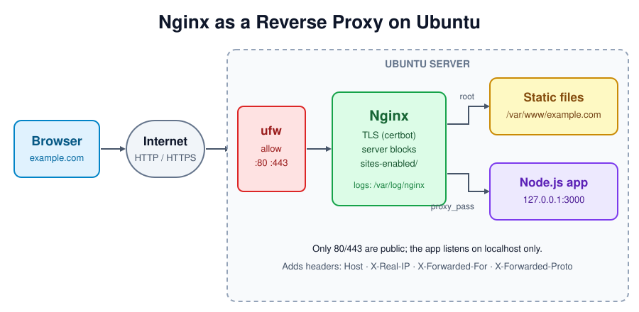

# Install and Configure Nginx

Host a static website and reverse-proxy a Node.js app with Nginx on Ubuntu, open the firewall, add free HTTPS with certbot and fix common errors.

## Use Case

You have a fresh Ubuntu server with a public IP and a domain `example.com`. You want to serve a static site from `/var/www` and put a Node.js API running on port 3000 behind Nginx, with HTTPS.



Nginx receives every request on ports 80/443 and either serves a file from disk or forwards the request to the app on `127.0.0.1:3000`. The app is never exposed to the internet directly.

## 1. Install Nginx

Refresh the index first, as explained in [package management](README.md).

```bash
sudo apt-get update
sudo apt-get install -y nginx
nginx -v
# nginx version: nginx/1.24.0 (Ubuntu)
```

## 2. Check and Enable the Service

Services are managed with systemd, see [system administration basics](../07_System_Administration/README.md).

```bash
systemctl status nginx
# ● nginx.service - A high performance web server and a reverse proxy server
#      Active: active (running) since Mon 2026-11-23 10:02:11 UTC
sudo systemctl enable nginx      # start at boot (already enabled on Ubuntu)
curl -I http://localhost
# HTTP/1.1 200 OK
```

## 3. Open the Firewall

```bash
sudo ufw app list
# Available applications:
#   Nginx Full
#   Nginx HTTP
#   Nginx HTTPS
#   OpenSSH
sudo ufw allow OpenSSH           # do this BEFORE enabling ufw on a remote box
sudo ufw allow 'Nginx Full'      # ports 80 and 443
sudo ufw enable
```

## 4. File Layout

| Path | Purpose |
| :--- | :--- |
| `/etc/nginx/nginx.conf` | Main config (workers, includes) |
| `/etc/nginx/sites-available/` | One file per site (not active yet) |
| `/etc/nginx/sites-enabled/` | Symlinks to active sites |
| `/var/www/html/` | Default web root |
| `/var/log/nginx/access.log` | Every request |
| `/var/log/nginx/error.log` | Errors, upstream failures |

## 5. Server Block for a Static Site

```bash
sudo mkdir -p /var/www/example.com
echo '<h1>Hello from Nginx</h1>' | sudo tee /var/www/example.com/index.html
sudo chown -R www-data:www-data /var/www/example.com
sudo nano /etc/nginx/sites-available/example.com
```

```nginx
server {
    listen 80;
    server_name example.com www.example.com;

    root /var/www/example.com;
    index index.html;

    location / {
        try_files $uri $uri/ =404;
    }
}
```

```bash
sudo ln -s /etc/nginx/sites-available/example.com /etc/nginx/sites-enabled/
sudo rm /etc/nginx/sites-enabled/default      # optional: disable the welcome page
```

## 6. Reverse-Proxy Server Block for a Node.js App

Run the app on `127.0.0.1:3000` (for example as a systemd service), then add a second site:

```nginx
server {
    listen 80;
    server_name api.example.com;

    location / {
        proxy_pass http://127.0.0.1:3000;
        proxy_http_version 1.1;
        proxy_set_header Host $host;
        proxy_set_header X-Real-IP $remote_addr;
        proxy_set_header X-Forwarded-For $proxy_add_x_forwarded_for;
        proxy_set_header X-Forwarded-Proto $scheme;
        proxy_set_header Upgrade $http_upgrade;      # WebSockets
        proxy_set_header Connection "upgrade";
    }
}
```

The `X-Forwarded-*` headers tell the app the real client IP and whether the original request was HTTPS.

## 7. Test, Then Reload

```bash
sudo nginx -t
# nginx: the configuration file /etc/nginx/nginx.conf syntax is ok
# nginx: configuration file /etc/nginx/nginx.conf test is successful
sudo systemctl reload nginx
```

Always run `nginx -t` first: a reload with a broken config is refused, but a restart would take the site down.

## 8. Free HTTPS with certbot

DNS for the domain must already point to the server.

```bash
sudo apt-get install -y certbot python3-certbot-nginx
sudo certbot --nginx -d example.com -d www.example.com
# Successfully deployed certificate for example.com to /etc/nginx/sites-enabled/example.com
sudo certbot renew --dry-run     # renewal runs automatically via a systemd timer
```

certbot edits the server block to listen on 443 and redirects HTTP to HTTPS.

## Troubleshooting

| Symptom | Likely cause | Fix |
| :--- | :--- | :--- |
| `502 Bad Gateway` | Node app is down or on another port | `curl 127.0.0.1:3000`, check `tail /var/log/nginx/error.log` |
| `403 Forbidden` | Nginx (`www-data`) cannot read files, or no `index` file | `namei -l /var/www/example.com/index.html`, fix with `chmod`/`chown` |
| `bind() to 0.0.0.0:80 failed` | Port already used (Apache, another Nginx) | `sudo ss -tulpn \| grep ':80'` and stop that service |
| Changes not visible | Forgot reload, or site not symlinked | `ls -l /etc/nginx/sites-enabled/`, `sudo systemctl reload nginx` |
| Timeout from outside | Firewall or cloud security group | `sudo ufw status`, check the provider console |

```bash
sudo ss -tulpn | grep -E ':80|:443'
# tcp LISTEN 0 511 0.0.0.0:80 0.0.0.0:* users:(("nginx",pid=1234,fd=6))
```

Directory permissions are explained in [permissions](../02_Filesystem/permissions.md).

## Interview Questions

**Q1. What is a reverse proxy?**
A server that accepts client requests and forwards them to backend apps. It adds TLS, caching, load balancing and hides the backend.

**Q2. `sites-available` vs `sites-enabled`?**
`sites-available` stores every site config; only those symlinked into `sites-enabled` are loaded by Nginx.

**Q3. What does a 502 Bad Gateway mean?**
Nginx is fine but could not get a valid response from the upstream app (it is down, crashed or on the wrong port).

**Q4. Why `reload` instead of `restart`?**
`reload` re-reads the config with no dropped connections and keeps the old config if the new one is invalid.

**Q5. Why set `X-Forwarded-For`?**
Without it the app sees every request coming from `127.0.0.1` instead of the real client IP.
