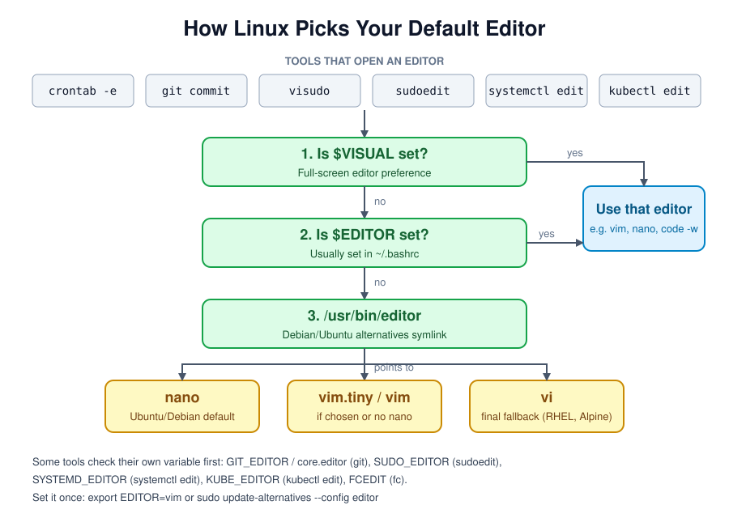

# Linux पर टेक्स्ट एडिटर

Servers पर terminal editors क्यों ज़रूरी हैं, हर distro में कौन-सा editor मिलता है, Linux default editor कैसे चुनता है, और nano, vim, emacs व micro की तुलना।



## Terminal editors क्यों ज़रूरी हैं

Server से आप आमतौर पर SSH के ज़रिए जुड़ते हैं। वहाँ न desktop होता है, न mouse, न VS Code की window, सिर्फ़ एक shell। किसी config file, cron job या `.env` file को ठीक करने के लिए ऐसा editor चाहिए जो **terminal के अंदर** चले।

| स्थिति | Terminal editor क्यों चाहिए |
| :--- | :--- |
| Cloud VM में SSH | Servers पर GUI इंस्टॉल नहीं होता |
| Rescue / single-user mode | सिर्फ़ base system उपलब्ध होता है |
| `crontab -e`, `visudo`, `git commit` | ये tools आपके लिए editor खोलते हैं |
| Container के अंदर (`docker exec -it`) | Image छोटी होती है, अक्सर सिर्फ़ `vi` या कुछ भी नहीं |

इस module के topics:

- [nano: पूरी गाइड](nano.md)
- [vim: पूरी गाइड](vim.md)
- [असली दुनिया के editing काम](real-world-editing.md)
- vi का छोटा revision: [vi editor](../05_Shell_Scripting/vi-editor.md)

## Default रूप से कौन-सा editor मिलता है

| Distro / image | Default इंस्टॉल | `vi` असल में | `crontab -e` आदि का default |
| :--- | :--- | :--- | :--- |
| Ubuntu / Debian | `nano`, `vim-tiny` | `vim.tiny` | `nano` |
| RHEL / Rocky / Alma | `vi` (vim-minimal) | vim-minimal | `vi` |
| Amazon Linux 2 / 2023 | `vi` (vim-minimal), अक्सर `nano` | vim-minimal | `vi` |
| Fedora | `nano`, `vi` | vim-minimal | `nano` |
| Alpine / BusyBox | सिर्फ़ `vi` | BusyBox `vi` | `vi` |
| Minimal Docker images (`debian:slim`, distroless) | अक्सर **कोई नहीं** | मौजूद नहीं | कोई नहीं |

```bash
which nano vi vim               # what is installed?
ls -l /usr/bin/vi               # follow the symlink
sudo apt install -y vim nano    # Debian / Ubuntu
sudo dnf install -y vim-enhanced nano   # RHEL / Amazon Linux
apk add vim nano                # Alpine
```

जिस container में कोई editor नहीं है, वहाँ file को host पर edit करके अंदर copy करना बेहतर है (`docker cp`), या कुछ देर के लिए editor इंस्टॉल कर लें: `apt-get update && apt-get install -y nano`।

## Editor कैसे चुना जाता है

ज़्यादातर tools यही क्रम मानते हैं (ऊपर का diagram देखें):

1. `$VISUAL` (full-screen editor)
2. `$EDITOR`
3. `/usr/bin/editor`, एक symlink जिसे Debian **alternatives** संभालता है (सिर्फ़ Debian/Ubuntu)
4. Built-in fallback, आमतौर पर `vi` (कुछ distros पर `nano`)

```bash
echo $VISUAL $EDITOR                     # current choice (often empty)
ls -l /usr/bin/editor /etc/alternatives/editor
select-editor                            # Ubuntu/Debian: per-user menu, saved in ~/.selected_editor
sudo update-alternatives --config editor # Debian/Ubuntu: system-wide default
```

अपने user के लिए चुनाव स्थायी बनाएँ:

```bash
echo 'export EDITOR=vim'  >> ~/.bashrc
echo 'export VISUAL=vim'  >> ~/.bashrc
source ~/.bashrc

git config --global core.editor "nano"   # git only
git config --global core.editor "code --wait"   # VS Code (must wait until tab closes)
```

`sudo` ज़्यादातर environment variables हटा देता है, इसलिए `sudo crontab -e` फिर भी nano खोल सकता है। `sudo -E` इस्तेमाल करें या root के लिए भी `EDITOR` सेट करें।

## कौन-से tools editor खोलते हैं

| Command | आप क्या edit करते हैं | पहले कौन-सा variable देखा जाता है |
| :--- | :--- | :--- |
| `crontab -e` | आपके cron jobs ([scheduling](../03_Processes/scheduling.md)) | `VISUAL`, `EDITOR` |
| `sudo visudo` | `/etc/sudoers`, syntax check के साथ ([users and groups](../07_System_Administration/users-and-groups.md)) | `SUDO_EDITOR`, `VISUAL`, `EDITOR` |
| `sudoedit /etc/hosts` | Root की file, एक सुरक्षित temp copy के रूप में | `SUDO_EDITOR`, `VISUAL`, `EDITOR` |
| `sudo systemctl edit nginx` | Unit के लिए drop-in override | `SYSTEMD_EDITOR`, `EDITOR`, `VISUAL` |
| `git commit` | Commit message | `GIT_EDITOR`, `core.editor`, `VISUAL`, `EDITOR` |
| `kubectl edit deploy/web` | Live Kubernetes object (YAML) | `KUBE_EDITOR`, `EDITOR` |
| `fc` | पिछला shell command, save करने पर दोबारा चलता है | `FCEDIT`, `EDITOR` |

```bash
EDITOR=nano crontab -e          # one-off override for a single command
KUBE_EDITOR=nano kubectl edit deploy/web
fc                              # edit the previous command in your editor, runs on save
```

## तुलना: nano vs vi/vim vs emacs vs micro

| Editor | सीखने में कठिनाई | Servers पर उपलब्धता | किसके लिए सबसे अच्छा |
| :--- | :--- | :--- | :--- |
| `nano` | बहुत आसान, shortcuts screen पर दिखते हैं | Ubuntu/Debian पर default, हर जगह इंस्टॉल हो सकता है | जल्दी config edit, नए लोग |
| `vi` / `vim` | कठिन (modes), सीखने के बाद बहुत तेज़ | हर जगह, BusyBox और rescue mode में भी | रोज़ का server काम, बड़ी files, power editing |
| `emacs` | कठिन, बहुत बड़ा और extensible | Servers पर कम ही इंस्टॉल होता है | Developers जो एक ही tool में रहते हैं |
| `micro` | आसान, GUI जैसे Ctrl+S / Ctrl+C | Default इंस्टॉल नहीं (एक binary) | जिन्हें terminal में GUI जैसी keys चाहिए |

सीधा नियम: पहले दिन **nano** सीखें, हर server पर काम चलाने लायक **vi** सीखें, और servers पर ज़्यादा edit करते हैं तो **vim** में आगे बढ़ें।

## GUI और remote editing के विकल्प

| विकल्प | कैसे काम करता है |
| :--- | :--- |
| VS Code Remote-SSH | VS Code remote machine पर एक छोटा server चलाता है; आप local पर पूरे GUI से edit करते हैं |
| `sshfs` | Remote directory को local पर mount करता है, किसी भी editor से edit करें |
| `scp` / `rsync` | File नीचे copy करें, edit करें, वापस copy करें (एक बार के edit के लिए ठीक) |
| `vim scp://user@host//etc/hosts` | vim SSH से सीधे remote file edit करता है |

```bash
sshfs user@server:/etc/nginx ~/remote-nginx   # then open ~/remote-nginx in any editor
fusermount -u ~/remote-nginx                  # unmount
```

Production में सबसे अच्छा "editor" अक्सर कोई भी नहीं होता: configs को Git में रखें और servers को हाथ से edit करने के बजाय Ansible या CI से deploy करें।

## आम गलतियाँ

- **`crontab -e` या `git commit` के बाद vi में फँस जाना।** `Esc` दबाएँ, `:q!` टाइप करके Enter दबाएँ, फिर `export EDITOR=nano` सेट करें।
- **`EDITOR` सिर्फ़ current shell में सेट करना।** Logout पर यह खो जाता है; इसे `~/.bashrc` में डालें।
- **Git editor के रूप में `code` को `--wait` के बिना इस्तेमाल करना।** Git को editor तुरंत बंद होता दिखता है और वह खाली message के कारण abort कर देता है।
- **`/etc/sudoers` को सीधे edit करना।** एक typo से `sudo` बंद हो सकता है। हमेशा `visudo` इस्तेमाल करें।
- **Slim container में editor की उम्मीद करना।** Host पर edit करें या file को volume के रूप में mount करें।

## इंटरव्यू प्रश्न

**Q1. `$VISUAL` और `$EDITOR` में क्या फ़र्क है?**
पहले `EDITOR` एक line editor (जैसे `ed`) होता था और `VISUAL` full-screen editor। Tools पहले `VISUAL` देखते हैं, फिर `EDITOR`। आजकल ज़्यादातर लोग दोनों को एक ही value देते हैं।

**Q2. Ubuntu पर पूरे system का default editor कैसे बदलें?**
`sudo update-alternatives --config editor` से `/usr/bin/editor` symlink बदलता है। सिर्फ़ अपने user के लिए `select-editor` चलाएँ या `~/.bashrc` में `EDITOR` सेट करें।

**Q3. `nano /etc/sudoers` की जगह `visudo` क्यों?**
`visudo` file को lock करता है और save से पहले syntax जाँचता है, ताकि एक गलती से सबका `sudo` न टूटे।

**Q4. `sudoedit` क्या है और यह `sudo vim` से ज़्यादा सुरक्षित क्यों है?**
यह file को एक temp file में copy करता है, आपका editor आपके normal user के रूप में चलाता है, और फिर root के रूप में वापस copy करता है। आपका editor और उसके plugins कभी root बनकर नहीं चलते।

**Q5. आप Alpine container में SSH करते हैं और `nano` नहीं है। क्या करेंगे?**
`vi` इस्तेमाल करें, जो BusyBox हमेशा देता है, या container read-only न हो तो `apk add nano` से nano इंस्टॉल करें।
