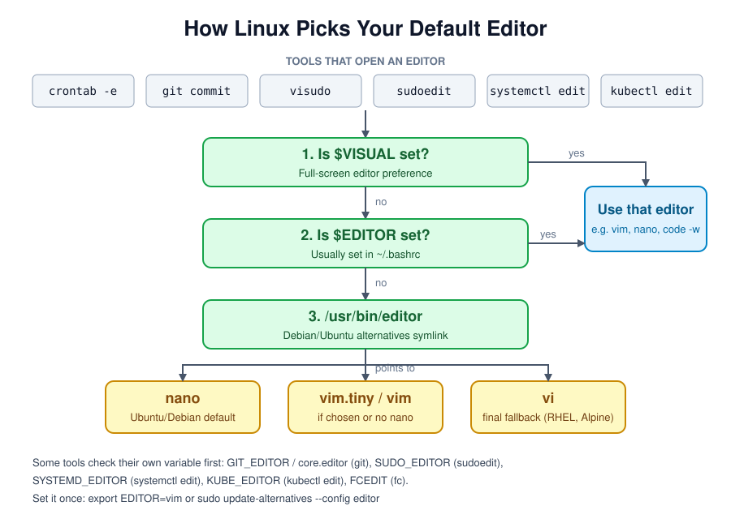

# Linux par Text Editors

Servers par terminal editors kyon zaroori hain, har distro ka default editor, Linux editor kaise chunta hai, aur nano, vim, emacs va micro ka comparison.



## Terminal editors kyon zaroori hain

Server se aap aam taur par SSH ke through judte ho. Wahan na desktop hota hai, na mouse, na VS Code ki window, sirf ek shell. Kisi config file, cron job ya `.env` file ko theek karne ke liye aisa editor chahiye jo **terminal ke andar** chale.

| Situation | Terminal editor kyon chahiye |
| :--- | :--- |
| Cloud VM mein SSH | Servers par GUI install nahi hota |
| Rescue / single-user mode | Sirf base system available hota hai |
| `crontab -e`, `visudo`, `git commit` | Ye tools aapke liye editor kholte hain |
| Container ke andar (`docker exec -it`) | Image chhoti hoti hai, aksar sirf `vi` ya kuch bhi nahi |

Is module ke topics:

- [nano: complete guide](nano.md)
- [vim: complete guide](vim.md)
- [Real-world editing ke kaam](real-world-editing.md)
- vi ka quick revision: [vi editor](../05_Shell_Scripting/vi-editor.md)

## Default mein kaunsa editor milta hai

| Distro / image | Default install | `vi` asal mein | `crontab -e` waghera ka default |
| :--- | :--- | :--- | :--- |
| Ubuntu / Debian | `nano`, `vim-tiny` | `vim.tiny` | `nano` |
| RHEL / Rocky / Alma | `vi` (vim-minimal) | vim-minimal | `vi` |
| Amazon Linux 2 / 2023 | `vi` (vim-minimal), aksar `nano` | vim-minimal | `vi` |
| Fedora | `nano`, `vi` | vim-minimal | `nano` |
| Alpine / BusyBox | sirf `vi` | BusyBox `vi` | `vi` |
| Minimal Docker images (`debian:slim`, distroless) | aksar **koi nahi** | missing | koi nahi |

```bash
which nano vi vim               # what is installed?
ls -l /usr/bin/vi               # follow the symlink
sudo apt install -y vim nano    # Debian / Ubuntu
sudo dnf install -y vim-enhanced nano   # RHEL / Amazon Linux
apk add vim nano                # Alpine
```

Jis container mein koi editor nahi hai, wahan file ko host par edit karke andar copy karna better hai (`docker cp`), ya thodi der ke liye editor install kar lo: `apt-get update && apt-get install -y nano`.

## Editor kaise chuna jaata hai

Zyada tar tools yahi order follow karte hain (upar ka diagram dekho):

1. `$VISUAL` (full-screen editor)
2. `$EDITOR`
3. `/usr/bin/editor`, ek symlink jise Debian **alternatives** manage karta hai (sirf Debian/Ubuntu)
4. Built-in fallback, aam taur par `vi` (kuch distros par `nano`)

```bash
echo $VISUAL $EDITOR                     # current choice (often empty)
ls -l /usr/bin/editor /etc/alternatives/editor
select-editor                            # Ubuntu/Debian: per-user menu, saved in ~/.selected_editor
sudo update-alternatives --config editor # Debian/Ubuntu: system-wide default
```

Apne user ke liye choice permanent banao:

```bash
echo 'export EDITOR=vim'  >> ~/.bashrc
echo 'export VISUAL=vim'  >> ~/.bashrc
source ~/.bashrc

git config --global core.editor "nano"   # git only
git config --global core.editor "code --wait"   # VS Code (must wait until tab closes)
```

`sudo` zyada tar environment variables hata deta hai, isliye `sudo crontab -e` phir bhi nano khol sakta hai. `sudo -E` use karo ya root ke liye bhi `EDITOR` set karo.

## Kaunse tools editor kholte hain

| Command | Aap kya edit karte ho | Pehle kaunsa variable check hota hai |
| :--- | :--- | :--- |
| `crontab -e` | Aapke cron jobs ([scheduling](../03_Processes/scheduling.md)) | `VISUAL`, `EDITOR` |
| `sudo visudo` | `/etc/sudoers`, syntax check ke saath ([users and groups](../07_System_Administration/users-and-groups.md)) | `SUDO_EDITOR`, `VISUAL`, `EDITOR` |
| `sudoedit /etc/hosts` | Root ki file, ek safe temp copy ke roop mein | `SUDO_EDITOR`, `VISUAL`, `EDITOR` |
| `sudo systemctl edit nginx` | Unit ke liye drop-in override | `SYSTEMD_EDITOR`, `EDITOR`, `VISUAL` |
| `git commit` | Commit message | `GIT_EDITOR`, `core.editor`, `VISUAL`, `EDITOR` |
| `kubectl edit deploy/web` | Live Kubernetes object (YAML) | `KUBE_EDITOR`, `EDITOR` |
| `fc` | Pichhla shell command, save karne par dobara chalta hai | `FCEDIT`, `EDITOR` |

```bash
EDITOR=nano crontab -e          # one-off override for a single command
KUBE_EDITOR=nano kubectl edit deploy/web
fc                              # edit the previous command in your editor, runs on save
```

## Comparison: nano vs vi/vim vs emacs vs micro

| Editor | Seekhne mein mushkil | Servers par availability | Kiske liye best |
| :--- | :--- | :--- | :--- |
| `nano` | Bahut aasaan, shortcuts screen par dikhte hain | Ubuntu/Debian par default, har jagah install ho sakta hai | Jaldi config edit, beginners |
| `vi` / `vim` | Mushkil (modes), seekhne ke baad bahut fast | Har jagah, BusyBox aur rescue mode mein bhi | Roz ka server kaam, badi files, power editing |
| `emacs` | Mushkil, bahut bada aur extensible | Servers par kam hi install hota hai | Developers jo ek hi tool mein rehte hain |
| `micro` | Aasaan, GUI jaise Ctrl+S / Ctrl+C | Default install nahi (single binary) | Jinhe terminal mein GUI jaisi keys chahiye |

Seedha rule: pehle din **nano** seekho, har server par kaam chalane laayak **vi** seekho, aur servers par zyada edit karte ho to **vim** mein aage badho.

## GUI aur remote editing ke options

| Option | Kaise kaam karta hai |
| :--- | :--- |
| VS Code Remote-SSH | VS Code remote machine par ek chhota server chalata hai; aap local par full GUI se edit karte ho |
| `sshfs` | Remote directory ko local par mount karta hai, kisi bhi editor se edit karo |
| `scp` / `rsync` | File neeche copy karo, edit karo, wapas copy karo (one-off edit ke liye theek) |
| `vim scp://user@host//etc/hosts` | vim SSH se seedha remote file edit karta hai |

```bash
sshfs user@server:/etc/nginx ~/remote-nginx   # then open ~/remote-nginx in any editor
fusermount -u ~/remote-nginx                  # unmount
```

Production mein sabse accha "editor" aksar koi bhi nahi hota: configs ko Git mein rakho aur servers ko haath se edit karne ke bajaye Ansible ya CI se deploy karo.

## Common mistakes

- **`crontab -e` ya `git commit` ke baad vi mein phas jaana.** `Esc` dabao, `:q!` type karke Enter dabao, phir `export EDITOR=nano` set karo.
- **`EDITOR` sirf current shell mein set karna.** Logout par ye kho jaata hai; ise `~/.bashrc` mein daalo.
- **Git editor ke roop mein `code` ko `--wait` ke bina use karna.** Git ko editor turant band hota dikhta hai aur wo khaali message ki wajah se abort kar deta hai.
- **`/etc/sudoers` ko seedha edit karna.** Ek typo se `sudo` band ho sakta hai. Hamesha `visudo` use karo.
- **Slim container mein editor expect karna.** Host par edit karo ya file ko volume ki tarah mount karo.

## Interview Questions

**Q1. `$VISUAL` aur `$EDITOR` mein kya farak hai?**
Pehle `EDITOR` ek line editor (jaise `ed`) hota tha aur `VISUAL` full-screen editor. Tools pehle `VISUAL` dekhte hain, phir `EDITOR`. Aajkal zyada tar log dono ko same value dete hain.

**Q2. Ubuntu par system-wide default editor kaise badlein?**
`sudo update-alternatives --config editor` se `/usr/bin/editor` symlink badalta hai. Sirf apne user ke liye `select-editor` chalao ya `~/.bashrc` mein `EDITOR` set karo.

**Q3. `nano /etc/sudoers` ki jagah `visudo` kyon?**
`visudo` file ko lock karta hai aur save se pehle syntax check karta hai, taaki ek galti se sabka `sudo` na toote.

**Q4. `sudoedit` kya hai aur ye `sudo vim` se zyada safe kyon hai?**
Ye file ko ek temp file mein copy karta hai, aapka editor aapke normal user ke roop mein chalata hai, aur phir root ke roop mein wapas copy karta hai. Aapka editor aur uske plugins kabhi root bankar nahi chalte.

**Q5. Aap Alpine container mein SSH karte ho aur `nano` nahi hai. Kya karoge?**
`vi` use karo, jo BusyBox hamesha deta hai, ya container read-only na ho to `apk add nano` se nano install karo.
