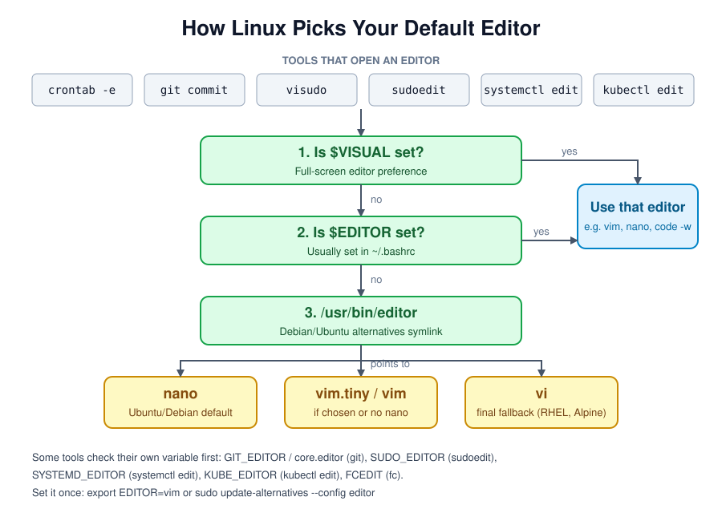

# Text Editors on Linux

Why terminal editors matter on servers, which editor each distro gives you, how Linux picks the default editor, and how nano, vim, emacs and micro compare.



## Why terminal editors matter

On a server you usually connect over SSH. There is no desktop, no mouse and no VS Code window, only a shell. Fixing a config file, a cron job or a `.env` file means using an editor that runs **inside the terminal**.

| Situation | Why a terminal editor is needed |
| :--- | :--- |
| SSH into a cloud VM | No GUI is installed on servers |
| Rescue / single-user mode | Only the base system is available |
| `crontab -e`, `visudo`, `git commit` | These tools open an editor for you |
| Inside a container (`docker exec -it`) | Image is minimal, often only `vi` or nothing |

Topics in this module:

- [nano: complete guide](nano.md)
- [vim: complete guide](vim.md)
- [Real-world editing tasks](real-world-editing.md)
- Quick vi refresher: [vi editor](../05_Shell_Scripting/vi-editor.md)

## Which editor you get by default

| Distro / image | Installed by default | `vi` is | Default for `crontab -e` etc. |
| :--- | :--- | :--- | :--- |
| Ubuntu / Debian | `nano`, `vim-tiny` | `vim.tiny` | `nano` |
| RHEL / Rocky / Alma | `vi` (vim-minimal) | vim-minimal | `vi` |
| Amazon Linux 2 / 2023 | `vi` (vim-minimal), often `nano` | vim-minimal | `vi` |
| Fedora | `nano`, `vi` | vim-minimal | `nano` |
| Alpine / BusyBox | `vi` only | BusyBox `vi` | `vi` |
| Minimal Docker images (`debian:slim`, distroless) | often **none** | missing | none |

```bash
which nano vi vim               # what is installed?
ls -l /usr/bin/vi               # follow the symlink
sudo apt install -y vim nano    # Debian / Ubuntu
sudo dnf install -y vim-enhanced nano   # RHEL / Amazon Linux
apk add vim nano                # Alpine
```

In a container without any editor, prefer editing the file on the host and copying it in (`docker cp`), or install one temporarily: `apt-get update && apt-get install -y nano`.

## How the editor is chosen

Most tools follow the same order (see the diagram above):

1. `$VISUAL` (full-screen editor)
2. `$EDITOR`
3. `/usr/bin/editor`, a symlink managed by Debian **alternatives** (Debian/Ubuntu only)
4. A built-in fallback, usually `vi` (or `nano` on some distros)

```bash
echo $VISUAL $EDITOR                     # current choice (often empty)
ls -l /usr/bin/editor /etc/alternatives/editor
select-editor                            # Ubuntu/Debian: per-user menu, saved in ~/.selected_editor
sudo update-alternatives --config editor # Debian/Ubuntu: system-wide default
```

Make your choice permanent for your user:

```bash
echo 'export EDITOR=vim'  >> ~/.bashrc
echo 'export VISUAL=vim'  >> ~/.bashrc
source ~/.bashrc

git config --global core.editor "nano"   # git only
git config --global core.editor "code --wait"   # VS Code (must wait until tab closes)
```

`sudo` drops most environment variables, so `sudo crontab -e` may still open nano. Use `sudo -E` or set `EDITOR` for root as well.

## Which tools open an editor

| Command | What you edit | Variable checked first |
| :--- | :--- | :--- |
| `crontab -e` | Your cron jobs ([scheduling](../03_Processes/scheduling.md)) | `VISUAL`, `EDITOR` |
| `sudo visudo` | `/etc/sudoers`, with syntax check ([users and groups](../07_System_Administration/users-and-groups.md)) | `SUDO_EDITOR`, `VISUAL`, `EDITOR` |
| `sudoedit /etc/hosts` | Root file, edited as a safe temp copy | `SUDO_EDITOR`, `VISUAL`, `EDITOR` |
| `sudo systemctl edit nginx` | A drop-in override for a unit | `SYSTEMD_EDITOR`, `EDITOR`, `VISUAL` |
| `git commit` | Commit message | `GIT_EDITOR`, `core.editor`, `VISUAL`, `EDITOR` |
| `kubectl edit deploy/web` | Live Kubernetes object (YAML) | `KUBE_EDITOR`, `EDITOR` |
| `fc` | Last shell command, re-run after save | `FCEDIT`, `EDITOR` |

```bash
EDITOR=nano crontab -e          # one-off override for a single command
KUBE_EDITOR=nano kubectl edit deploy/web
fc                              # edit the previous command in your editor, runs on save
```

## Comparison: nano vs vi/vim vs emacs vs micro

| Editor | Learning curve | Availability on servers | Best for |
| :--- | :--- | :--- | :--- |
| `nano` | Very easy, shortcuts shown on screen | Default on Ubuntu/Debian, installable everywhere | Quick config edits, beginners |
| `vi` / `vim` | Steep (modes), very fast once learned | Everywhere, even BusyBox and rescue mode | Daily server work, large files, power editing |
| `emacs` | Steep, huge and extensible | Rarely installed on servers | Developers who live in one tool |
| `micro` | Easy, Ctrl+S / Ctrl+C like a GUI | Not installed by default (single binary) | People who want GUI-style keys in a terminal |

Rule of thumb: learn **nano** for day one, learn enough **vi** to survive any server, and grow into **vim** if you edit on servers often.

## GUI and remote editing options

| Option | How it works |
| :--- | :--- |
| VS Code Remote-SSH | VS Code runs a small server on the remote box; you edit with the full GUI locally |
| `sshfs` | Mounts the remote directory locally, edit with any editor |
| `scp` / `rsync` | Copy file down, edit, copy back (fine for one-off edits) |
| `vim scp://user@host//etc/hosts` | vim edits a remote file over SSH directly |

```bash
sshfs user@server:/etc/nginx ~/remote-nginx   # then open ~/remote-nginx in any editor
fusermount -u ~/remote-nginx                  # unmount
```

For production, the best "editor" is often none at all: keep configs in Git and deploy them with Ansible or CI instead of hand-editing servers.

## Common mistakes

- **Stuck in vi after `crontab -e` or `git commit`.** Press `Esc`, type `:q!` and Enter, then set `export EDITOR=nano`.
- **Setting `EDITOR` only in the current shell.** It is lost on logout; add it to `~/.bashrc`.
- **Using `code` without `--wait` as git editor.** Git sees the editor exit instantly and aborts with an empty message.
- **Editing `/etc/sudoers` directly.** A typo can lock out `sudo`. Always use `visudo`.
- **Expecting an editor in a slim container.** Edit on the host or mount the file as a volume instead.

## Interview Questions

**Q1. What is the difference between `$VISUAL` and `$EDITOR`?**
Historically `EDITOR` was a line editor (like `ed`) and `VISUAL` a full-screen one. Tools try `VISUAL` first, then `EDITOR`. Today most people set both to the same value.

**Q2. How do you change the default editor system-wide on Ubuntu?**
`sudo update-alternatives --config editor` changes the `/usr/bin/editor` symlink. Per user, run `select-editor` or set `EDITOR` in `~/.bashrc`.

**Q3. Why use `visudo` instead of `nano /etc/sudoers`?**
`visudo` locks the file and checks syntax before saving, so a mistake cannot break `sudo` for everyone.

**Q4. What is `sudoedit` and why is it safer than `sudo vim`?**
It copies the file to a temp file, runs your editor as your normal user, and copies it back as root. Your editor and its plugins never run as root.

**Q5. You SSH into an Alpine container and `nano` is missing. What do you do?**
Use `vi`, which BusyBox always provides, or install nano with `apk add nano` if the container is not read-only.
