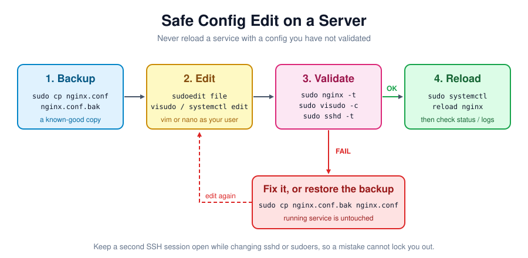

# Linux Servers पर असली Editing

सर्वर के ग्यारह असली हालात: सुरक्षित config edit, sudoedit, crontab, visudo, systemd override, git, containers, बड़े logs, CI edits, CRLF और YAML।

Laptop पर file में typo से एक मिनट जाता है। Server पर वही typo website गिरा सकता है या आपको SSH से बाहर कर सकता है। यह note असली काम में आने वाले editing कामों के सटीक commands दिखाता है। Key bindings [vim reference](vim.md) और [nano note](nano.md) में हैं; module का overview [README](README.md) में है।



## 1. nginx config को सुरक्षित तरीके से edit करना

नियम: **backup, edit, validate, reload**। जिस config को test नहीं किया, उससे service कभी restart न करें।

```bash
cd /etc/nginx/sites-available
sudo cp default default.bak.$(date +%F)   # 1. backup with a date
sudoedit default                          # 2. edit as your user, saved as root
sudo nginx -t                             # 3. validate syntax
sudo systemctl reload nginx               # 4. apply without dropping connections
sudo cp default.bak.$(date +%F) default   #    if step 3 failed: restore the backup
```

`sudoedit` (`sudo -e` जैसा ही) file को एक temp file में copy करता है, उसे आपके अपने editor (`$SUDO_EDITOR`, `$VISUAL` या `$EDITOR`) में आपकी settings के साथ खोलता है, और save करने पर ही root बनकर वापस copy करता है। आपका vimrc चलता है और editor कभी root बनकर नहीं चलता। पूरा setup [install nginx](../08_Projects_and_Use_Cases/install-nginx.md) में है।

## 2. Root file बिना sudo के खोल ली

आपने vim में `/etc/hosts` edit किया, `:w` टाइप किया और `E45: 'readonly' option is set` या "Permission denied" मिला। बाहर निकलकर अपना काम न खोएँ:

```vim
:w !sudo tee % > /dev/null
```

`:w !cmd` buffer को एक command में pipe करता है, `%` current file का नाम है, और `sudo tee` उसे root बनकर लिखता है। जब vim बताए कि file बदल गई है तो `L` (Load) दबाएँ, फिर `:q`। यह vim में चलता है, neovim में नहीं (वहाँ sudo password नहीं पूछ पाता); neovim में `/tmp/x` में save करें और `sudo cp` करें।

## 3. crontab -e: editor चुनें और job जोड़ें

Debian/Ubuntu पर `crontab -e` पहली बार चलाने पर editor चुनने को कहता है। बाद में `select-editor` से या एक बार के लिए `EDITOR` से बदलें:

```bash
select-editor                      # Debian/Ubuntu: choose nano, vim.basic ...
EDITOR=vim crontab -e              # one-off choice
crontab -l                         # list your jobs
# line to add (m h dom mon dow command); save, quit, cron installs it:
30 2 * * * /opt/scripts/backup.sh >> /var/log/backup.log 2>&1
```

Syntax और ज़्यादा उदाहरण [scheduling](../03_Processes/scheduling.md) में हैं।

## 4. /etc/sudoers सीधे edit करने के बजाय visudo

`/etc/sudoers` में एक syntax error सबके लिए `sudo` तोड़ देता है, और शायद उसे ठीक करने के लिए आपके पास root password भी न हो। `visudo` file को lock करता है, एक copy खोलता है, और टूटी हुई file save करने से मना करता है (`What now?` आने पर `e` से दोबारा edit, `x` से बिना save किए बाहर)।

```bash
sudo visudo                                  # edit the main file safely
sudo visudo -f /etc/sudoers.d/deploy         # better: a drop-in file per rule
sudo EDITOR=nano visudo                      # choose the editor
sudo visudo -c                               # check all sudoers files
```

Drop-in उदाहरण: `deploy ALL=(ALL) NOPASSWD: /usr/bin/systemctl restart myapp`। देखें [users and groups](../07_System_Administration/users-and-groups.md)।

## 5. systemctl edit: unit को छुए बिना override करना

Package upgrade `/lib/systemd/system/nginx.service` को overwrite कर देते हैं। इसलिए अपने बदलाव एक override में रखें:

```bash
sudo systemctl edit nginx          # creates /etc/systemd/system/nginx.service.d/override.conf
sudo systemctl restart nginx       # edit already ran daemon-reload for you
systemctl cat nginx                # shows the unit plus your override
```

Override का उदाहरण: `[Service]` फिर `LimitNOFILE=65535` और `Restart=on-failure`। `ExecStart` जैसी list setting बदलने के लिए पहले एक ख़ाली `ExecStart=` line से उसे साफ़ करें, फिर नई line जोड़ें।

## 6. Git commit messages और interactive rebase

```bash
git config --global core.editor "vim"   # or "nano"
git commit                              # opens the editor for the message
git rebase -i HEAD~3                    # rewrite the last 3 commits
```

Rebase list में `pick` को `reword`, `squash` या `drop` में बदलें (vim में: word पर `cw`, या `:2,3s/^pick/squash/`), फिर `:wq`। vim के अंदर से commit या rebase रद्द करने के लिए `:cq` इस्तेमाल करें: यह error code के साथ बाहर निकलता है और git रुक जाता है।

## 7. Docker container के अंदर कोई editor नहीं

Slim images में vi या nano नहीं होता। तीन विकल्प, सबसे अच्छा पहले:

```bash
# a) Edit on the host if the file is bind-mounted (check with docker inspect)
vim ./nginx/default.conf && docker exec web nginx -s reload
# b) Copy out, edit, copy back
docker cp web:/etc/nginx/conf.d/default.conf .
vim default.conf
docker cp default.conf web:/etc/nginx/conf.d/default.conf
docker exec web nginx -t && docker exec web nginx -s reload
# c) Install an editor (lost when the container is recreated)
docker exec -it web sh -c 'apt-get update && apt-get install -y nano'   # Alpine: apk add nano
```

Container के अंदर किए बदलाव उसे दोबारा बनाने पर मिट जाते हैं; असली fix image या volume में होना चाहिए। देखें [install docker](../08_Projects_and_Use_Cases/install-docker.md)।

## 8. बहुत बड़ी log files

vim पूरी file memory में load करता है और swap file बनाता है, इसलिए 5 GB के log पर `vim app.log` server को अटका सकता है। Logs pager से पढ़ें:

```bash
less /var/log/app.log          # G = end, /ERROR = search, F = follow (Ctrl+c stops)
tail -f /var/log/app.log       # just watch new lines
tail -n 5000 app.log > /tmp/recent.log && view /tmp/recent.log   # small excerpt
```

`view` (read-only vim) सामान्य आकार की files के लिए ठीक है, लेकिन वह भी सब कुछ load करता है।

## 9. Scripts और CI में बिना editor के edit

Pipelines में terminal नहीं होता, इसलिए editor भी नहीं। `sed -i`, `tee` या here-doc इस्तेमाल करें:

```bash
sed -i.bak 's/^Port 22$/Port 2222/' /etc/ssh/sshd_config     # in place, keep .bak
echo "10.0.0.5 db.internal" | sudo tee -a /etc/hosts          # append as root
sudo tee /etc/myapp/app.env > /dev/null <<'EOF'
APP_ENV=production
LOG_LEVEL=info
EOF
```

`sudo echo x > /etc/file` fail होता है क्योंकि redirect आपके बिना-अधिकार वाले shell में चलता है; `sudo tee` इसे ठीक करता है। ज़्यादा जानकारी [sed note](../06_Sed_and_Awk/sed.md) में।

## 10. CRLF line endings ठीक करना

Windows पर लिखी script `/bin/bash^M: bad interpreter` के साथ fail होती है। `^M` एक carriage return है।

```bash
file deploy.sh            # "with CRLF line terminators"
dos2unix deploy.sh        # convert (apt install dos2unix)
sed -i 's/\r$//' deploy.sh   # same thing without extra packages
```

vim में: `:set ff?` format दिखाता है, `:set ff=unix` फिर `:w` उसे बदल देता है।

## 11. YAML: tabs बनाम spaces

YAML में indentation के लिए tabs मना हैं; एक tab से `found character that cannot start any token` error आता है।

```vim
:set expandtab tabstop=2 shiftwidth=2   " Tab key now inserts 2 spaces
:set list                               " tabs show as ^I
:retab                                  " convert existing tabs to spaces
```

Shell से: `grep -nP '\t' docker-compose.yml` tab वाली lines दिखाता है।

## कौन सा tool कब

| हालात | सबसे अच्छा tool |
| :--- | :--- |
| Beginner के लिए एक file का छोटा edit | `nano` |
| लंबे edits, search-replace, macros | `vim` |
| Root की config file | `sudoedit` |
| `/etc/sudoers` | `visudo` |
| systemd unit में बदलाव | `systemctl edit` |
| Cron jobs | `crontab -e` |
| बहुत बड़ी या live log files | `less`, `tail -f` |
| Scripts, CI, Ansible जैसे बदलाव | `sed -i`, `tee`, here-doc |
| Container के अंदर की files | Host bind mount या `docker cp` |

## आम गलतियाँ

| गलती | सुधार |
| :--- | :--- |
| `nginx -t` से पहले restart करना | हमेशा पहले validate, फिर `reload` |
| हर file पर `sudo vim` | `sudoedit` इस्तेमाल करें; editor root बनकर नहीं चलता |
| `/etc/sudoers` को सादे vim से edit करना | `visudo` या drop-ins के लिए `visudo -f` |
| इकलौते SSH session में `sshd_config` बदलना | दूसरा session खुला रखें और `sudo sshd -t` चलाएँ |

## Interview प्रश्न

**Q1. `sudo vim` के बजाय `sudoedit` क्यों?**
Editor आपके user और आपकी config के साथ चलता है, सिर्फ़ आख़िरी copy-back root से होता है। कोई plugin या `:!sh` root shell नहीं पा सकता।

**Q2. `visudo` क्यों इस्तेमाल करें?**
यह file lock करता है और save से पहले syntax जाँचता है। टूटी sudoers file सबको `sudo` से बाहर कर देगी।

**Q3. बिना sudo के vim में खोली root file को कैसे save करें?**
`:w !sudo tee % > /dev/null`, फिर file reload करें और बाहर निकलें।

**Q4. `systemctl edit` के बदलाव कहाँ जाते हैं और क्यों?**
`/etc/systemd/system/<unit>.d/override.conf` में, जो package upgrade के बाद भी बचा रहता है और vendor unit से ऊपर priority रखता है।

**Q5. Script `bad interpreter: ^M` के साथ fail होती है। गड़बड़ क्या है?**
उसमें Windows की CRLF line endings हैं। `dos2unix` या vim में `:set ff=unix` से बदलें।
