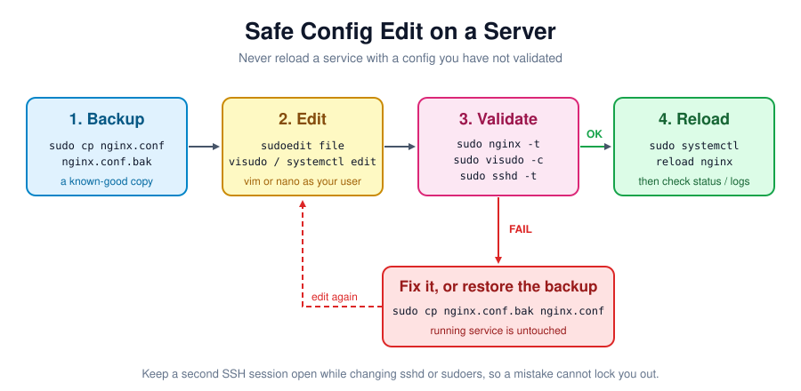

# Linux Servers par Asli Editing

Server ke gyarah asli scenarios: safe config edit, sudoedit, crontab, visudo, systemd override, git, containers, bade logs, CI edits, CRLF aur YAML.

Laptop par file mein typo se ek minute jaata hai. Server par wahi typo website gira sakta hai ya tumhe SSH se bahar kar sakta hai. Ye note asli kaam mein aane wale editing jobs ke exact commands dikhata hai. Key bindings [vim reference](vim.md) aur [nano note](nano.md) mein hain; module ka overview [README](README.md) mein hai.



## 1. nginx config ko safely edit karna

Rule: **backup, edit, validate, reload**. Jis config ko test nahi kiya, us se service kabhi restart mat karo.

```bash
cd /etc/nginx/sites-available
sudo cp default default.bak.$(date +%F)   # 1. backup with a date
sudoedit default                          # 2. edit as your user, saved as root
sudo nginx -t                             # 3. validate syntax
sudo systemctl reload nginx               # 4. apply without dropping connections
sudo cp default.bak.$(date +%F) default   #    if step 3 failed: restore the backup
```

`sudoedit` (`sudo -e` jaisa hi) file ko ek temp file mein copy karta hai, use tumhare apne editor (`$SUDO_EDITOR`, `$VISUAL` ya `$EDITOR`) mein tumhari settings ke saath kholta hai, aur save karne par hi root ban kar wapas copy karta hai. Tumhara vimrc chalta hai aur editor kabhi root ban kar nahi chalta. Poora setup [install nginx](../08_Projects_and_Use_Cases/install-nginx.md) mein hai.

## 2. Root file bina sudo ke khol li

Tumne vim mein `/etc/hosts` edit kiya, `:w` type kiya aur `E45: 'readonly' option is set` ya "Permission denied" mila. Quit karke apna kaam mat khona:

```vim
:w !sudo tee % > /dev/null
```

`:w !cmd` buffer ko ek command mein pipe karta hai, `%` current file ka naam hai, aur `sudo tee` use root ban kar likhta hai. Jab vim bole ki file badal gayi hai to `L` (Load) dabao, phir `:q`. Ye vim mein chalta hai, neovim mein nahi (wahan sudo password nahi maang paata); neovim mein `/tmp/x` mein save karo aur `sudo cp` karo.

## 3. crontab -e: editor chuno aur job add karo

Debian/Ubuntu par `crontab -e` pehli baar chalane par editor chunne ko kehta hai. Baad mein `select-editor` se ya ek baar ke liye `EDITOR` se badlo:

```bash
select-editor                      # Debian/Ubuntu: choose nano, vim.basic ...
EDITOR=vim crontab -e              # one-off choice
crontab -l                         # list your jobs
# line to add (m h dom mon dow command); save, quit, cron installs it:
30 2 * * * /opt/scripts/backup.sh >> /var/log/backup.log 2>&1
```

Syntax aur zyada examples [scheduling](../03_Processes/scheduling.md) mein hain.

## 4. /etc/sudoers seedha edit karne ke bajaye visudo

`/etc/sudoers` mein ek syntax error sabke liye `sudo` tod deta hai, aur shayad use theek karne ke liye tumhare paas root password bhi na ho. `visudo` file ko lock karta hai, ek copy kholta hai, aur tooti hui file save karne se mana karta hai (`What now?` aane par `e` se dobara edit, `x` se bina save kiye bahar).

```bash
sudo visudo                                  # edit the main file safely
sudo visudo -f /etc/sudoers.d/deploy         # better: a drop-in file per rule
sudo EDITOR=nano visudo                      # choose the editor
sudo visudo -c                               # check all sudoers files
```

Drop-in example: `deploy ALL=(ALL) NOPASSWD: /usr/bin/systemctl restart myapp`. Dekho [users and groups](../07_System_Administration/users-and-groups.md).

## 5. systemctl edit: unit ko chhue bina override karna

Package upgrades `/lib/systemd/system/nginx.service` ko overwrite kar dete hain. Isliye apne changes ek override mein rakho:

```bash
sudo systemctl edit nginx          # creates /etc/systemd/system/nginx.service.d/override.conf
sudo systemctl restart nginx       # edit already ran daemon-reload for you
systemctl cat nginx                # shows the unit plus your override
```

Override ka example: `[Service]` phir `LimitNOFILE=65535` aur `Restart=on-failure`. `ExecStart` jaisi list setting badalne ke liye pehle ek khaali `ExecStart=` line se use clear karo, phir nayi line add karo.

## 6. Git commit messages aur interactive rebase

```bash
git config --global core.editor "vim"   # or "nano"
git commit                              # opens the editor for the message
git rebase -i HEAD~3                    # rewrite the last 3 commits
```

Rebase list mein `pick` ko `reword`, `squash` ya `drop` mein badlo (vim mein: word par `cw`, ya `:2,3s/^pick/squash/`), phir `:wq`. vim ke andar se commit ya rebase cancel karne ke liye `:cq` use karo: ye error code ke saath quit karta hai aur git ruk jaata hai.

## 7. Docker container ke andar koi editor nahi

Slim images mein vi ya nano nahi hota. Teen options, sabse achha pehle:

```bash
# a) Edit on the host if the file is bind-mounted (check with docker inspect)
vim ./nginx/default.conf && docker exec web nginx -s reload
# b) Copy out, edit, copy back
docker cp web:/etc/nginx/conf.d/default.conf .
vim default.conf
docker cp default.conf web:/etc/nginx/conf.d/default.conf
docker exec web nginx -t && docker exec web nginx -s reload
# c) Install an editor (lost when the container is recreated)
docker exec -it web sh -c 'apt-get update && apt-get install -y nano'   # Alpine: apk add nano
```

Container ke andar kiye changes use dobara banane par mit jaate hain; asli fix image ya volume mein hona chahiye. Dekho [install docker](../08_Projects_and_Use_Cases/install-docker.md).

## 8. Bahut badi log files

vim poori file memory mein load karta hai aur swap file banata hai, isliye 5 GB ke log par `vim app.log` server ko hang kar sakta hai. Logs pager se padho:

```bash
less /var/log/app.log          # G = end, /ERROR = search, F = follow (Ctrl+c stops)
tail -f /var/log/app.log       # just watch new lines
tail -n 5000 app.log > /tmp/recent.log && view /tmp/recent.log   # small excerpt
```

`view` (read-only vim) normal size ki files ke liye theek hai, lekin wo bhi sab kuch load karta hai.

## 9. Scripts aur CI mein bina editor ke edit

Pipelines mein terminal nahi hota, isliye editor bhi nahi. `sed -i`, `tee` ya here-doc use karo:

```bash
sed -i.bak 's/^Port 22$/Port 2222/' /etc/ssh/sshd_config     # in place, keep .bak
echo "10.0.0.5 db.internal" | sudo tee -a /etc/hosts          # append as root
sudo tee /etc/myapp/app.env > /dev/null <<'EOF'
APP_ENV=production
LOG_LEVEL=info
EOF
```

`sudo echo x > /etc/file` fail hota hai kyunki redirect tumhare normal (bina root) shell mein chalta hai; `sudo tee` ise theek karta hai. Zyada [sed note](../06_Sed_and_Awk/sed.md) mein.

## 10. CRLF line endings theek karna

Windows par likhi script `/bin/bash^M: bad interpreter` ke saath fail hoti hai. `^M` ek carriage return hai.

```bash
file deploy.sh            # "with CRLF line terminators"
dos2unix deploy.sh        # convert (apt install dos2unix)
sed -i 's/\r$//' deploy.sh   # same thing without extra packages
```

vim mein: `:set ff?` format dikhata hai, `:set ff=unix` phir `:w` use convert kar deta hai.

## 11. YAML: tabs vs spaces

YAML mein indentation ke liye tabs allowed nahi hain; ek tab se `found character that cannot start any token` error aata hai.

```vim
:set expandtab tabstop=2 shiftwidth=2   " Tab key now inserts 2 spaces
:set list                               " tabs show as ^I
:retab                                  " convert existing tabs to spaces
```

Shell se: `grep -nP '\t' docker-compose.yml` tab wali lines dikhata hai.

## Kaun sa tool kab

| Situation | Best tool |
| :--- | :--- |
| Beginner ke liye ek file ka chhota edit | `nano` |
| Lambe edits, search-replace, macros | `vim` |
| Root ki config file | `sudoedit` |
| `/etc/sudoers` | `visudo` |
| systemd unit mein changes | `systemctl edit` |
| Cron jobs | `crontab -e` |
| Bahut badi ya live log files | `less`, `tail -f` |
| Scripts, CI, Ansible jaise changes | `sed -i`, `tee`, here-doc |
| Container ke andar ki files | Host bind mount ya `docker cp` |

## Common mistakes

| Galti | Fix |
| :--- | :--- |
| `nginx -t` se pehle restart karna | Hamesha pehle validate, phir `reload` |
| Har file par `sudo vim` | `sudoedit` use karo; editor root ban kar nahi chalta |
| `/etc/sudoers` ko plain vim se edit karna | `visudo` ya drop-ins ke liye `visudo -f` |
| Akele SSH session mein `sshd_config` badalna | Doosra session khula rakho aur `sudo sshd -t` chalao |

## Interview Questions

**Q1. `sudo vim` ke bajaye `sudoedit` kyun?**
Editor tumhare user aur tumhari config ke saath chalta hai, sirf aakhri copy-back root se hota hai. Koi plugin ya `:!sh` root shell nahi le sakta.

**Q2. `visudo` kyun use karein?**
Ye file lock karta hai aur save se pehle syntax check karta hai. Tooti sudoers file sabko `sudo` se bahar kar degi.

**Q3. Bina sudo ke vim mein kholi root file ko kaise save karein?**
`:w !sudo tee % > /dev/null`, phir file reload karo aur quit karo.

**Q4. `systemctl edit` ke changes kahan jaate hain aur kyun?**
`/etc/systemd/system/<unit>.d/override.conf` mein, jo package upgrade ke baad bhi bacha rehta hai aur vendor unit se upar priority rakhta hai.

**Q5. Script `bad interpreter: ^M` ke saath fail hoti hai. Problem kya hai?**
Usmein Windows ki CRLF line endings hain. `dos2unix` ya vim mein `:set ff=unix` se convert karo.
