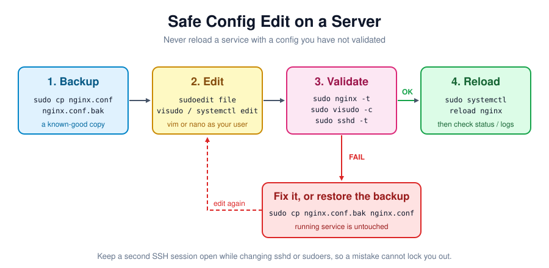

# Real-World Editing on Linux Servers

Eleven real server scenarios: safe config edits, sudoedit, crontab, visudo, systemd overrides, git, containers, huge logs, CI edits, CRLF and YAML.

On a laptop a typo in a file costs you a minute. On a server it can take a website down or lock you out of SSH. This note shows the exact commands for the editing jobs you meet in real work. Key bindings are in the [vim reference](vim.md) and the [nano note](nano.md); the module overview is in the [README](README.md).



## 1. Safely edit an nginx config

Rule: **backup, edit, validate, reload**. Never restart a service with a config you have not tested.

```bash
cd /etc/nginx/sites-available
sudo cp default default.bak.$(date +%F)   # 1. backup with a date
sudoedit default                          # 2. edit as your user, saved as root
sudo nginx -t                             # 3. validate syntax
sudo systemctl reload nginx               # 4. apply without dropping connections
sudo cp default.bak.$(date +%F) default   #    if step 3 failed: restore the backup
```

`sudoedit` (same as `sudo -e`) copies the file to a temp file, opens it in your own editor (`$SUDO_EDITOR`, `$VISUAL` or `$EDITOR`) with your own settings, and copies it back as root only when you save. Your vimrc works and the editor never runs as root. Full setup is in [install nginx](../08_Projects_and_Use_Cases/install-nginx.md).

## 2. Opened a root file without sudo

You edited `/etc/hosts` in vim, typed `:w` and got `E45: 'readonly' option is set` or "Permission denied". Do not quit and lose your work:

```vim
:w !sudo tee % > /dev/null
```

`:w !cmd` pipes the buffer into a command, `%` is the current file name, and `sudo tee` writes it as root. Press `L` (Load) when vim warns that the file changed, then `:q`. This works in vim, not in neovim (sudo cannot prompt there); in neovim save to `/tmp/x` and `sudo cp` it.

## 3. crontab -e: pick an editor and add a job

The first run of `crontab -e` on Debian/Ubuntu asks you to choose an editor. Change it later with `select-editor` or for one run with `EDITOR`:

```bash
select-editor                      # Debian/Ubuntu: choose nano, vim.basic ...
EDITOR=vim crontab -e              # one-off choice
crontab -l                         # list your jobs
# line to add (m h dom mon dow command); save, quit, cron installs it:
30 2 * * * /opt/scripts/backup.sh >> /var/log/backup.log 2>&1
```

Syntax and more examples are in [scheduling](../03_Processes/scheduling.md).

## 4. visudo instead of editing /etc/sudoers

A syntax error in `/etc/sudoers` breaks `sudo` for everyone, and you may have no root password to fix it. `visudo` locks the file, opens a copy, and refuses to save a broken one (`What now?` then `e` to re-edit, `x` to exit without saving).

```bash
sudo visudo                                  # edit the main file safely
sudo visudo -f /etc/sudoers.d/deploy         # better: a drop-in file per rule
sudo EDITOR=nano visudo                      # choose the editor
sudo visudo -c                               # check all sudoers files
```

Drop-in example: `deploy ALL=(ALL) NOPASSWD: /usr/bin/systemctl restart myapp`. See [users and groups](../07_System_Administration/users-and-groups.md).

## 5. systemctl edit: override a unit without touching it

Package upgrades overwrite `/lib/systemd/system/nginx.service`. Put your changes in an override instead:

```bash
sudo systemctl edit nginx          # creates /etc/systemd/system/nginx.service.d/override.conf
sudo systemctl restart nginx       # edit already ran daemon-reload for you
systemctl cat nginx                # shows the unit plus your override
```

Example override: `[Service]` then `LimitNOFILE=65535` and `Restart=on-failure`. To replace a list setting like `ExecStart`, first clear it with an empty `ExecStart=` line, then add the new one.

## 6. Git commit messages and interactive rebase

```bash
git config --global core.editor "vim"   # or "nano"
git commit                              # opens the editor for the message
git rebase -i HEAD~3                    # rewrite the last 3 commits
```

In the rebase list, change `pick` to `reword`, `squash` or `drop` (in vim: `cw` on the word, or `:2,3s/^pick/squash/`), then `:wq`. To abort the commit or rebase from inside vim, use `:cq`: it quits with an error code and git stops.

## 7. No editor inside a Docker container

Slim images ship without vi or nano. Three options, best first:

```bash
# a) Edit on the host if the file is bind-mounted (check with docker inspect)
vim ./nginx/default.conf && docker exec web nginx -s reload
# b) Copy out, edit, copy back
docker cp web:/etc/nginx/conf.d/default.conf .
vim default.conf
docker cp default.conf web:/etc/nginx/conf.d/default.conf
docker exec web nginx -t && docker exec web nginx -s reload
# c) Install an editor (lost when the container is recreated)
docker exec -it web sh -c 'apt-get update && apt-get install -y nano'   # Alpine: apk add nano
```

Changes made inside a container vanish on recreate; the real fix belongs in the image or a volume. See [install docker](../08_Projects_and_Use_Cases/install-docker.md).

## 8. Huge log files

vim loads the whole file into memory and creates a swap file, so `vim app.log` on a 5 GB log can hang the server. Read logs with a pager instead:

```bash
less /var/log/app.log          # G = end, /ERROR = search, F = follow (Ctrl+c stops)
tail -f /var/log/app.log       # just watch new lines
tail -n 5000 app.log > /tmp/recent.log && view /tmp/recent.log   # small excerpt
```

`view` (vim read-only) is fine for normal-sized files, but it still loads everything.

## 9. Non-interactive edits in scripts and CI

Pipelines have no terminal, so no editor. Use `sed -i`, `tee` or a here-doc:

```bash
sed -i.bak 's/^Port 22$/Port 2222/' /etc/ssh/sshd_config     # in place, keep .bak
echo "10.0.0.5 db.internal" | sudo tee -a /etc/hosts          # append as root
sudo tee /etc/myapp/app.env > /dev/null <<'EOF'
APP_ENV=production
LOG_LEVEL=info
EOF
```

`sudo echo x > /etc/file` fails because the redirect runs in your unprivileged shell; `sudo tee` fixes that. More in the [sed note](../06_Sed_and_Awk/sed.md).

## 10. Fixing CRLF line endings

A script written on Windows fails with `/bin/bash^M: bad interpreter`. The `^M` is a carriage return.

```bash
file deploy.sh            # "with CRLF line terminators"
dos2unix deploy.sh        # convert (apt install dos2unix)
sed -i 's/\r$//' deploy.sh   # same thing without extra packages
```

In vim: `:set ff?` shows the format, `:set ff=unix` then `:w` converts it.

## 11. YAML: tabs vs spaces

YAML forbids tabs for indentation; one tab gives `found character that cannot start any token`.

```vim
:set expandtab tabstop=2 shiftwidth=2   " Tab key now inserts 2 spaces
:set list                               " tabs show as ^I
:retab                                  " convert existing tabs to spaces
```

From the shell: `grep -nP '\t' docker-compose.yml` lists lines with tabs.

## Which tool when

| Situation | Best tool |
| :--- | :--- |
| Quick one-file edit as a beginner | `nano` |
| Long edits, search and replace, macros | `vim` |
| Root-owned config file | `sudoedit` |
| `/etc/sudoers` | `visudo` |
| systemd unit changes | `systemctl edit` |
| Cron jobs | `crontab -e` |
| Huge or live log files | `less`, `tail -f` |
| Scripts, CI, Ansible-style changes | `sed -i`, `tee`, here-doc |
| Files inside a container | Host bind mount or `docker cp` |

## Common mistakes

| Mistake | Fix |
| :--- | :--- |
| Restarting before `nginx -t` | Always validate first, then `reload` |
| `sudo vim` on every file | Use `sudoedit`; the editor does not run as root |
| Editing `/etc/sudoers` with plain vim | Use `visudo` or `visudo -f` for drop-ins |
| Changing `sshd_config` in your only SSH session | Keep a second session open and run `sudo sshd -t` |

## Interview Questions

**Q1. Why use `sudoedit` instead of `sudo vim`?**
The editor runs as your user with your config, and only the final copy-back is root. A plugin or `:!sh` cannot get a root shell.

**Q2. Why should you use `visudo`?**
It locks the file and checks syntax before saving. A broken sudoers file would lock everyone out of `sudo`.

**Q3. How do you save a root file you opened in vim without sudo?**
`:w !sudo tee % > /dev/null`, then reload the file and quit.

**Q4. Where do `systemctl edit` changes go and why?**
To `/etc/systemd/system/<unit>.d/override.conf`, which survives package upgrades and takes priority over the vendor unit.

**Q5. A script fails with `bad interpreter: ^M`. What is wrong?**
It has Windows CRLF line endings. Convert with `dos2unix` or `:set ff=unix` in vim.
