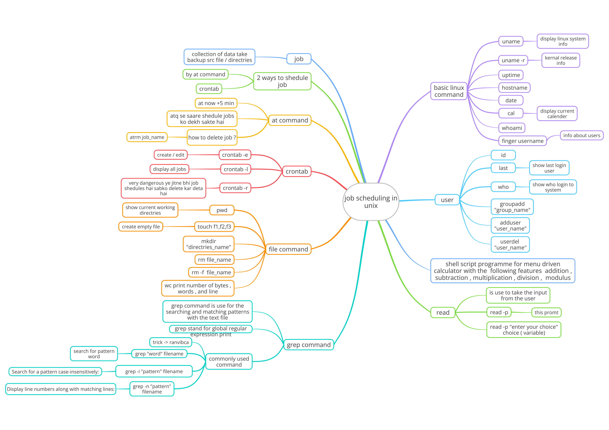

# 🐧 Developers aur DevOps ke liye Linux

Unix/Linux ko shuru se seekhne aur Linux, Shell Scripting aur DevOps interviews ki taiyari ke liye ek study kit.


---

## 🎯 Yeh Kiske Liye Hai

- **Developers** jinhe Linux servers, containers aur CI runners par comfortably kaam karna hai.
- **DevOps / SRE aspirants** jo interviews ya job switch ki taiyari kar rahe hain.
- **Students** jo Unix/Linux Programming course kar rahe hain (material ek standard university syllabus se match karta hai).

---

## 📁 Repository Contents

| File | Type | Pages | Isme Kya Hai |
| :--- | :--- | :---: | :--- |
| [Unix and Linux Programming C_Final.pdf](Unix%20and%20Linux%20Programming%20C_Final.pdf) | Course book | 340 | Poori textbook: OS introduction, processes, commands, vi aur shell programming, sed aur awk |
| [Unix_syllbus.pdf](Unix_syllbus.pdf) | Syllabus | 5 | Module-wise syllabus (Modules I–VI), progress checklist ke roop mein useful |
| [Linux Interview Questions.pdf](Linux%20Interview%20Questions.pdf) | Interview Q&A | 132 | **Part I – 60 questions**: basics, file permissions, SSH, networking, processes, services, redirection, monitoring, automation |
| [70 Linux Questions Part2.pdf](70%20Linux%20Questions%20Part2.pdf) | Interview Q&A | 134 | **Part II – 70 questions** MCQ, case-study, troubleshooting, conceptual aur true/false formats mein |
| [Shell Scripting Questions.pdf](Shell%20Scripting%20Questions.pdf) | Interview Q&A | 101 | **50 shell scripting questions** "What is a shell?" se aage tak |
| [applicaitons of unix sysetem.md](applicaitons%20of%20unix%20sysetem.md) | Notes | — | Production mein Linux kahan chalta hai (Nginx, EC2, Docker, cron, CI/CD), senior engineers ko kaun si skills chahiye, aur ek production cheat sheet |
| [unix-1.png](unix-1.png) | Diagram | — | Unix overview |
| [unix file structure.png](unix%20file%20structure.png) | Diagram | — | Unix/Linux filesystem hierarchy |
| [job-scheduling-in-unix.png](job-scheduling-in-unix.png) | Diagram | — | Job scheduling (`cron`, `at`, `batch`) |
| [unix-shell-scripting (1).png](unix-shell-scripting%20(1).png) | Diagram | — | Shell scripting overview |

---

## 🗺️ Suggested Learning Path

1. **Foundations** → Course book ka Module I [filesystem diagram](unix%20file%20structure.png) ke saath padhein.
2. **Processes aur jobs** → Module II aur saath mein [job scheduling diagram](job-scheduling-in-unix.png).
3. **Daily commands** → Module III: navigation, files, filters, pipes, permissions, links.
4. **vi aur shell scripting** → Module IV, phir *Shell Scripting Questions* solve karein.
5. **Text processing** → Module V: `sed` aur `awk`.
6. **Real-world context** → Theory ko servers, containers aur CI/CD se jodne ke liye [Applications of Unix Systems](applicaitons%20of%20unix%20sysetem.md) padhein.
7. **Interview drill** → Linux Interview Questions Part I, phir Part II (case studies aur troubleshooting).

---

## 📖 Syllabus Overview

| Module | Topic | Key Concepts |
| :---: | :--- | :--- |
| **I** | Introduction | OS basics, GNU history, Unix family, layered architecture, shells (Bourne, Bash, Korn, C), absolute/relative paths, filesystem structure, inode, CUI vs GUI, Linux boot process, X Window, GNOME aur KDE |
| **II** | Processes | Process states aur transitions, process context, foreground/background jobs, job control, suspend/interrupt/kill, `at` aur `batch` se scheduling |
| **III** | Unix/Linux Commands | Login/logout, internal vs external commands, `cd`/`mkdir`/`touch`/`cat`/`cp`/`mv`/`rm`, filters aur pipes (`head`, `tail`, `wc`, `sort`, `cut`, `grep`, `diff`, `uniq`), `expr`/`bc`, `man`, wildcards, redirection, permissions, hard aur symbolic links |
| **IV** | vi Editor aur Shell Programming | vi modes, editing, search aur replace; variables, environment variables, `read`/`echo`, positional parameters, `set`/`shift`, operators, `test`, `if`/`case`, `while`/`until`/`for` |
| **V** | sed aur awk | Regular expressions, sed addressing, insert/delete/print, substitution, sed scripts; awk records aur fields, `print`/`printf` |
| **VI** | System Administration | Users add/remove karna, startup aur shutdown, disk management, mounting/unmounting, system usage monitoring, system security |

> Module VI sirf syllabus mein hai; course book Modules I–V cover karti hai.

---

## 💼 Interview Preparation

Teen sets mein **180 questions**:

| Set | Count | Formats | Topics |
| :--- | :---: | :--- | :--- |
| Linux Interview Questions – Part I | 60 | Q&A | Linux basics, file permissions, SSH, networking, services, redirection, processes, system monitoring, automation |
| Linux Questions – Part II | 70 | MCQ, case study, troubleshooting, conceptual, true/false | Wahi topics, zyada mushkil aur scenario-based |
| Shell Scripting Questions | 50 | Q&A | Shell concepts, variables, conditions, loops, scripting practice |

**Tip:** Har question ka answer padhne *se pehle* use bolkar answer karein, phir command ko ek real Linux box (WSL, VM, ya `docker run -it ubuntu bash`) par run karein.

---

## 🖼️ Visual Notes

| Filesystem Structure | Job Scheduling | Shell Scripting |
| :---: | :---: | :---: |
|  |  | .png) |

---

## ⚡ Quick Command Reference

```bash
# System health
htop                      # live CPU / memory / processes
df -h                     # disk usage
free -h                   # memory usage
ps aux | grep node        # koi process dhoondhein

# Logs
tail -f /var/log/nginx/error.log
awk '{print $1}' /var/log/nginx/access.log | sort | uniq -c | sort -nr | head

# Networking
lsof -i :8080             # port 8080 kaun use kar raha hai
curl -Iv https://example.com
netstat -tulpn            # listening ports (ya: ss -tulpn)

# Permissions
chmod 600 ~/.ssh/id_rsa
chown -R www-data:www-data /var/www/html

# Scheduling
crontab -e                # recurring jobs
echo "backup.sh" | at 02:00   # ek baar wala job
```

Aur jaankari [Applications of Unix Systems → Production Cheat Sheet](applicaitons%20of%20unix%20sysetem.md#4-production-cheat-sheet-for-senior-developers) mein.

---

## 🤝 Contributing

Contributions ka swagat hai: naye notes, cheat sheets, scripts ya question sets.

1. Repository ko fork karein.
2. Ek branch banayein: `git checkout -b add-networking-notes`
3. Apne changes commit karein aur pull request kholein.

---

## 📄 License

[MIT License](LICENSE) ke under released. Saath diye gaye PDFs third-party study materials hain aur apne-apne authors aur publishers ki property bane rehte hain. Example ke liye, course book © Amity University Press hai.

---

⭐ Agar yeh aapki Linux ya DevOps journey mein help kare, to repo ko star karne ke baare mein sochiye!
