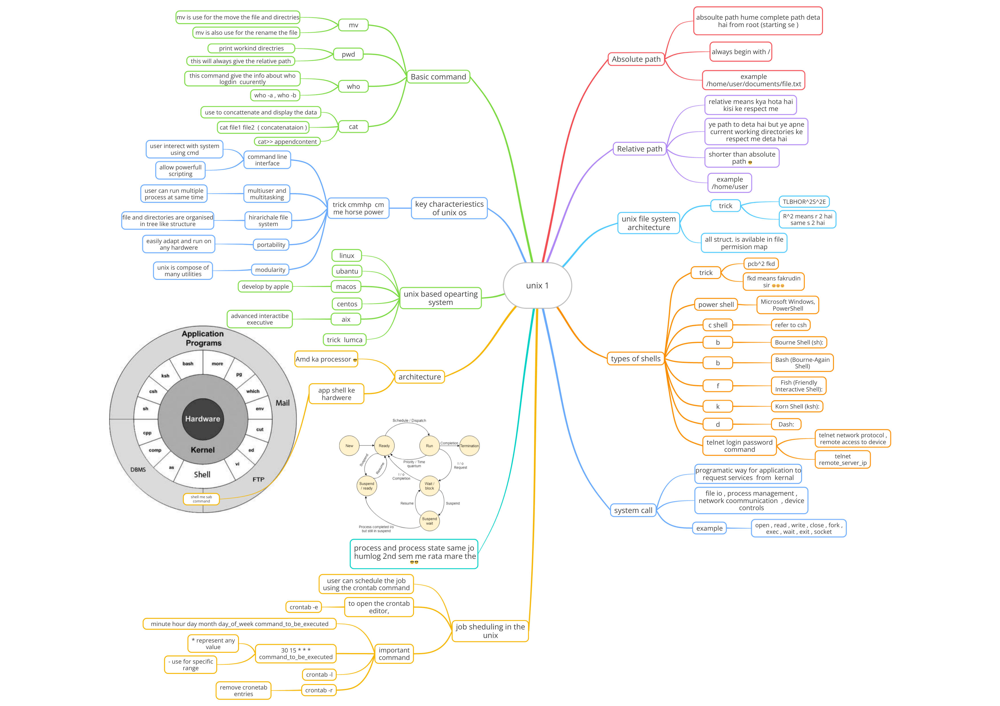

# 🐧 Linux for Developers and DevOps

A curated study kit for learning Unix/Linux from the ground up and preparing for **Linux, Shell Scripting, and DevOps interviews**: a full course book, a module-wise syllabus, 180 interview questions, visual cheat sheets, and production-focused notes.



---

## 📚 Table of Contents

- [Who This Is For](#-who-this-is-for)
- [Repository Contents](#-repository-contents)
- [Suggested Learning Path](#-suggested-learning-path)
- [Syllabus Overview](#-syllabus-overview)
- [Interview Preparation](#-interview-preparation)
- [Visual Notes](#-visual-notes)
- [Quick Command Reference](#-quick-command-reference)
- [Contributing](#-contributing)
- [License](#-license)

---

## 🎯 Who This Is For

- **Developers** who need to work comfortably on Linux servers, containers, and CI runners.
- **DevOps / SRE aspirants** preparing for interviews or a job switch.
- **Students** following a Unix/Linux Programming course (the material maps to a standard university syllabus).

---

## 📁 Repository Contents

| File | Type | Pages | What's Inside |
| :--- | :--- | :---: | :--- |
| [Unix and Linux Programming C_Final.pdf](Unix%20and%20Linux%20Programming%20C_Final.pdf) | Course book | 340 | Complete textbook: OS introduction, processes, commands, vi & shell programming, sed & awk |
| [Unix_syllbus.pdf](Unix_syllbus.pdf) | Syllabus | 5 | Module-wise syllabus (Modules I–VI), useful as a progress checklist |
| [Linux Interview Questions.pdf](Linux%20Interview%20Questions.pdf) | Interview Q&A | 132 | **Part I – 60 questions**: basics, file permissions, SSH, networking, processes, services, redirection, monitoring, automation |
| [70 Linux Questions Part2.pdf](70%20Linux%20Questions%20Part2.pdf) | Interview Q&A | 134 | **Part II – 70 questions** in MCQ, case-study, troubleshooting, conceptual and true/false formats |
| [Shell Scripting Questions.pdf](Shell%20Scripting%20Questions.pdf) | Interview Q&A | 101 | **50 shell scripting questions** from "What is a shell?" upward |
| [applicaitons of unix sysetem.md](applicaitons%20of%20unix%20sysetem.md) | Notes | — | Where Linux runs in production (Nginx, EC2, Docker, cron, CI/CD), the skills senior engineers need, and a production cheat sheet |
| [unix-1.png](unix-1.png) | Diagram | — | Unix overview |
| [unix file structure.png](unix%20file%20structure.png) | Diagram | — | Unix/Linux filesystem hierarchy |
| [job-scheduling-in-unix.png](job-scheduling-in-unix.png) | Diagram | — | Job scheduling (`cron`, `at`, `batch`) |
| [unix-shell-scripting (1).png](unix-shell-scripting%20(1).png) | Diagram | — | Shell scripting overview |

---

## 🗺️ Suggested Learning Path

1. **Foundations** → Read Module I of the course book alongside the [filesystem diagram](unix%20file%20structure.png).
2. **Processes & jobs** → Module II plus the [job scheduling diagram](job-scheduling-in-unix.png).
3. **Daily commands** → Module III: navigation, files, filters, pipes, permissions, links.
4. **vi & shell scripting** → Module IV, then work through the *Shell Scripting Questions*.
5. **Text processing** → Module V: `sed` and `awk`.
6. **Real-world context** → Read [Applications of Unix Systems](applicaitons%20of%20unix%20sysetem.md) to connect the theory to servers, containers and CI/CD.
7. **Interview drill** → Linux Interview Questions Part I, then Part II (case studies and troubleshooting).

---

## 📖 Syllabus Overview

| Module | Topic | Key Concepts |
| :---: | :--- | :--- |
| **I** | Introduction | OS basics, GNU history, Unix family, layered architecture, shells (Bourne, Bash, Korn, C), absolute/relative paths, filesystem structure, inode, CUI vs GUI, Linux boot process, X Window, GNOME & KDE |
| **II** | Processes | Process states and transitions, process context, foreground/background jobs, job control, suspend/interrupt/kill, scheduling with `at` and `batch` |
| **III** | Unix/Linux Commands | Login/logout, internal vs external commands, `cd`/`mkdir`/`touch`/`cat`/`cp`/`mv`/`rm`, filters & pipes (`head`, `tail`, `wc`, `sort`, `cut`, `grep`, `diff`, `uniq`), `expr`/`bc`, `man`, wildcards, redirection, permissions, hard & symbolic links |
| **IV** | vi Editor & Shell Programming | vi modes, editing, search & replace; variables, environment variables, `read`/`echo`, positional parameters, `set`/`shift`, operators, `test`, `if`/`case`, `while`/`until`/`for` |
| **V** | sed & awk | Regular expressions, sed addressing, insert/delete/print, substitution, sed scripts; awk records & fields, `print`/`printf` |
| **VI** | System Administration | Adding/removing users, startup & shutdown, disk management, mounting/unmounting, monitoring system usage, system security |

> Module VI is covered in the syllabus only; the course book covers Modules I–V.

---

## 💼 Interview Preparation

**180 questions** across three sets:

| Set | Count | Formats | Topics |
| :--- | :---: | :--- | :--- |
| Linux Interview Questions – Part I | 60 | Q&A | Linux basics, file permissions, SSH, networking, services, redirection, processes, system monitoring, automation |
| Linux Questions – Part II | 70 | MCQ, case study, troubleshooting, conceptual, true/false | Same topics, harder and scenario-based |
| Shell Scripting Questions | 50 | Q&A | Shell concepts, variables, conditions, loops, scripting practice |

**Tip:** Answer each question aloud *before* reading the answer, then run the command on a real Linux box (WSL, a VM, or `docker run -it ubuntu bash`).

---

## 🖼️ Visual Notes

| Filesystem Structure | Job Scheduling | Shell Scripting |
| :---: | :---: | :---: |
|  |  | .png) |

---

## ⚡ Quick Command Reference

```bash
# System health
htop                      # live CPU / memory / processes
df -h                     # disk usage
free -h                   # memory usage
ps aux | grep node        # find a process

# Logs
tail -f /var/log/nginx/error.log
awk '{print $1}' /var/log/nginx/access.log | sort | uniq -c | sort -nr | head

# Networking
lsof -i :8080             # who is using port 8080
curl -Iv https://example.com
netstat -tulpn            # listening ports (or: ss -tulpn)

# Permissions
chmod 600 ~/.ssh/id_rsa
chown -R www-data:www-data /var/www/html

# Scheduling
crontab -e                # recurring jobs
echo "backup.sh" | at 02:00   # one-off job
```

More in [Applications of Unix Systems → Production Cheat Sheet](applicaitons%20of%20unix%20sysetem.md#4-production-cheat-sheet-for-senior-developers).

---

## 🤝 Contributing

Contributions are welcome: new notes, cheat sheets, scripts, or question sets.

1. Fork the repository.
2. Create a branch: `git checkout -b add-networking-notes`
3. Commit your changes and open a pull request.

---

## 📄 License

Released under the [MIT License](LICENSE). The bundled PDFs are third-party study materials and remain the property of their respective authors and publishers. The course book, for example, is © Amity University Press.

---

⭐ If this helps your Linux or DevOps journey, consider starring the repo!
